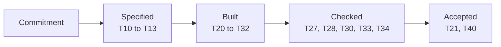

# SPRINT-003 plan: commitments to tasks, and N5

This page belongs to the [SPRINT-003 plan](03.9-sprint-003-plan.md). It maps each of the twelve commitments to the tasks that establish it, and splits item N5, the data statements. Task IDs are on the [specification round](03.9.1-sprint-003-plan-specification.md) and the [build page](03.9.2-sprint-003-plan-build.md).

*Each commitment passes through specification, build, a check and a human acceptance.*

| ID | Specified | Built | Checked | Accepted by Pablo |
| --- | --- | --- | --- | --- |
| S003-LAYOUT | T11, T22 | T20, T26 | T28 | T21 |
| S003-PREVIEW | T11 | T20 | T21 hash record | T21 |
| S003-GLANCE | T11, T22 | T26 | T28 | T40 |
| S003-ANSWER | T11 | T23, T26 | T27, T40 | T40 |
| S003-NOKEY | T11 | T24, T26 | T27, T28 | T40 |
| S003-TESTS | T12 | T27 | T27 | T40 |
| S003-PAGECHECK | T12 | T28 | T28 | T40 |
| S003-RUN | T11 | T29 | T30 | T40 |
| S003-LIVE | T11 (timing points) | T23 | T40 | T40 |
| S003-DETAILS | T11, T22 | T23, T26 | T27, T28 | T40 |
| S003-CONTEXT | T11, T13 | T23, T25 | T27, T34 | T40 |
| S003-STATEMENTS | T13 | T31, T32 | T33 | T40 |

Tasks without a commitment row are wording and process: T01 and T02 (wording and a reading), T14 (specification review), T41 to T43 (review, refresh, close). Each still cites commitment IDs on its own page. The OpenSpec change of T10 links its own tasks to the same IDs.

## N5: who edits which data statement

| Page | Gate | Owner | When | Why this owner |
| --- | --- | --- | --- | --- |
| Root `AGENTS.md` | Outside the sprint scope; a protected control target, so 00 Governance cannot write it | Pablo or ASDG Admin, on his instruction (T31) | After T27 passes, before T40 | Only the human owner or a selected Admin may edit it; the file is at 54 of 50 nonblank lines, so the shortening Pablo is deciding comes first |
| `poc/README.md` | Inside `poc/`; needs the active sprint and `sprint check-implementation` | 09 Coding (T32) | Same | It documents application behavior |

Both use Architecture's exact wording and change only after the behavior exists, so neither page is wrong at any moment. 04 checks both (T33).
Criterion 9 says "only those are sent". The data statements scope it to the answer request; audio and transcript text still go to OpenAI as before. T02 asks Pablo to confirm that reading without changing the record.
Return to the [plan](03.9-sprint-003-plan.md) or to [Planning](README.md).
