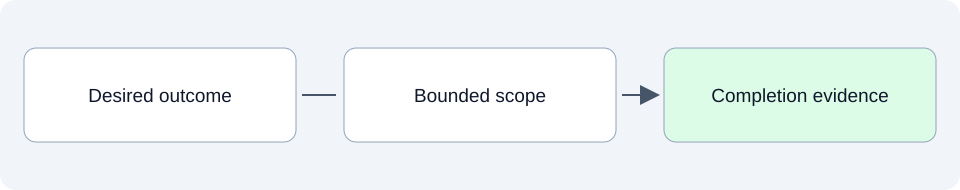

# Planning: choose a small piece of work

This folder connects desired outcomes to selected release and sprint work. A useful plan explains what we will do, why it matters, what is excluded and what evidence will show it is finished.

## SpeakerCoach today

As of 28 October 2026, SPRINT-000 is active for the streaming/agent POC and no release is declared. The existing review reports concern documentation and ASDG evolution; they should not be mistaken for a committed product delivery plan.

## What belongs here as we develop

Release plans describe a broader delivery objective. Sprint plans select a small, explicit scope within that direction. Both need clear decision status, dependencies and completion criteria.

## Explore

- [Shared documentation authority review](02.7-review-documentation-authority.md): every agent can save documents while code and approval gates remain separate.

- [ASDG evolution task list](03-asdg-evolution-tasks.md): methodology work and its recorded sequencing.
- [Continuation increment review](current/reviews/asdg-continuation-increment-01.md): evidence from that methodology increment.
- [Purpose documentation review](current/reviews/purpose-documentation-authoring.md): a documentation-related review record.

Read files in order: **01 Intended**, **02 Current**, **03 Planned**. Additional topics use dotted numbers such as `01.1` or `03.2`; release and sprint plans identify their horizon in the filename and text.
See the [folder guide](../../../asdg/00-governance/docs/stage-layout.md) for consolidation at cycle closeout. Return to [project documentation](../README.md).
