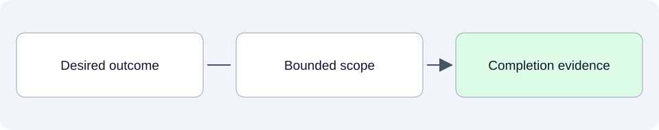

# Planning: choose a small piece of work

This folder connects desired outcomes to selected release and sprint work. A useful plan explains what we will do, why it matters, what is excluded and what evidence will show it is finished.

## Alice.Good.Meetings today

As of 28 October 2026, SPRINT-000 is active for the streaming/agent POC and no release is declared. The existing review reports concern documentation and ASDG evolution; they should not be mistaken for a committed product delivery plan.

## What belongs here as we develop

Release plans describe a broader delivery objective. Sprint plans select a small, explicit scope within that direction. Both need clear decision status, dependencies and completion criteria.

## Explore

- [Client-aware initialization](02.15-review-client-aware-initialization.md): `--client codex|claude|both`, thin Claude skill adapters from the shared templates, idempotent repeat setup.
- [`$asdg-admin` skill](02.14-review-asdg-admin-skill.md): an explicit skill that switches a chat to ASDG Admin, and `clear` back to 00 Governance.
- [Root AGENTS.md bootstrap and project guidance](02.13-review-root-agents-bootstrap.md): a seven-line ASDG bootstrap first, shared rules under `asdg/`, Alice.Good.Meetings guidance after.
- [Governance default, ASDG Admin and title sync](02.12-review-governance-admin-and-titles.md): every session has an accountable role, and only Admin changes ASDG rules.
- [ASDG–OpenSpec proposal wrapper](02.11-review-openspec-proposal-wrapper.md): source-linked planning through the installed native OpenSpec workflow.
- [Concise role, focus and attitude titles](02.10-review-concise-role-titles.md): the current naming convention, with the thirteen short role labels.
- [Shorter session names](02.9-review-short-session-names.md): role and attitude in titles, with NoAttitude and NoFocus for unset selections.
- [Attitude and session naming review](02.8-review-attitude-and-session-naming.md): independent role, subject and thinking attitude, with portable skills and native test evidence.
- [Shared documentation authority review](02.7-review-documentation-authority.md): every agent can save documents while code and approval gates remain separate.

- [SPRINT-003 review brief](03.6-sprint-003-review-brief.md): the shared baseline, commitment IDs, direction and sources for the Purpose, Use Case, Evaluation and Architecture reviews.
- [SPRINT-003 brief addendum](03.6.3-sprint-003-brief-addendum.md): Pablo's answers of 16 November and the two commitments they add.
- [SPRINT-003 alignment report](03.7-sprint-003-alignment-report.md): version 3 after the correction round and Pablo's "Accept all" of 18 November; foundations close to aligned, `NOT_READY`, with coverage, conflicts and amendments.
- [SPRINT-003 review brief, version 2](03.8-sprint-003-review-brief-v2.md): the amended baseline for the second alignment run, with [direction](03.8.1-sprint-003-brief-v2-direction.md), [prior reviews](03.8.2-sprint-003-brief-v2-prior-reviews.md) and sources for [02 and 03](03.8.3-sprint-003-brief-v2-sources.md) and [04 to 06](03.8.4-sprint-003-brief-v2-sources-04-06.md).
- [SPRINT-003 alignment report, version 4](03.10-sprint-003-alignment-report-v4.md): `FOUNDATION_ALIGNED` after the correction round, with the [reconciliation](03.10.1-sprint-003-reconciliation.md) and [sources](03.10.2-sprint-003-reconciliation-sources.md); version 3 above keeps its bytes.
- [Alice backlog](03.12-product-backlog.md) with [later stories](03.12.1-product-backlog-later.md), and the [SPRINT-004 proposal](03.13-sprint-004-proposal.md) with [Option B and the SPRINT-003 closeout](03.13.1-sprint-004-option-b-and-closeout.md): drafts of 19 November 2026; nothing approved, no sprint changed.
- [SPRINT-003 readiness report, version 5](03.11-sprint-003-readiness-report-v5.md): `READY_FOR_09` for documentation after Pablo's decision of 18 November; the gate for 09 is a separate condition. With [rule check](03.11.1-sprint-003-readiness-rule-check.md), [remaining work](03.11.2-sprint-003-remaining-work.md) and sources [A](03.11.3-sprint-003-readiness-sources-spec.md) and [B](03.11.4-sprint-003-readiness-sources-other.md).
- [SPRINT-003 plan](03.9-sprint-003-plan.md): one task list, with the [specification round](03.9.1-sprint-003-plan-specification.md), [build and live session](03.9.2-sprint-003-plan-build.md) and [trace](03.9.3-sprint-003-plan-trace.md).
- [SPRINT-003 record amendment](03.7.4-sprint-003-record-amendment.md): draft text for S003-DETAILS and S003-CONTEXT, and the human route to the sprint record.
- [ASDG evolution task list](03-asdg-evolution-tasks.md): methodology work and its recorded sequencing.
- [ASDG installation lifecycle plan](03.1-asdg-install-lifecycle-plan.md): proposed `init`, `update` and `replace` under a mandatory clean-Git rule, and reconciling Alice's manual swap.
- [Continuation increment review](current/reviews/asdg-continuation-increment-01.md): evidence from that methodology increment.
- [Purpose documentation review](current/reviews/purpose-documentation-authoring.md): a documentation-related review record.

Read files in order: **01 Intended**, **02 Current**, **03 Planned**. Additional topics use dotted numbers such as `01.1` or `03.2`; release and sprint plans identify their horizon in the filename and text.
See the [folder guide](../../../asdg/00-governance/docs/stage-layout.md) for consolidation at cycle closeout. Return to [project documentation](../README.md).
