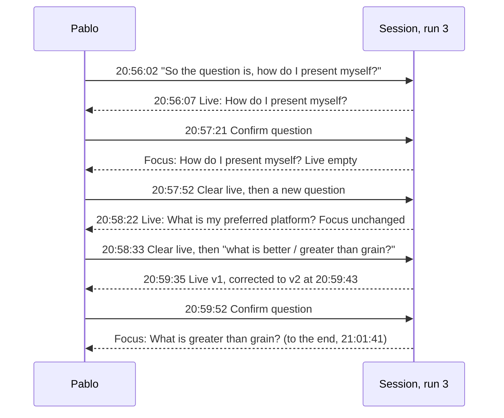

# UC-04 verification: Focus and Live questions (SPRINT-001, task 4.4)

This records what the live runs on 4 November 2026 showed about the [Focus and Live design](03-uc-04-focus-and-live-question.md), for Pablo's review. It is written by 09 Coding, the implementer, so it is not an independent review. Runs 1 and 2 have the server audit log and Pablo's report; **run 3 also has the full capture of displayed wording and times**.

*Run 3 from `/tmp/speakercoach-live-uc04-3/capture.json`. Focus changed only at the two Confirms; Live refilled only from speech after each Clear.*

## Runs

| Run | Code | What happened |
| --- | --- | --- |
| 1 (14:56–15:15) | 28 Oct design | Found the bug: after a Confirm, an automatic `new-question` replaced the confirmed question. This led to the Focus/Live redesign. |
| 2a / 2b (19:24, 20:13) | Focus/Live | 2a: no buttons pressed. 2b: 3 Confirms and 1 Reset live, all accepted; Pablo: "the confirm question works fine". |
| 3 (20:55–21:01) | Focus/Live plus the fixes below, button labelled Clear live | 2 Confirms and 2 Clear live, all accepted; full capture saved by autosave. |

All runs used commit `d1602c0` plus the uncommitted `sprint-01` changes, real OpenAI transcription and agent calls, a physical microphone and only Pablo speaking. The code is covered by 19 unit tests and the [browser protocol check](../../../poc/browser-protocol.md).

## Results by scenario

| Scenario (specs) | Result | Evidence |
| --- | --- | --- |
| Live fills from speech, with no interviewer audio | PASS | Run 3: each question reached Live 4–8 s after its final transcript |
| Corrected wording updates Live | PASS | Run 3: "better than Grain" became "greater than grain", Live version 1 → 2 |
| Only Confirm writes Focus; a new question waits in Live (4 Nov bug) | PASS | Run 3: Focus held through 2.5 min of further speech and new Live questions; 2b: Focus versions 1→2→3 only at Confirms |
| Clear live clears Live and keeps Focus; Live refills only from later speech | PASS | Run 3: two clears, each refilled 30–60 s later from new speech only |
| New session starts empty | PASS | Runs 2b and 3 began at Focus version 0 |
| Multipart wording; restatement exchange; ANSWER phase after Confirm | UNVERIFIED live | Not exercised in the free-form run 3; unit tests only |
| Stale, retired or lost confirmations; Stop while thinking; server down | UNVERIFIED live | Unit and browser tests only |
| Replay (task 4.3) | SKIPPED | Not run; `eval-data/` unchanged since `00cc882` |

## Timings (one person, not benchmarks)

Run 3: click to server result 1–9 ms, result to render acknowledgement 6–18 ms, agent call median 3.2 s (maximum 4.3 s), final transcript to Live 4–8 s. Runs 2a/2b: agent median 3.1–3.6 s; final transcript to the next accepted result median 6.0–7.7 s, maximum 41.6 s.

## Findings for review

1. **Many agent results are rejected:** 21 of 45, then 10 of 24, then still 5 of 11 in run 3, after the ANSWER-phase fix. So that fix wasn't the only cause. Since run 3, `agent_finished` records a text-free rejection reason (stale revision, schema fields, evidence and others); the next run will show the causes before any tuning.
2. **Fixed after run 2:** Confirm and Clear live now acknowledge their render (timed above); the capture autosaves and takes Option+Shift+K checkpoints; the button is renamed **Clear live**.
3. **Fixed after run 3:** closing the window did not end the capture, because Playwright's browser kept running. The script now finishes on window close; tested in the dry run.
4. **Open:** "Confirmed…" stays on screen through the answer until Live changes. Many final transcripts were empty (silence), harmless but noisy in the capture.

Back to [Low-level design](README.md)
