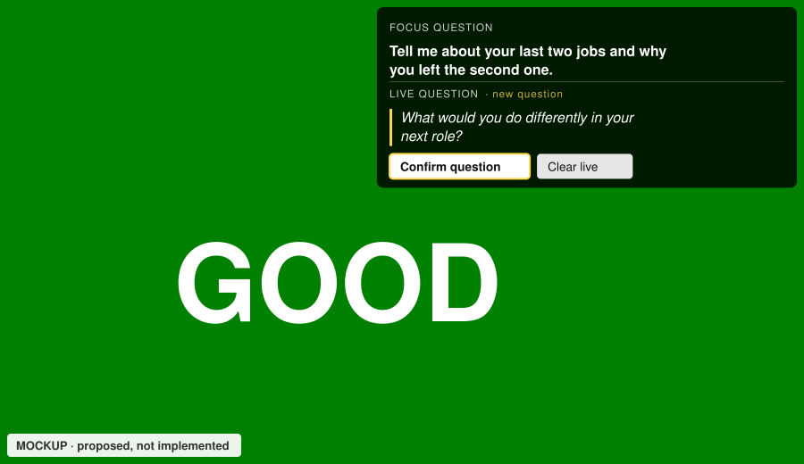
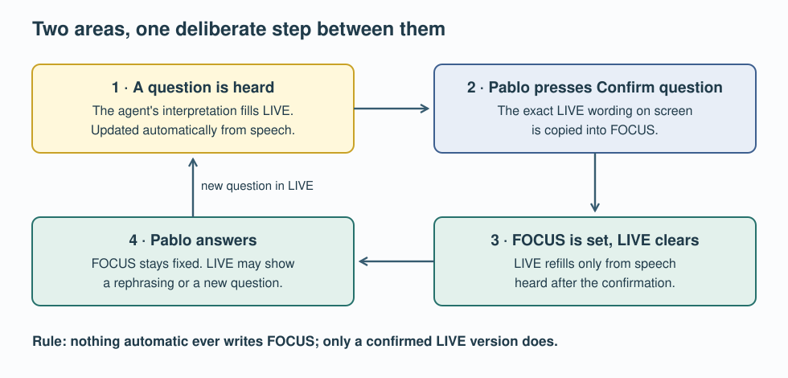

# UC-04 · Focus question and Live question

Pablo uses the question panel in the top-right corner of the SpeakerCoach page while answering interview questions. It must show, at a glance, the question being answered and what the service is hearing now, without ever changing the question behind Pablo's back.

*Proposed design, state 5 of the [panel states](03.1-uc-04-panel-states.md). Drawn from this design, not captured from the running page.*

## Status

Low-level design of 4 November 2026. Pablo accepted its five recommendations the same day; see [decisions](03.4-uc-04-openspec-update.md#decisions-pablo-4-november-2026). That acceptance is not approval of the exact document bytes. Nothing here is implemented yet. 09 Coding implements it inside SPRINT-001 (branch `sprint-01`).

## Why it changes

On 4 November Pablo decided: *"I like to see two areas all the time"*, a confirmed **Focus question** that stays fixed, and the question **currently being interpreted**. This replaces the 28 October rule of confirming only during clarification.

The same day, a live run showed the old rule failing. After Pablo confirmed a question, later speech that the agent labelled `new-question` replaced it automatically. The panel then showed "CURRENT QUESTION (AUTOMATIC)" with Confirm disabled. In this design the agent has no path to write Focus at all.

## The cycle

| Area | Written by | Changes when |
| --- | --- | --- |
| **Focus question** | Only a successful Confirm question | Pablo confirms a Live wording that differs from Focus |
| **Live question** | The agent, from speech | A question, rephrasing or correction is heard; cleared by Confirm or Clear live |

## Read next

1. [Panel states and mockups](03.1-uc-04-panel-states.md): eight states, desktop and phone.
2. [State model and rules](03.2-uc-04-state-and-rules.md): server fields, transitions, invariants and button rules.
3. [Protocol changes](03.3-uc-04-protocol.md): the controls and results on the `/session` WebSocket.
4. [OpenSpec update and decisions](03.4-uc-04-openspec-update.md): what changed in `openspec/changes/uc-04-confirm-current-question/`, and Pablo's five decisions.

## Sources

The 09 Coding hand-over of 4 November (with Pablo's words), today's [question controls protocol](../../../poc/docs/04.1-question-controls.md), and the uncommitted UC-04 code on `sprint-01`: [session.mjs](../../../poc/session.mjs), [agent.mjs](../../../poc/agent.mjs), [app.js](../../../app.js) and [index.html](../../../index.html). The code was read, not run, for this design. The [UC-04 use case](../03-system-model-and-use-cases/01.4-confirm-current-question.md) was updated separately by 03 Use Cases, using the same terms.

Return to [detailed design](README.md).
