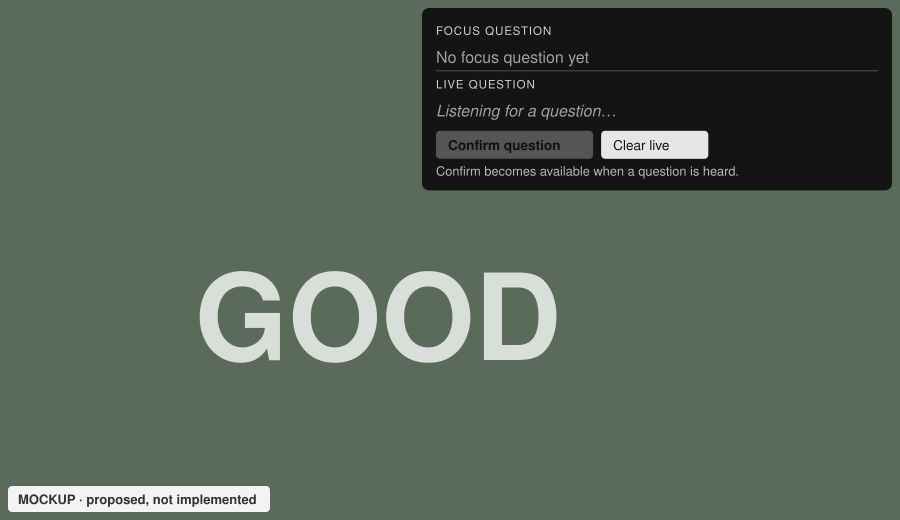
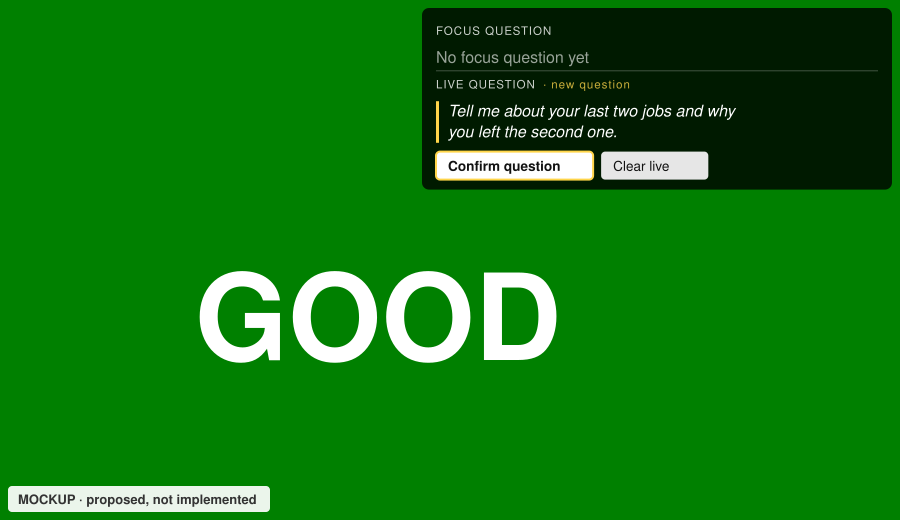
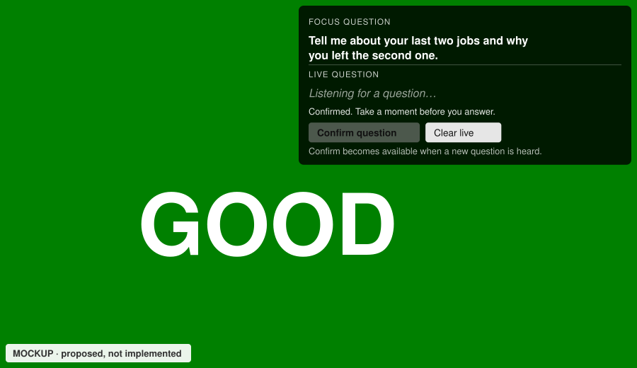
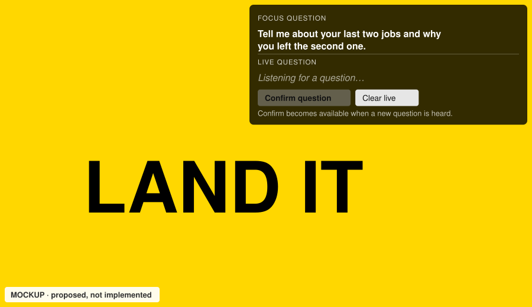
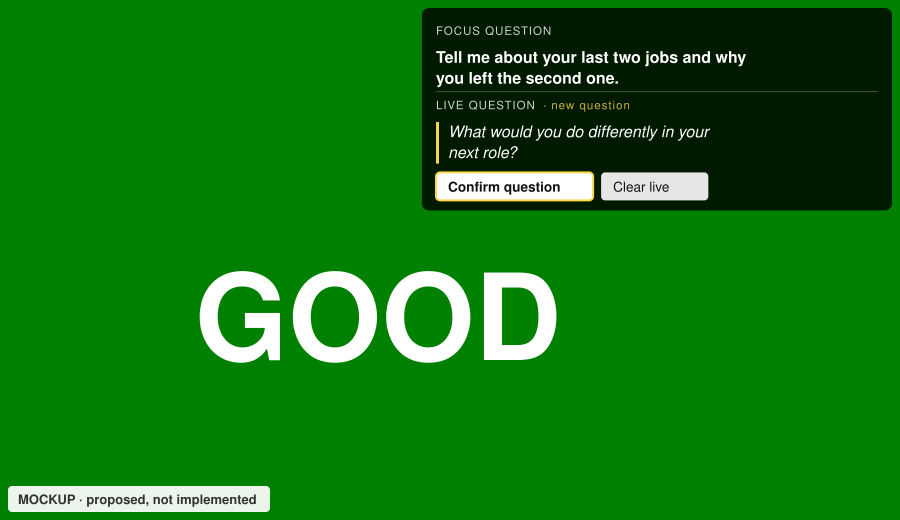
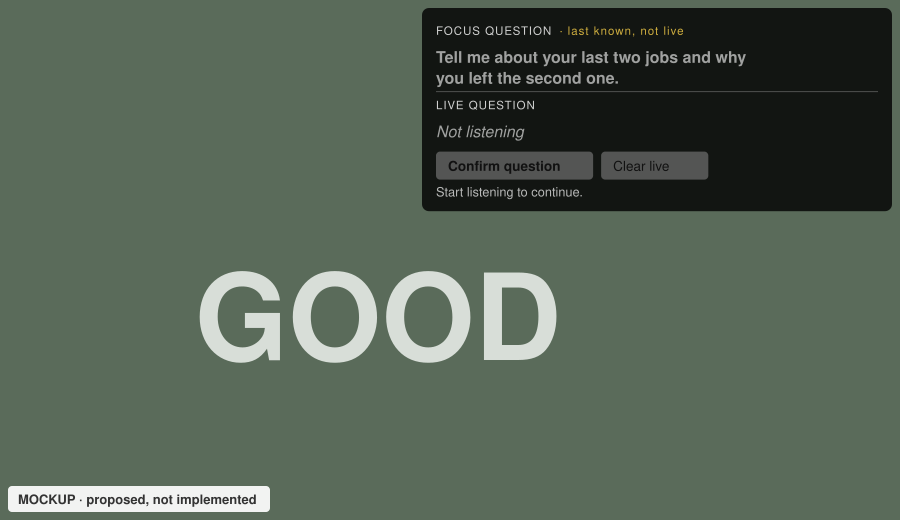
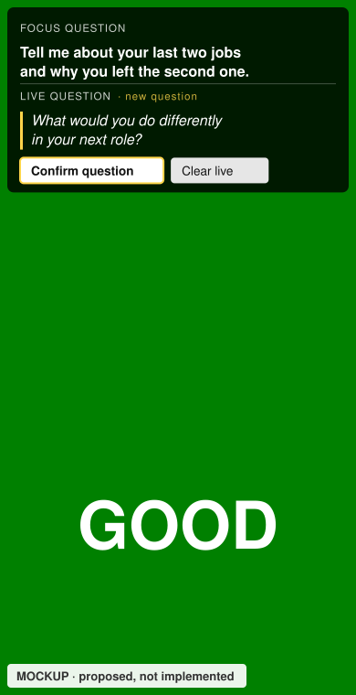

# UC-04 · Panel states and mockups

These mockups show what Pablo sees in the question panel at each step of the [Focus/Live cycle](03-uc-04-focus-and-live-question.md). All eight are **proposed, not implemented**. They were drawn as SVG from this design on 4 November 2026 (generated at 900×520, phone at 390×760) and use invented interview questions. They follow today's page: the timer colour fills the screen and the panel sits top right.

Layout in every state: **FOCUS QUESTION** on top, bold; a thin divider; **LIVE QUESTION** below, italic with a yellow bar; one feedback line; **Confirm question** (primary) and **Clear live**; then a hint when Confirm is disabled. The small yellow tag after LIVE QUESTION is the agent's reading of what it heard ("new question" or "restatement"), shown only while Live has text.

## 1 · Session ready, nothing heard yet

## 2 · A question is heard

## 3 · After Confirm

The feedback clears the next time Live changes. Phase becomes QUESTION, leaving time to think before answering.

## 4 · During the answer

If Pablo rephrases the question on purpose, Live shows it tagged "restatement". Focus does not move unless Pablo confirms.

## 5 · A new question appears in Live

## 6 · Confirmation pending, then uncertain

For the first five seconds after pressing Confirm, the button reads "Confirming…" and is disabled, with no uncertainty message yet. The mockup shows the moment after that.

## 7 · Disconnected or stopped

## 8 · Phone width, state 5

Below 700 pixels the panel takes the full width and at most 40% of the height, as it does today. Long questions wrap and never get cut off; the panel scrolls instead.

Next: [state model and rules](03.2-uc-04-state-and-rules.md) · Back to [overview](03-uc-04-focus-and-live-question.md)
