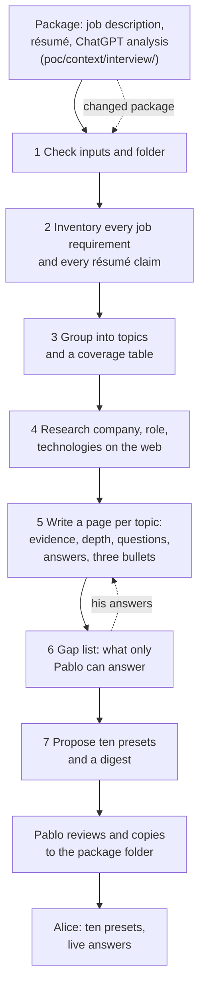

# SPRINT-006 part 2 (draft): the preparation skill

**Draft. No sprint is active and nothing here is approved.** Today Pablo's first package, holding the job description, his résumé and an analysis, is made by ChatGPT on his own account; that stays as it is. He wants an agent skill that takes that package and expands it into a growing Markdown knowledge base, so that he can answer deep questions about every item he claims and about the job, and Alice becomes "an expert in him". This series specifies that skill. It builds on the screen in [03.9](03.9-sprint-006-screen-specification.md); the matching use case is [UC-10, prepare a meeting](../03-system-model-and-use-cases/01.10-prepare-a-meeting.md), with its [exceptions and live use](../03-system-model-and-use-cases/01.10.1-prepare-exceptions-and-live-use.md). Each exception is covered by a rule here or listed as open on [03.10.5](03.10.5-s006-skill-where-it-runs-and-questions.md).

## The process

*Steps 1 to 7 are one run of the skill, run before a meeting. Dotted lines are the next run; it keeps his edits.*

## Pages

| Page | Content | Rule IDs |
| --- | --- | --- |
| [03.10.1](03.10.1-s006-skill-inputs-and-folder.md) | Inputs, folder layout, page templates | KI, KF |
| [03.10.2](03.10.2-s006-skill-steps.md) | The steps in detail | KP |
| [03.10.3](03.10.3-s006-skill-truth-and-privacy.md) | Never invent, sources, privacy | KT, KV |
| [03.10.4](03.10.4-s006-skill-reruns-and-outputs.md) | Re-runs without overwriting; feeding presets and live answers | KU, KO |
| [03.10.5](03.10.5-s006-skill-where-it-runs-and-questions.md) | Where it runs, UC-10 exceptions covered, conflicts for 05 and 02, questions for Pablo | KS, C, Q |

## Decided by Pablo (22 November 2026, relayed)

- The ChatGPT step is unchanged; the skill starts from the uploaded package.
- The base grows over time; later he uploads only the job description, later still others use it. This draft covers step one: package in.
