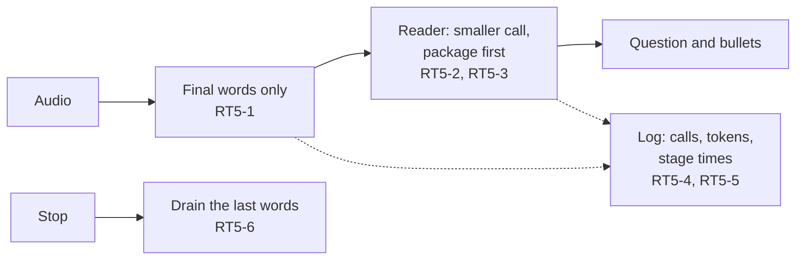

# SPRINT-005 rules: a faster Alice, measured (draft)

**Draft; no approval recorded.** SPRINT-005 cuts the time from the end of Pablo's speech to the Question and bullets, and the model calls that show nothing, with cheap fixes only. The baseline from 09's analysis ([poc/docs/08](../../../poc/docs/08-response-time.md)) is 7 live questions, mean 8.6 s, and 16 of 23 model calls showing nothing. The rule group is **RT5** (the lead's RT-1 to RT-7), because SPRINT-003 already has RT-1 to RT-6 for the retry. Checks and open items are on [03.11.1](03.11.1-s005-checks-and-open-items.md).

*Only Stop (RT5-6) changes the page. The other rules live in the service and its log.*

## Rules

| ID | Rule | Ties to |
| --- | --- | --- |
| RT5-1 | **Final words only.** The reader is scheduled only when a transcription item becomes final, never on a partial delta. The snapshot it receives holds final items only. The partial text still goes to the page's speech column (SA-17), and a final item still needs at least 8 characters. The check `corrected-evidence` stays as a guard. | S005-FINAL; B-18 |
| RT5-2 | **Smaller reply.** The model is no longer asked for `reply`, and the service no longer requires or length-checks it: `reply` leaves the model schema, `state.reply` leaves the snapshot, the empty-reply rejection in `validate()` goes, and the instructions lose their `reply` lines and the "on event connected, confirm" wording. `phase` goes too only if 09 shows no rule reads it (the `greetings-after-question` guard does today). The fields that make the Question, the bullets and the checks (`intent`, `question`, `covered`, `bullets`, `evidenceIds`) stay. The Question and bullets shown are unchanged. | S005-SMALLER; 05 A4 |
| RT5-3 | **Package first.** The reader's input is: the fixed instructions, then the package (terms and documents in name order), then the snapshot. The package part is the same bytes in every call of a session, so a provider can reuse the unchanged beginning. It is kept only if the measurement shows a gain (RT5-4). | S005-SMALLER |
| RT5-4 | **Call log.** Every reader call and every answer call writes one meeting-log event `model_call` with `kind` (`reader` or `answer`), `callId` (1, 2, … in the session), `startMs`, `durationMs`, `outcome`, `reason`, `model`, `effort`, `inputTokens`, `cachedTokens` and `outputTokens`. Outcome is `question` (a new Question or answer), `no-question` (kept, nothing new), `rejected`, `failed` or `dropped`. For `rejected`, `reason` is the service's stable public reason, and a reading thrown away because its words changed is always `corrected-evidence`. A call shows nothing when its outcome is not `question`. Tokens come from the API's usage and are `null` when it gives none. No prompt, reply or package text. | S005-WASTE, S005-SMALLER; ML-11 |
| RT5-5 | **Stage times.** Every speech turn that gets a reader call writes one `question_timing` event when the turn ends (bullets shown, no new question, failure, superseded or Stop), whether or not a Focus results. Fields, in ms from the session start: `speechEndMs` (the pause's `startMs`), `finalMs`, `readerStartMs`, `readerEndMs`, `focusVersion`, `questionMs` (Focus set), `answerStartMs`, `answerEndMs`, `bulletsMs`, `outcome`, and `toQuestionMs` = `questionMs` − `speechEndMs` and `toBulletsMs` = `bulletsMs` − `speechEndMs`. A stage that did not happen is `null`; with no Focus, `focusVersion`, `questionMs` and the two differences are `null`. `speechEndMs` is good to one audio packet, 0.1 s. | S005-TIME; 04 gap 2 |
| RT5-6 | **Stop loses no speech.** **Service:** on a `stop` message (and at the 30-minute limit) it commits buffered speech, waits up to 3 seconds for the final transcripts of every committed item, logs them before `session_stopped` and sends them to the page. That text never calls the reader, sets a Focus or starts an answer. If it does not arrive, the log gets `speech_lost` with `audioMs`; this is the log only (whether the page shows a line is open, Q-S5-1). **Page, changed:** Stop sends `stop` and keeps the socket open; the Stop button reads "Stopping…" and Start is disabled; the page closes when the service closes, or after 4 seconds, then shows SS-8. A disconnect or error cannot drain and logs `speech_lost` the same way. | S005-STOP; B-18; 05 A1, A2 |
| RT5-7 | **Idle-pause guard, conditional.** Not built unless 04's measurement after RT5-1 to RT5-3 shows calls with no new final item still above its threshold. If built: no reader call unless a final item is newer than the last call's snapshot. 10 records the decision on the measurement. | S005-WASTE; B-19 |
| RT5-8 | **Log compatibility (ML-1).** The log stays at `version` 1. Readers ignore unknown event types and unknown fields. A version bump is only for a changed meaning or a removed event, and adding `model_call`, `question_timing` and `speech_lost` is neither. | ML-1, ML-15; 05 A3 |

[Index of stage 08](README.md) · [Next: checks and open items](03.11.1-s005-checks-and-open-items.md)
