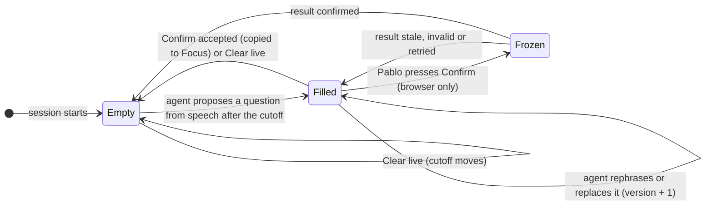

# UC-04 · State model and rules

This page is for whoever changes `InterviewSession` in [session.mjs](../../../poc/session.mjs) and the panel in [app.js](../../../app.js). It names the session fields, what may change them, and the rules both ends must keep. Panel wording is in the [panel states](03.1-uc-04-panel-states.md).

*Life of the Live question. Focus has no automatic transitions: only "Confirm accepted" writes it.*

## Session fields

| Field | Replaces | Meaning |
| --- | --- | --- |
| `focus` | `question` | Confirmed text, or `null` before the first confirmation |
| `focusVersion` | `questionVersion` | 0 at start; +1 only on a successful Confirm |
| `live` | `clarification` | `null`, or `{id, version, text, kind}`; `kind` is `new` or `restatement` |
| `exchangeId` | unchanged | Belongs to Focus; set on Confirm |
| — | `questionOrigin` | Removed: Focus is always user-confirmed |

`revision` and `phase` keep their meaning. Every change to `focus` or `live`, and every Clear live, adds 1 to `revision`, so reasoning based on older state is rejected.

## How the agent's proposal updates Live

The agent keeps its intents `none | clarify | new-question | answer`. Only `clarify` and `new-question` with question text can touch Live, and only when at least one cited observation is newer than the **Live cutoff**: the observations already present at the last Confirm or Clear live.

- `new-question`: Live gets the text with `kind: new`.
- `clarify` with Live open: Live text is replaced and its `kind` stays the same.
- `clarify` with Live empty: Live opens with `kind: restatement` (it refers to Focus), unless the text equals Focus, which is ignored.
- `answer` and `none`: Live is unchanged. `phase` is still taken from the proposal.
- A new Live gets a fresh `id` and `version: 1`; each text change adds 1 to `version`. Equal text changes nothing.

## Confirm and Clear live on the server

**Confirm** is accepted only for the current Live `id`, `version` and exact `text`, and the current `focusVersion`. It then sets `focus` to that text and adds 1 to `focusVersion`. It sets `phase: QUESTION` and `live: null`, moves the Live cutoff, and retires the Live id. `exchangeId` stays the same when `kind` is `restatement` and Focus exists; otherwise a new exchange starts.

**Clear live** sets `live: null` and moves the Live cutoff, even when Live is already empty. It never touches Focus.

## Invariants

1. Only a `confirmed` result writes `focus`. Model output, silence, transcript finality and timers never do.
2. Live never refills from speech that was heard before the last Confirm or Clear live.
3. `revision`, `focusVersion` and each Live `version` only increase. No result or broadcast rolls the page back.
4. A new session starts with `focus: null` and `live: null`. Stop or disconnect leaves Focus on screen marked "last known, not live".
5. The speaking timer (GOOD / LAND IT / STOP) is independent of this panel and stays unchanged.

## Browser rules

**Confirm question** is enabled when connected, no confirmation is pending, Live has text, and that text differs from Focus. The hint for a disabled Confirm is chosen in this order: "Start listening to continue."; "Waiting for the server…"; "Confirm becomes available when a (new) question is heard."; "Live matches the focus question." Feedback such as "Confirmed…" clears when the Live id or version changes. Pending, uncertain and retry behaviour is unchanged from today: wording freezes, "uncertain" after 5 seconds, and an identical retry.

Next: [protocol changes](03.3-uc-04-protocol.md) · Back to [overview](03-uc-04-focus-and-live-question.md)
