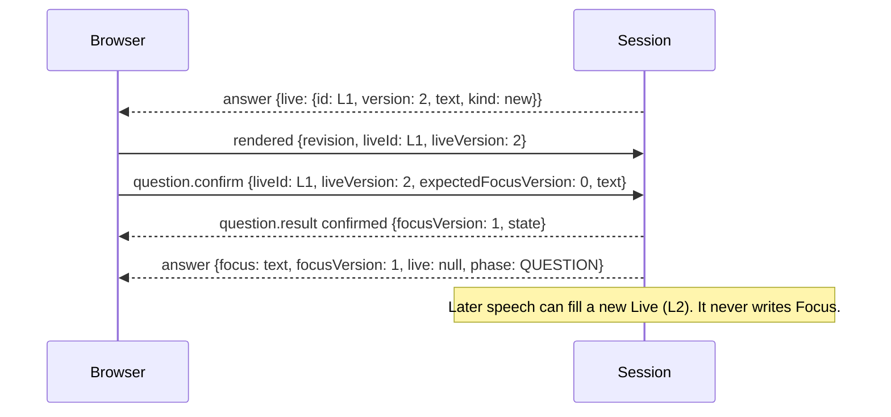

# UC-04 · Protocol changes

The browser and the local service exchange question controls on the existing `/session` WebSocket, beside audio. This page lists what changes from today's [question controls](../../../poc/docs/04.1-question-controls.md). Both ends must ship together; there is no stored data to migrate.

*A confirmation round trip. The result always arrives before the `answer` broadcast it causes, as today.*

## Messages

| Message | Today | Proposed |
| --- | --- | --- |
| Browser → `question.start` | Opens a clarification draft | Renamed **`question.reset`** `{type, sessionId, requestId}`: clears Live and moves the cutoff. Kept: Pablo decided on 4 November to keep the button, now labelled Clear live; the message keeps the name `question.reset` |
| Browser → `question.confirm` | `draftId, draftVersion, expectedQuestionVersion, text` | `liveId, liveVersion, expectedFocusVersion, text`, with the same bounds: IDs 1–100 characters, safe non-negative integer versions, text 1–600 characters |
| Server → `question.result` | Status `started` and others | Status **`reset`** replaces `started`. `confirmed` adds `liveId`, `liveVersion` and `focusVersion` |
| Server → `answer` state | `question`, `questionVersion`, `questionOrigin`, `clarification` | `focus`, `focusVersion`, `live`; `questionOrigin` removed |
| Browser → `rendered` | May name `draftId`/`draftVersion` | Names `liveId`/`liveVersion`. It records what was displayed; it is not consent |

## Confirm results

| Status | When |
| --- | --- |
| `confirmed` | Live id, version and text match, and `expectedFocusVersion` equals `focusVersion` |
| `stale` | The Live version or `focusVersion` changed, or the Live id was **retired** by an earlier Confirm or Reset in this session |
| `invalid` | Malformed, wrong session, a Live id never issued in this session, text that differs from that version, or a reused `requestId` with a different payload |
| `unavailable` | Session stopped, Live empty, or Live text equals Focus |
| `limit` | More than 256 distinct requests in this session |

Treating a retired id as `stale` rather than `invalid` is new. The id is known, and Pablo only needs to look at the newer Live. The server keeps retired ids in a set, bounded by the same 256-request cap.

The following stay as they are: caching of identical retries by `requestId`; results that carry the state at the time they were produced; audit records that hold versions and statuses but never question text; and the browser's 5-second "uncertain" timer with an identical retry.

## Agent input

The reasoning snapshot carries `state.focus` and `state.live` instead of `question` and `clarification`. The prompt in [agent.mjs](../../../poc/agent.mjs) changes in three ways:

- `state.focus` is the question Pablo chose, and the agent never proposes changing it.
- `clarify` means rephrasing or correcting `state.live`, or `state.focus` when Live is empty.
- `new-question` means a question different from both.

The output schema is unchanged. The controller, not the prompt, guarantees that Focus cannot change, so a wrong intent can only produce a wrong Live, which Pablo can ignore or reset.

Next: [OpenSpec update and decisions](03.4-uc-04-openspec-update.md) · Back to [overview](03-uc-04-focus-and-live-question.md)
