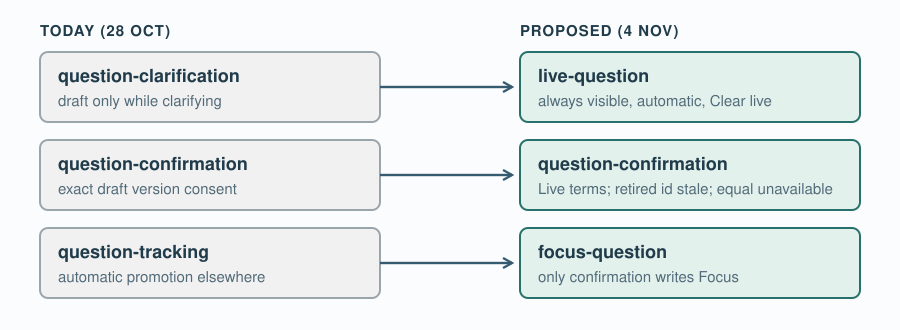

# UC-04 · OpenSpec update and decisions

The OpenSpec change [`uc-04-confirm-current-question`](../../../openspec/changes/uc-04-confirm-current-question/proposal.md) used to describe the 28 October behaviour: confirm only while clarifying, track automatically everywhere else. On 4 November Pablo accepted the five recommendations below ("Accept all five", relayed by 09 Coding). The change was then updated in place to match the [Focus/Live design](03-uc-04-focus-and-live-question.md).

## Edits made to the change

The change was updated in place because it is neither applied nor archived, and its folder name still fits.

| File | Change |
| --- | --- |
| `proposal.md` | Adds the 4 November decision, which supersedes the 28 October one, and cites the live-run bug. "What Changes" now describes the Focus/Live cycle, and the capabilities are renamed as below. |
| `design.md` | State, entry and compatibility sections follow the [state model](03.2-uc-04-state-and-rules.md). The protocol table follows the [protocol changes](03.3-uc-04-protocol.md). `questionOrigin` is removed. |
| `specs/question-clarification/` → `specs/live-question/` | Live is always visible and updated automatically. It refills only from speech after the last Confirm or Clear live. Clear live is the manual fallback. The multipart and readability scenarios are kept. |
| `specs/question-confirmation/` | Uses Live instead of draft. Adds two outcomes: a retired Live id is `stale`, and Live text equal to Focus is `unavailable`. Exact-version consent, retries, the 256 cap and no-rollback are kept. |
| `specs/question-tracking/` → `specs/focus-question/` | "Automatic promotion is scoped around clarification" is gone. "Only confirmation writes Focus" is added. The reflection/answer and session-failure requirements are reworded for Focus. |
| `tasks.md` | The tasks now describe changes to the existing uncommitted `sprint-01` code. They include a regression test for the 4 November bug: `new-question` after Confirm leaves Focus unchanged. |
| `images/` | `proposal-flow`, `clarification-flow`, `tracking-flow` and `design-protocol` were redrawn for Focus/Live. |

The key new scenario for `focus-question`: Pablo confirms Q1, and later speech that the agent labels `new-question` is heard. Then Live shows Q2 tagged "new question", and Focus still shows Q1 with Confirm enabled.

## Decisions (Pablo, 4 November 2026)

| # | Question | Decision |
| --- | --- | --- |
| 1 | Keep the button today called **Start question**? | Keep it, relabelled Reset live; renamed **Clear live** after the live run (finding 4). It clears Live and never touches Focus. |
| 2 | How are exchanges numbered? | A confirmed restatement stays in the same exchange; anything else starts a new one. |
| 3 | Show the agent's tag on Live? | Yes: "new question" or "restatement", small and muted. |
| 4 | Phase after Confirm? | QUESTION, so there is time to reflect. ANSWER still needs a Focus question. |
| 5 | Keyboard shortcut for Confirm? | None for now; the buttons are already keyboard operable. |

## Who does what next

09 Coding implements against the [state model](03.2-uc-04-state-and-rules.md) and the [protocol](03.3-uc-04-protocol.md) on `sprint-01`. At Pablo's request, SPRINT-001 now records the Focus/Live objective and criteria. 03 Use Cases is relabelling Start question as Clear live in the [UC-04 use case](../03-system-model-and-use-cases/01.4-confirm-current-question.md).

Back to [overview](03-uc-04-focus-and-live-question.md)
