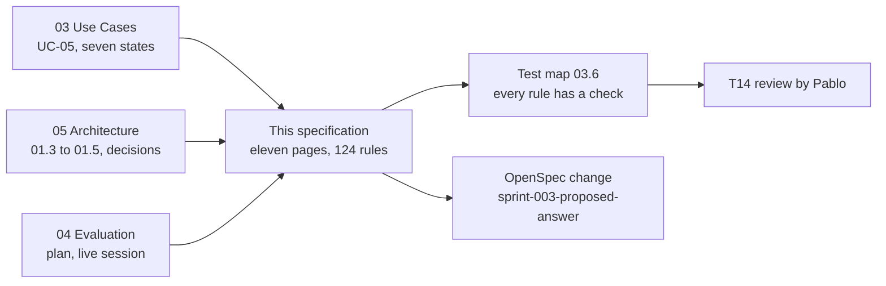

# SPRINT-003 specification: the proposed answer and the new page

SPRINT-003 gives Alice (Alice.Good.Meetings) a new page layout and a proposed answer to the Focus question: up to three short points beside it and supporting details below, built from the question and Pablo's interview preparation package. Pablo is the only user and reads the page at a glance while he answers. This specification turns the stage pages into exact, testable rules for 09 Coding, and each rule is mapped to a check on the [test map](03.6-sprint-003-test-map.md).

*Stages 03, 04 and 05 supply the behavior; this stage fixes the interfaces. The OpenSpec change carries the same rules as requirements and tasks.*

## Pages

| Page | Contract | Rule IDs | Commitments |
| --- | --- | --- | --- |
| [03.5.1](03.5.1-s003-answer-request-and-result.md) | Request object, result fields, limits | RQ, RS | ANSWER, DETAILS, CONTEXT |
| [03.5.2](03.5.2-s003-answer-controller.md) | Controller states, Stop rules | CT | ANSWER, DETAILS, LIVE |
| [03.5.3](03.5.3-s003-answer-labels.md) | The seven labels | LB | GLANCE, NOKEY, DETAILS |
| [03.5.4](03.5.4-s003-health-and-no-key.md) | `/health`, three no-key cases | HL, NK | NOKEY, RUN |
| [03.5.5](03.5.5-s003-package-loader.md) | Package loader | PK | CONTEXT |
| [03.5.6](03.5.6-s003-retry-and-timing.md) | One retry, timing points | RT, TM | ANSWER, LIVE |
| [03.5.7](03.5.7-s003-print-and-fixtures.md) | Print option, fixture hooks | PR, FX | CONTEXT, TESTS, PAGECHECK |
| [03.5.8](03.5.8-s003-page-and-preview.md) | Page behavior, preview | PG, PV | LAYOUT, PREVIEW, GLANCE, DETAILS, PAGECHECK |
| [03.5.9](03.5.9-s003-run-script.md) | `poc/alice-run.sh` | RN | RUN |
| [03.5.10](03.5.10-s003-review-items.md) | What Pablo should review | R1 to R10 | all |
| [03.5.11](03.5.11-s003-fixed-layout-values.md) | Limits and layout values fixed from the approved preview | PG-15, PG-16 | LAYOUT, GLANCE, DETAILS |

## How to read a rule

Each rule has an ID, one testable statement, the stage page it comes from and a limit column. Limits are fixed: the bullet and details lengths, label wording, control placement and row heights were fixed by T22 on 18 November 2026 from the approved preview ([03.5.11](03.5.11-s003-fixed-layout-values.md)). Only the names of new settings and RT-5's timeout remain open to change. The S003-STATEMENTS wording and the two check procedures belong to 00 Governance and 04 (T31, T33, T13); this specification fixes only the request object they compare against (RQ-1, RQ-5).

## Decisions since the first draft

On 18 November 2026 Pablo decided, as relayed by 00 Governance: R1 to R10 on the [review page](03.5.10-s003-review-items.md) are accepted as written (provisional limits stay provisional until T21 and T22); the reviewer script lives at `poc/review/package-check.mjs`; criterion 9's "only" means the answer request alone.

## Status

Draft of 18 November 2026 by 08 Detailed Design under the plan's task T11. It is derived from stage pages that are themselves drafts, approves nothing and changes no application file. Nothing has been built or run. Return to the [folder index](README.md) and to [Planning](../07-planning/03.9-sprint-003-plan.md).
