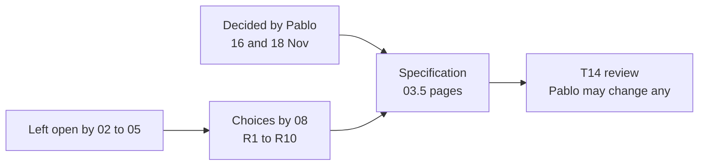

# SPRINT-003 specification: what Pablo should review (T14)

The [specification](03.5-sprint-003-specification.md) rests on decisions Pablo has already made and on choices that Detailed Design had to make because the stage pages left them open. This page lists the second kind, so the specification review (T14) spends his time where it matters. On 18 November 2026 Pablo accepted R1 to R10 as written ("Accept all", relayed by 00 Governance); the items stay in this draft, now recorded as decided. Provisional limits stay provisional until T21 and T22.

*Decided items are relied on as written; R1 to R10 are decided too. The ten items below are 08's choices, accepted by Pablo.*

## Choices made by 08, decided 18 November 2026

| Item | Choice | Where | Why it needed a choice |
| --- | --- | --- | --- |
| R1 | After Stop, an interrupted Preparing becomes Last known with the note "No answer arrived before listening stopped", not Empty | CT-13, LB-7 | 03 and 05 differ |
| R2 | A rejected key shows Unavailable only after a session starts, not before | NK-3 | 04's plan says before Start; OpenAI answers only at start |
| R3 | An over-limit or malformed result is refused whole, never cut | RS-4 | 04's plan says "refuses or cuts" |
| R4 | A 30-second timeout per attempt, so Failed after at most about 60 seconds | RT-5 | Pablo set no delay limit; a Failed state needs some limit; revisit after T40 |
| R5 | Speech-start `tS` is the first voiced audio packet after Confirm, from any speaker | TM-5 | 05 and 04 left the point open |
| R6 | The run script runs in the terminal, does not open the page, and may end an older idle service by its port; "older" includes a changed `.env.local` | RN-8 to RN-11 | 05 proposed these; Pablo was not asked |
| R7 | Session id and file names stay on the Mac; only instructions, question and document text are sent | RQ-5 | 05's object lists the session; its data statement lists less |
| R8 | Package edge rules: `.txt` and `.md` only, links and subfolders skipped, one unreadable file voids the package, name order, size as string length | PK-2 to PK-6 | 05 gave the limit and folder, not these |
| R9 | Names for new things: `proposed` and its message, `/preview`, `poc/fixtures.mjs`, `ALICE_PACKAGE_DIR`, `ALICE_PRINT_REQUEST`, `ANSWER_MODEL`, `ANSWER_TIMEOUT_MS` | various | Pablo may rename; 09 may adjust with the spec |
| R10 | Provisional limits: bullet 120 characters, details 1500, label wording, control placement | RS-2, RS-3, LB-*, PV-5 | Fixed by T21 and T22 from the approved preview |

## Decided items relied on

At most three bullets; details read on demand and scrolling inside themselves with no collapse control; one model call; a separate generator; one service retry; always replace on any Focus change; a late answer shown silently; no retry button; general points without a package; last known after Stop; the package in `poc/context/interview/`, 20,000 characters, README.md skipped, over-limit never cut; no package notice before Start; a key in place with the no-key page as fallback; the print option as an accepted, droppable default; criterion 9's "only" meaning the answer request alone, which Pablo decided on 18 November 2026 (T02, "Yes, answer request", relayed by 00 Governance); audio and transcript text still go to OpenAI for transcription and the interview agent.

## Observed while writing

`python3 asdg/scripts/cli.py sprint check-implementation` reported IMPLEMENTATION BLOCKED on 18 November 2026 because two Codex and Claude skill integrations (`asdg-pre-code-review`, `asdg-presentation`) are "missing or locally modified". This does not affect these documents, but 09 will meet it at T20.
[Index](03.5-sprint-003-specification.md) · [Test map](03.6-sprint-003-test-map.md)

Also decided on 18 November 2026: the reviewer script is `poc/review/package-check.mjs`, inside the sprint scope; see PK-11.
