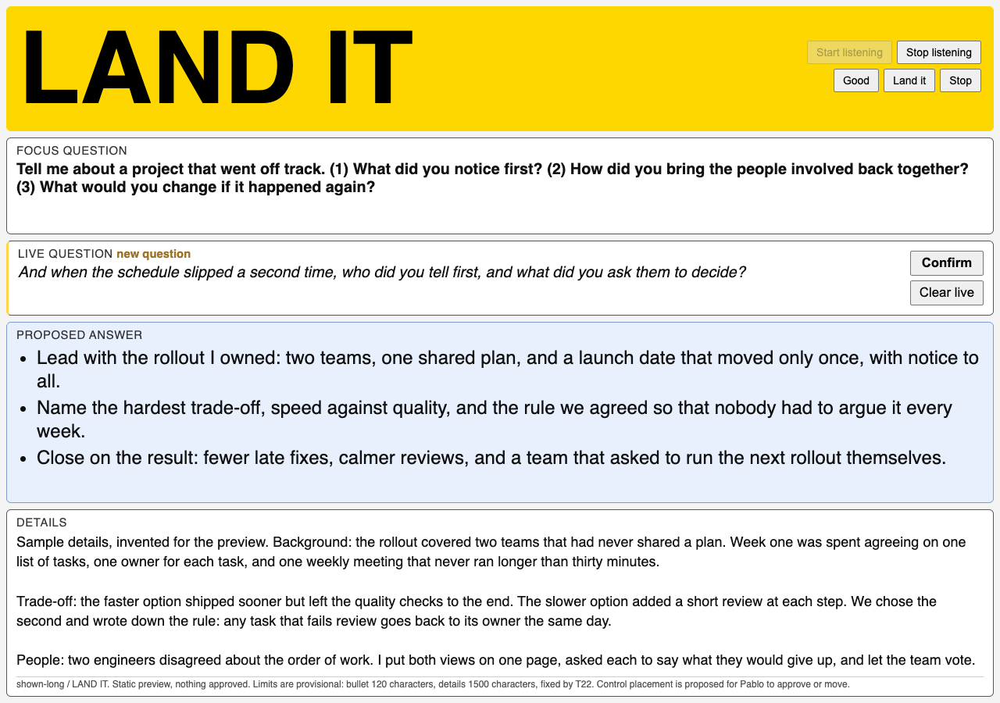

# SPRINT-003 contract: the limits and layout values fixed by the approved preview

Pablo approved the layout preview on 18 November 2026 at 19:09 UTC, as relayed by 00 Governance and recorded in the [approval record](../00-governance/03-sprint-003-preview-approval.md), and moved nothing. This page, task T22, replaces the provisional values of the [specification](03.5-sprint-003-specification.md) with the preview's actual values, so 09 can build the page and the service against numbers. It serves S003-LAYOUT, S003-GLANCE, S003-DETAILS and S003-ANSWER.

*Representative view of the approved preview, captured by 09 Coding, with invented sample text. Files approved by hash: `index.html` `24ee034e…`, `preview.css` `f493b9a4…`, `preview.js` `d20f82cb…`; any change needs a new approval (PV-6).*

## Fixed values

| Value | At 1280 × 900 | At 390 × 844 (width up to 700 px) | Decided by |
| --- | --- | --- | --- |
| Row heights: cue band, Focus, Live, answer card | 160, 124, 96, 232 px | 188, 190, 196, 460 px | Preview, as 09 reported |
| Details area | the rest of the window: 240 px | 260 px; the page may scroll | Preview |
| Page padding and row gap | 8 px and 8 px | same | Preview |
| Cue word | 128 px, bold | 78 px | Old page rule, as baseline [03.3](../10-document-review-and-release/03.3-sprint-003-pg3-baseline-text-sizes.md) |
| Focus and Live text | 19.8 px | 14 px | Same baseline |
| Bullets | 24 px, line height 1.25 | 20 px | Preview |
| Details text | 18 px, line height 1.4 | 18 px | Preview |
| Confirm and Clear live | 16.83 px | 16.83 px | Baseline row 7 |
| Start, Stop listening and cue buttons | 14 px | 14 px | Preview; above the old 11 px |
| Bullets, at most | 3 | 3 | Decided 16 Nov |
| `BULLET_MAX` | 120 characters | same | This page |
| `DETAILS_MAX` | 1500 characters | same | This page |

## Rules

| ID | Rule | Cites | Limit |
| --- | --- | --- | --- |
| PG-15 | The four glance rows have exactly the heights above at each size, in every state and cue, and only the details area takes the remaining height or scrolls. | approval record; 04 criteria | fixed |
| PG-16 | The controls sit where the preview puts them: Start and Stop listening, the manual Good, Land it and Stop buttons and their reason line inside the cue band on its right; Confirm and Clear live stacked at the right edge of the Live card, Confirm first. | approval record; PV-5 | fixed |

## Where I chose between the preview's value and a rounder one

- **Bullets.** The longest sample bullet is 118 characters and the card was sized and shown with it. I fixed 120, the nearest round number, which leaves a margin of two; a larger number would have been untested, because bullets cannot scroll.
- **Details.** The longest sample is 1432 characters and scrolls inside its 240 px area. I fixed 1500: the area scrolls, so a longer text cannot move the four glance rows, and the limit only bounds delay and reading time.
- **Wording.** All label wording shown in the preview is fixed as it appears (LB-1 to LB-7, LB-10). The reason lines for an oversized, empty or unreadable package, a missing service and a rejected key were not shown in the preview; they are fixed as written on [03.5.3](03.5.3-s003-answer-labels.md) and share its pattern, but Pablo has not seen them rendered.

## Not covered by the approval

The preview shows no server or debug readout, which the old page has. Where they go, or whether they stay, is not fixed here, and the approval does not cover them; 09 and Pablo decide at the page build.
[Index](03.5-sprint-003-specification.md) · [Page and preview](03.5.8-s003-page-and-preview.md) · [Review items](03.5.10-s003-review-items.md)
