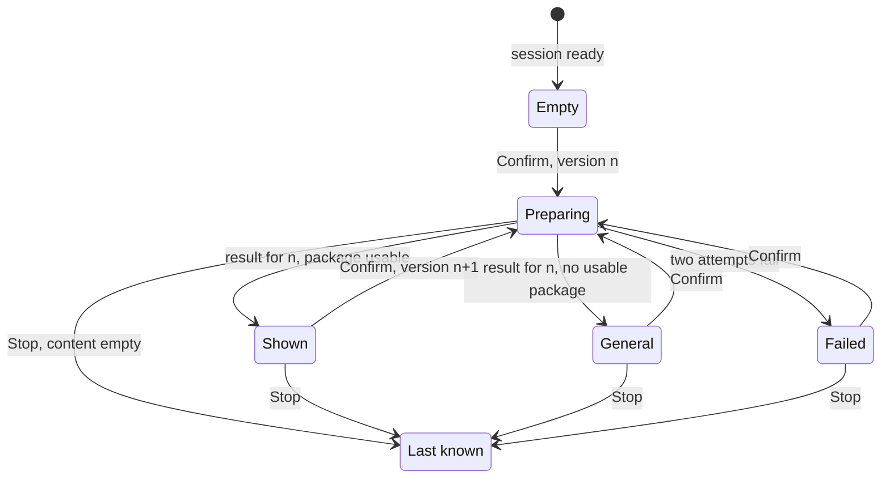

# SPRINT-003 contract: the controller, its states and the Stop rules

The state controller (`InterviewSession`) owns what the page may show. This page says how it keeps the proposed answer attached to the right Focus question, using the seven names of the [answer states](../03-system-model-and-use-cases/01.5.1-proposed-answer-states.md). It is part of the [specification](03.5-sprint-003-specification.md) and serves S003-ANSWER, S003-DETAILS and S003-LIVE.

*Unavailable is a page state before any session exists, so it is not a controller state; see [health and no key](03.5.4-s003-health-and-no-key.md).*

## Rules

| ID | Rule | Cites | Limit |
| --- | --- | --- | --- |
| CT-1 | The answer area, `proposed`, is kept apart from `state`: it is not in reasoning snapshots, not in cached `question.result` states and it never changes `revision`. Fields: `status`, `focusVersion`, `bullets`, `details`, `reason`, `lastKnown`, `lastStatus`. | 05 01.3 | |
| CT-2 | `proposed.status` is one of `empty`, `preparing`, `shown`, `general`, `failed`, `last-known`; it is `empty` when the session is ready. | 03 01.5.1 | |
| CT-3 | A successful Confirm, in one update, sets Focus as today, sets `preparing` for the new version with no content and starts one request. `question.result` still precedes the `answer` message, which now also carries `proposed`. | 05 [01.5](../05-high-level-design-and-architecture/01.5-pending-state-and-inspectable-inputs.md) | |
| CT-4 | Every Confirm, a reworded one included, raises `focusVersion`, aborts the earlier request and removes the earlier content in that same update. | 03 01.5 ("Yes, always replace") | |
| CT-5 | At most one answer request is in flight per session. | 05 01.3 | |
| CT-6 | A result is accepted only while the session is active, its `focusVersion` equals the current one and it belongs to the in-flight request. Otherwise it is dropped, never shown, and the audit names the reason `stale-version`, `stopped` or `superseded`. | 05 01.3 | |
| CT-7 | An accepted result with a usable package gives `shown`. Without one it gives `general` with `reason` of `null`, `too-large`, `empty` or `unreadable` from the loader status. | 03 01.5 | |
| CT-8 | An accepted result is published as one server message `{type:'proposed', sessionId, serverAt, proposed, proposedSeq}` holding bullets and details together, complete. | 05 01.3 | |
| CT-9 | `proposedSeq` rises with every publication in a session. The page applies a message only when its seq is higher and its `focusVersion` equals the displayed Focus. | 05 01.5 | |
| CT-10 | A result is published even after Pablo has started speaking, in place and with no other effect. | 03 01.5 | |
| CT-11 | The answer area has no write path to `focus`, `live`, `phase`, `reply`, `exchangeId` or `revision`; publishing it never makes an in-flight Live update stale. | 05 01.3 | |
| CT-12 | After the retry is exhausted the status is `failed` with no content and no retry control. The next Confirm starts afresh. | 03 01.5 | |
| CT-13 | Stop or disconnect aborts the request and never shows its result. `shown`, `general` and `failed` become `last-known` with content, `reason` and the earlier status kept in `lastStatus`, so a General answer keeps its General tag and reason and a Failed one keeps its Failed note; `preparing` becomes `last-known` with no content. | 03 01.5 | R1 |
| CT-14 | A new session starts `empty`; nothing from an earlier session is kept after Stop. | 03 01.5 | |
| CT-15 | The package is read once, at session start before `ready`; every request in the session uses those texts. | 05 [02](../05-high-level-design-and-architecture/decisions/Proposed%20answer%20and%20its%20context/02-preparation-package.md) | |
| CT-16 | With no key there is no session and no request. | 05 [01.4](../05-high-level-design-and-architecture/01.4-service-start-and-key.md) | |
| CT-17 | The cue, the timer, Focus, Live and Confirm never depend on the answer area. | 03 01.5.1 | |

R1: Use Cases name the Stop result "Last known, or a note that none arrived", while Architecture's 01.5 says an interrupted Preparing returns to Empty. CT-13 follows Use Cases, because Empty means no Focus question; see the [review page](03.5.10-s003-review-items.md).
[Previous: request and result](03.5.1-s003-answer-request-and-result.md) · [Index](03.5-sprint-003-specification.md) · [Next: labels](03.5.3-s003-answer-labels.md)
