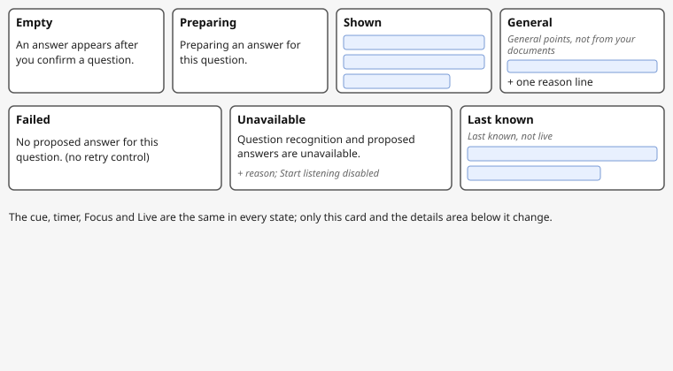

# SPRINT-003 contract: the seven labels

Pablo reads these words at a glance while an interview goes on, so each state needs its own short wording, and Failed and Unavailable must never look alike. This page fixes the text for the preview to show and for the page check to assert. It is part of the [specification](03.5-sprint-003-specification.md) and serves S003-GLANCE, S003-NOKEY and S003-DETAILS.

*Representative labelled mockup of the answer card, not a screenshot. Positions are those of the preview Pablo approved on 18 November 2026. [Editable SVG](images/s003-labels.svg).*

## Rules

| ID | Rule | Cites | Limit |
| --- | --- | --- | --- |
| LB-1 | **Empty:** the card says "An answer appears after you confirm a question." and the details area is empty. | 03 01.5.1 | wording fixed by T22 from the approved preview |
| LB-2 | **Preparing:** the card says "Preparing an answer for this question." with no earlier content; the details area is empty. | 03 01.5.1 | wording fixed by T22 from the approved preview |
| LB-3 | **Shown:** the card holds the bullets and the details area holds the details. Nothing says "general". | 03 01.5.1 | |
| LB-4 | **General:** the card carries the tag "General points, not from your documents" with the bullets, then one reason line from the table below. The details area holds general details or is empty. | 03 01.5.1 | wording fixed by T22 from the approved preview |
| LB-5 | **Failed:** the card says "No proposed answer for this question." It has no button, link or retry control. | 03 01.5 | |
| LB-6 | **Unavailable:** the card says "Question recognition and proposed answers are unavailable." with one reason line from the table below. Live says "Question recognition is unavailable." and Start listening is disabled with the same reason. | 03 01.5; S003-NOKEY | wording fixed by T22 from the approved preview |
| LB-7 | **Last known:** the card keeps its bullets and details and carries the tag "Last known, not live" beside what it already carried: a General answer keeps its General tag and reason line, a Failed one keeps "No proposed answer for this question." With no content it says "No answer arrived before listening stopped." | 03 01.5 | wording fixed by T22 from the approved preview |
| LB-8 | The Failed and Unavailable texts differ in their first sentence. General and Shown differ by the General tag. All wording shown in the preview is fixed as shown (T22, 18 Nov 2026); reason lines the preview did not show are fixed as written below. | 03 01.5.1 | fixed |
| LB-9 | A General reason comes only from the loader status; no file name, count or package text appears in it. The size line names only the 20,000 limit. | 05 02 | |
| LB-10 | At Stop or disconnect the Focus question keeps its text and carries its own last-known mark, as UC-04 already requires; the answer's tag does not replace it. | 03 01.4; UC-04 rule 4 | |

## Reason lines

| Code | Where | Line shown |
| --- | --- | --- |
| `null` (no package) | General | "No preparation package was found." |
| `too-large` | General | "The package is over 20,000 characters and was not used." |
| `empty` | General | "The package is empty and was not used." |
| `unreadable` | General | "The package could not be read and was not used." |
| `no-key` | Unavailable | "No OpenAI key is set up." |
| `no-service` | Unavailable | "The Alice service is not running." |
| `key-rejected` | Unavailable | "OpenAI did not accept the key." |

Only Shown may say anything about Pablo, and only what the package holds; that is judged in the live session, not here.
[Previous: controller](03.5.2-s003-answer-controller.md) · [Index](03.5-sprint-003-specification.md) · [Next: health and no key](03.5.4-s003-health-and-no-key.md)
