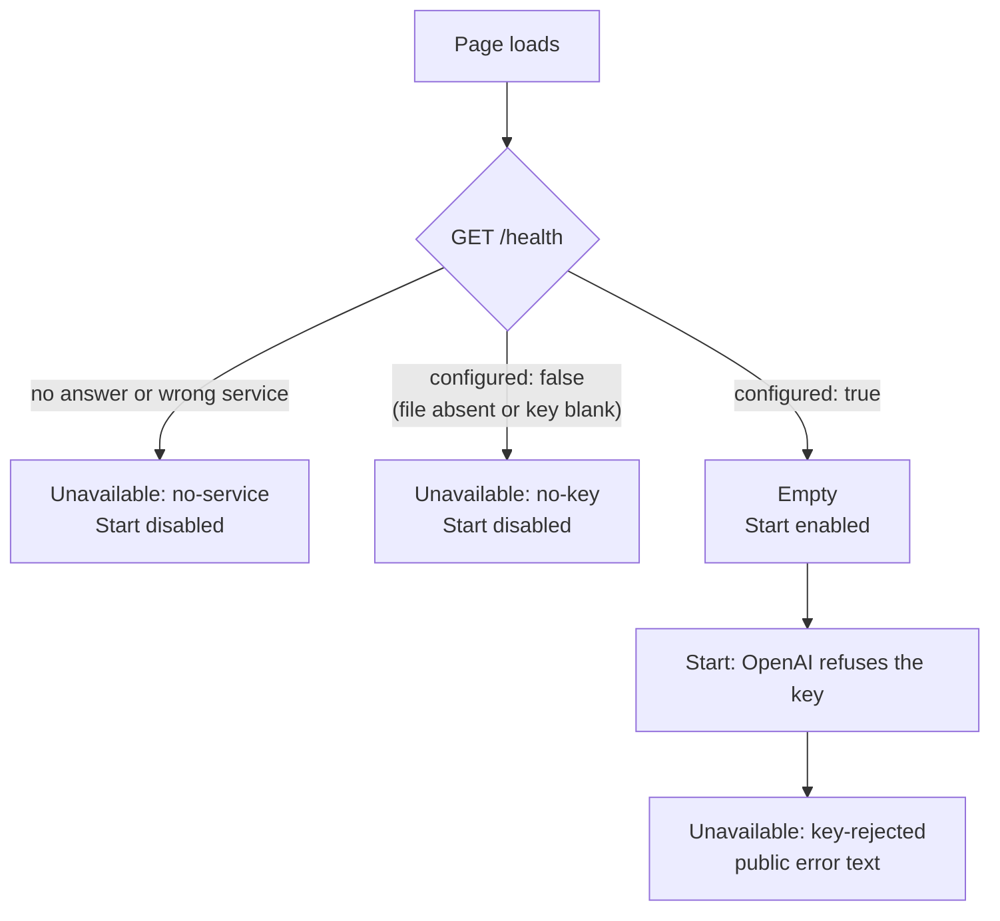

# SPRINT-003 contract: `/health` and the three no-key cases

Alice must stay useful when no OpenAI key is in place: the page loads, the timer and the cue work, and Pablo is told at once that question recognition and proposed answers are unavailable. This page fixes the `/health` reply the page and the run script read, and the three ways a key can be missing. It is part of the [specification](03.5-sprint-003-specification.md) and serves S003-NOKEY and S003-RUN.

*The first two outcomes are known on load, before any button is pressed. A rejected key is known only when a session starts.*

## `/health`

| ID | Rule | Cites | Limit |
| --- | --- | --- | --- |
| HL-1 | `GET /health` returns JSON `{status:'alive', service:'alice-good-meetings', startedAt, configured, sessions, package:{found, chars}}`. `startedAt` is an integer in milliseconds, set once when the service is created. | 05 [01.4](../05-high-level-design-and-architecture/01.4-service-start-and-key.md) | field names accepted (R9) |
| HL-2 | `configured` is true only when the key is a string with a non-blank character; an absent or blank key gives false. | 05 01.4 | |
| HL-3 | The reply never holds the key, any part of it, a package file name, package text or an error text. | 05 [02](../05-high-level-design-and-architecture/decisions/Proposed%20answer%20and%20its%20context/02-preparation-package.md) | |
| HL-4 | `package.found` is true when at least one eligible file exists, and `chars` is their total character count, which may exceed 20,000 and is 0 when none is found. There is no "usable" flag. | 05 [03](../05-high-level-design-and-architecture/decisions/Proposed%20answer%20and%20its%20context/03-data-statements.md) | |
| HL-5 | The route stays GET-only with today's host check and `Cache-Control: no-store`. | 05 01.4 | |
| HL-6 | The page reads `/health` once on load and uses only `service` and `configured`; it never shows or stores the package fact. | 05 01.4 (decision of 18 Nov) | |

## The three no-key cases

| ID | Rule | Cites | Limit |
| --- | --- | --- | --- |
| NK-1 | **File absent.** The service starts without `poc/.env.local` and listens when started as `node server.mjs` or by `alice-run.sh`; `/health` says `configured:false`. `poc/start.sh` is not in this rule: it still stops with Node's missing-file error, see R12. | 05 01.4 | |
| NK-2 | **Key empty.** `OPENAI_API_KEY=` or a blank value behaves exactly as an absent key. | 04 [plan](../04-benchmarks-and-eval-strategy/03.6-sprint-003-evaluation-plan.md) | |
| NK-3 | **Key rejected.** `configured` stays true; the session ends with the public error text; the page then shows Unavailable with `key-rejected`. The service recognizes a rejection by OpenAI's error code `invalid_api_key` or by a 401 on the transcription handshake. This mapping was checked only against fixtures; real OpenAI rejection behavior is unverified. | 05 01.4 | R2 |
| NK-4 | With no key the service makes no connection to OpenAI and never calls the transcription connection or the generator. | 04 plan | |
| NK-5 | Page loaded without a key, before any press: the answer card and Live say Unavailable (`no-key`), Start listening is disabled with that reason, and the timer and the cue buttons work. | 03 01.5; 02 B2 | |
| NK-6 | If `/health` is unreachable, not JSON, or names another service, the page shows Unavailable (`no-service`) with Start disabled. | 05 01.4 | |
| NK-7 | No page text, `/health` reply or log line holds the key or provider error text; only the public error text appears. | 04 plan | |
| NK-8 | A WebSocket opened with no key still gets today's status "Server needs OPENAI_API_KEY" and a close, with no connection to OpenAI. | existing `server.mjs` | |

R2: the evaluation plan says each of the three cases shows Unavailable before Start. For a rejected key that cannot hold, because OpenAI answers only when a session starts. NK-3 follows Architecture; see the [review page](03.5.10-s003-review-items.md).
[Previous: labels](03.5.3-s003-answer-labels.md) · [Index](03.5-sprint-003-specification.md) · [Next: package loader](03.5.5-s003-package-loader.md)
