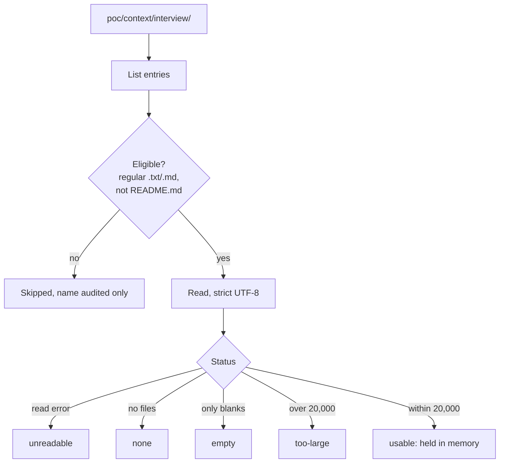

# SPRINT-003 contract: the preparation package loader

Pablo's résumé and other documents are plain files in a Git-ignored folder, and everything the loader accepts is sent to OpenAI with each Confirmed question. The loader must therefore be strict: it reads only what it should, never cuts a package, and never lets a recording or a shortcut slip in. It is part of the [specification](03.5-sprint-003-specification.md) and serves S003-CONTEXT.

*Anything other than `usable` means the package is not used at all and the answer is General.*

## Rules

| ID | Rule | Cites | Limit |
| --- | --- | --- | --- |
| PK-1 | The folder is `poc/context/interview/`, resolved from the `poc/` directory. The setting `ALICE_PACKAGE_DIR`, and the option `packageDir` of `createPocServer`, replace it so tests use a synthetic folder. | 05 [02](../05-high-level-design-and-architecture/decisions/Proposed%20answer%20and%20its%20context/02-preparation-package.md) | setting names accepted (R9) |
| PK-2 | An eligible entry is a regular file directly in the folder, with extension `.txt` or `.md` (any case), whose name does not start with a dot and is not `README.md` in any case. | 05 02 | |
| PK-3 | A symbolic link, even to a file inside the folder, and a subfolder are skipped and never entered or followed. | 05 02 ("no link out") | |
| PK-4 | Eligible files are read in ascending name order as strict UTF-8. A read or decoding failure in any eligible file gives `unreadable` for the whole package; nothing is partly used. | 05 02; 03 01.5 | |
| PK-5 | The size is the sum of the decoded texts as JavaScript string length, with no separators. Exactly 20,000 is used; 20,001 or more gives `too-large`, and the package is never cut. | 05 02 | 20,000, decided |
| PK-6 | Status is decided in this order: no eligible file gives `none` (a missing folder too); any read failure gives `unreadable`; only blank text gives `empty`; over the limit gives `too-large`; otherwise `usable`. | 03 01.5 | |
| PK-7 | Skipped entries (README.md, other extensions, dotfiles, links, subfolders) are listed by name in the audit and the start log only, never on `/health` or the page. | 05 02 | |
| PK-8 | The package is read once at session start before `ready`, held in memory for that session and dropped at Stop. It is written nowhere. | 05 02; 05 03 | |
| PK-9 | Once per session the audit records `package_loaded` with `sessionId`, `status`, `files` (`name`, `chars`, `sha256` of the file bytes), `chars` and `skipped`, never text. The start log holds one line with status, file count, characters and skipped names. | 04 [plan](../04-benchmarks-and-eval-strategy/03.6-sprint-003-evaluation-plan.md) | |
| PK-10 | Package text goes only into the answer generator's model input (RQ-5): never to the page, audit, `/health`, the interview agent or test output. | 05 [03](../05-high-level-design-and-architecture/decisions/Proposed%20answer%20and%20its%20context/03-data-statements.md) | |
| PK-11 | No `poc/` source other than the files in `poc/review/` opens, reads, imports or resolves a path under `eval-data/`, and nothing outside `poc/review/` imports the reviewer script `poc/review/package-check.mjs`; `alice-run.sh` and `node --test poc/poc.test.mjs` never run it. 09 writes the script and the reviewer runs it by hand. The literal folder name may appear outside `poc/review/` only in the title of a test case that asserts this isolation (ST-52, ST-57) and in the one existing URL probe that expects a 404; the static scan lists each such line and fails on any other occurrence. | 04 [03.8](../04-benchmarks-and-eval-strategy/03.8-sprint-003-package-and-statement-checks.md); S003-CONTEXT | location decided 18 Nov |

The loader reads nothing outside the folder and never reads `eval-data/`. It does not stop Pablo placing benchmark files in the folder; the reviewer-run package check of T13 finds that, and a failed check makes a live run invalid.
His existing folder also holds a meeting link and folder address, which would be sent; that is his to remove, and the loader does not edit his files.
[Previous: health and no key](03.5.4-s003-health-and-no-key.md) · [Index](03.5-sprint-003-specification.md) · [Next: retry and timing](03.5.6-s003-retry-and-timing.md)
