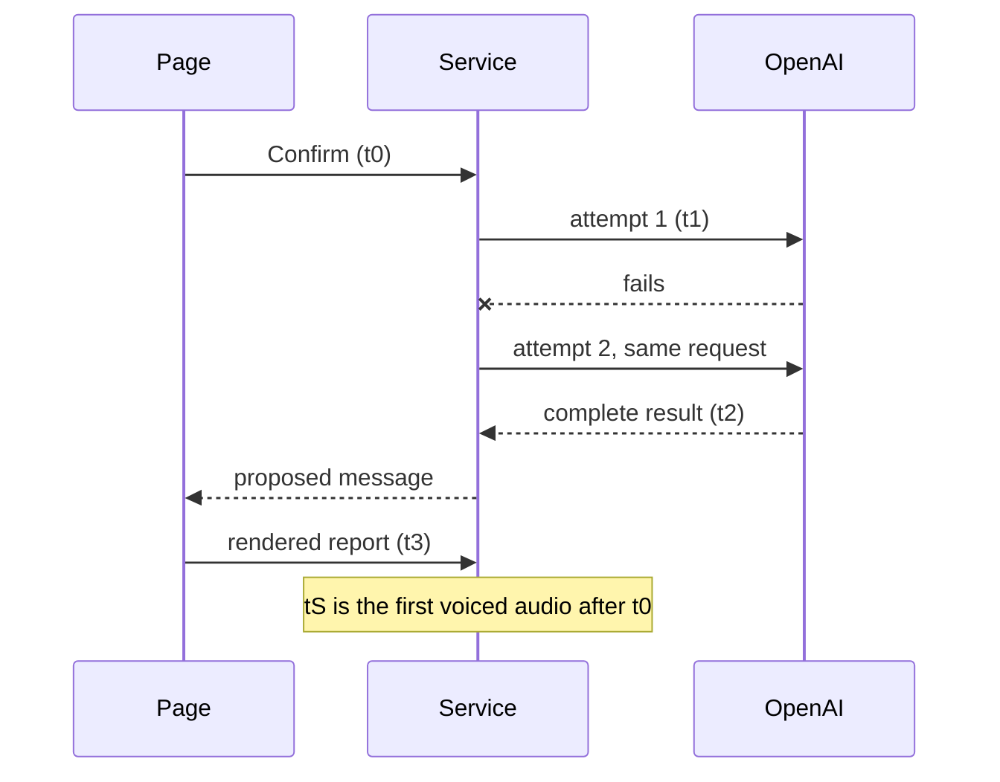

# SPRINT-003 contract: one retry and the timing points

A failed answer request is tried once more by the service, and every Confirm records when each step happened, so the live session can show how long Pablo waits. This page fixes both. It is part of the [specification](03.5-sprint-003-specification.md) and serves S003-ANSWER and S003-LIVE.

*All times come from the service clock. The page never supplies a time.*

## Retry

| ID | Rule | Cites | Limit |
| --- | --- | --- | --- |
| RT-1 | An attempt fails when the generator throws or rejects, the attempt timeout passes, or the result is rejected under RS-4. | 05 01.3 | |
| RT-2 | After a failed first attempt the service makes exactly one more, at once, with the same request object (same `focusVersion` and documents). | 05 01.3 (decided 18 Nov) | |
| RT-3 | After a second failure the status is `failed` (CT-12) and the audit records `answer_failed` with `attempts: 2` and a text-free code. | 05 01.3 | |
| RT-4 | No attempt starts for a superseded version or a stopped session; an abort during an attempt ends it with no retry. | 03 01.5 | |
| RT-5 | The attempt timeout is `ANSWER_TIMEOUT_MS`, 30,000 ms, the same as the interview agent's. | 04 [plan](../04-benchmarks-and-eval-strategy/03.6-sprint-003-evaluation-plan.md) | 30 s accepted (R4) but provisional until the live session; no delay limit is set in advance |
| RT-6 | The retry is invisible: the page stays Preparing and receives no extra message. | 03 01.5 | |

## Timing

| ID | Rule | Cites | Limit |
| --- | --- | --- | --- |
| TM-1 | `t0` is the service time when a Confirm is accepted as `confirmed`. | 05 [03.2](../05-high-level-design-and-architecture/03.2-answer-delay-question.md) | |
| TM-2 | `t1` is the time the first attempt's request leaves the service. | 05 03.2 | |
| TM-3 | `t2` is the time the accepted, complete result is in hand. | 05 03.2 | |
| TM-4 | `t3` is the time the service receives the page's `rendered` report whose `answerFocusVersion` equals the Focus version and whose `answerStatus` is `shown` or `general`. | 05 03.2 | |
| TM-5 | `tS` is the speech-start time: the first audio packet after `t0` that the existing energy test (RMS above 0.012) marks as voiced, or null if none. It cannot tell Pablo from another voice. | 04 plan | R5 |
| TM-6 | One audit event `answer_timing` is written per Focus version, when `t3` arrives or when the version is superseded, stopped or failed, with missing times null. It holds `sessionId`, `focusVersion`, `t0` to `t3`, `tS`, `attempts` and `outcome`. | 04 [live session](../04-benchmarks-and-eval-strategy/03.6.1-sprint-003-live-session.md) | |
| TM-7 | The event also holds `delayMs` = `t3` − `t0`, `generationMs` = `t2` − `t1`, `pauseMs` = `tS` − `t0` and `visibleBeforeSpeech` (`t3` < `tS`), each null when an input is missing. | 04 plan | |
| TM-8 | The audit events `answer_requested` (version, context kind, file count, characters), `answer_accepted` (duration, attempts) and `answer_dropped` (reason) never hold question, package or answer text. | 05 01.3 | |

R4 and R5 are on the [review page](03.5.10-s003-review-items.md).
[Previous: package loader](03.5.5-s003-package-loader.md) · [Index](03.5-sprint-003-specification.md) · [Next: print option and fixtures](03.5.7-s003-print-and-fixtures.md)
