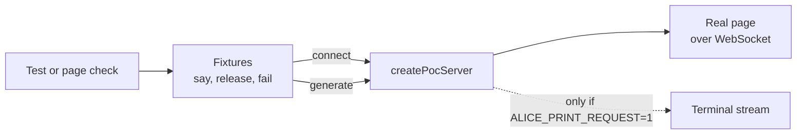

# SPRINT-003 contract: the print option and the fixture hooks

Two small contracts let Pablo and the tests see what the service does without OpenAI. The optional print option shows Pablo, once, exactly what would be sent. The fixture hooks let tests and the scripted page check drive every answer state with no key and no network. This page is part of the [specification](03.5-sprint-003-specification.md) and serves S003-CONTEXT, S003-TESTS and S003-PAGECHECK.

*Fixtures replace the two OpenAI connections the service already accepts as options. The print path goes to the terminal and nowhere else.*

## The print option

| ID | Rule | Cites | Limit |
| --- | --- | --- | --- |
| PR-1 | The option is off by default. It is on only when the environment variable `ALICE_PRINT_REQUEST` is exactly `1`; any other value leaves it off. | 05 [01.5](../05-high-level-design-and-architecture/01.5-pending-state-and-inspectable-inputs.md) | name provisional; droppable, T25 |
| PR-2 | When on, the service prints the assembled model input (instructions, question, document texts) once per answer request, not per retry, to the standard error stream. | 05 01.5 | |
| PR-3 | The printed text appears nowhere else: not on the page, in the audit, on `/health`, on any HTTP route or in a file. | 05 01.5 | |
| PR-4 | When on, the service prints at startup, and before each printed request, a warning that the output is private text which other tools may read and which should be cleared afterwards. | 05 01.5 | |

## The fixture hooks

| ID | Rule | Cites | Limit |
| --- | --- | --- | --- |
| FX-1 | `createPocServer` accepts `generate(request, {signal})`, returning `{bullets, details}` or throwing. The default calls OpenAI; a test passes its own, and the default is then never called. | 05 [01.3](../05-high-level-design-and-architecture/01.3-proposed-answer.md) | |
| FX-2 | The existing `connect` option stays the transcription seam. A fixture connection emits scripted events (`session.updated`, committed, transcription delta and completed) and never touches the network. | 04 [plan](../04-benchmarks-and-eval-strategy/03.6-sprint-003-evaluation-plan.md) | |
| FX-3 | `createPocServer` also accepts `now()` (clock), `answerTimeoutMs` and `packageDir`, so tests control time, the timeout and the package without waiting. | 04 plan | option names provisional |
| FX-4 | A support module `poc/fixtures.mjs` returns `{connect, generate, say(text), release(result), fail(error), calls}` so a test can hold, release or fail one request at a time and read each request object. Its text is invented. | 04 plan | file name provisional |
| FX-5 | Fixtures and the synthetic package never read or copy `eval-data/` or Pablo's real package; the synthetic package is created in a temporary folder by each test. | 04 [criteria](../04-benchmarks-and-eval-strategy/01.2-evaluation-criteria.md) | |

## How each state is reached

| State | Fixture steps |
| --- | --- |
| Empty | Key present, session ready, no Confirm |
| Preparing | Confirm, then `generate` held |
| Shown | Usable package, then `release(result)` |
| General | No package, or each loader status, then `release(result)` |
| Failed | `fail(error)` on both attempts |
| Unavailable | `apiKey` empty (no key), or no service answering `/health` |
| Last known | Any content state, then Stop or a closed socket |

[Previous: retry and timing](03.5.6-s003-retry-and-timing.md) · [Index](03.5-sprint-003-specification.md) · [Next: page and preview](03.5.8-s003-page-and-preview.md)
