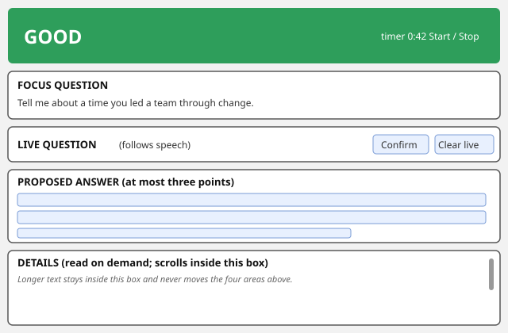

# SPRINT-003 contract: what the page does and the preview

Pablo is the only user, glancing at the page from a second screen while he answers. This page fixes what the new page must do with the answer messages and what the static preview must contain for him to approve the layout first. It is part of the [specification](03.5-sprint-003-specification.md) and serves S003-LAYOUT, S003-PREVIEW, S003-GLANCE, S003-DETAILS and S003-PAGECHECK.

*Representative labelled mockup of the layout "B, cue first", not a screenshot. The preview, not this sketch, fixes positions and sizes. [Editable SVG](images/s003-layout.svg).*

## The page

| ID | Rule | Cites | Limit |
| --- | --- | --- | --- |
| PG-1 | The page renders each of the seven states with the text of LB-1 to LB-7 from the `answer` and `proposed` messages of a scripted session. | 03 01.5.1 | |
| PG-2 | At 1280 × 900 with the longest content, the cue, Focus, Live and bullet card are fully visible with no page scroll, unclipped and not overlapped. At 390 × 844 they are unclipped and not overlapped; the page may scroll. | 04 [criteria](../04-benchmarks-and-eval-strategy/01.2-evaluation-criteria.md) | |
| PG-3 | At 1280 × 900 the cue word, Focus and Live text are no smaller than on the page at revision `7d60c0f`, whose sizes 10 ReviewQA records before the build (T19). | 04 criteria | baseline sizes recorded by 10 ReviewQA (T19) before the build; page to be linked once it exists |
| PG-4 | Long details scroll only inside their own area. The four glance elements keep the same position and size from the shortest to the longest content. | 03 01.5.1 | height fixed by T22 |
| PG-5 | The answer area has no collapse control, no retry control and no other button or link. | 03 01.5.1; 03 01.5 | |
| PG-6 | Content is replaced in place with no animation, transition or sound. | 03 01.5.1 | |
| PG-7 | No answer text appears inside the Focus or Live elements. | 03 01.5 | |
| PG-8 | After paint the `rendered` report names `answerFocusVersion` and `answerStatus` beside the existing revision fields. | 05 01.3 | |
| PG-9 | A message that sets a new Focus shows Preparing and no earlier answer text in the same render. | 03 01.5 | |
| PG-10 | A `proposed` message whose Focus version is not the displayed one, or whose seq is not higher, is ignored. | 05 01.3 | |
| PG-11 | On load without a key or service, Start listening is disabled with its reason while the timer and the cue buttons work. | 03 01.5 | |
| PG-12 | Bullets and details are shown as plain text: markup in them appears literally. | 05 01.3 | |
| PG-13 | The page makes only same-origin requests; the package text never reaches the page or its WebSocket frames. | 05 [03](../05-high-level-design-and-architecture/decisions/Proposed%20answer%20and%20its%20context/03-data-statements.md) | |
| PG-14 | The cue, timer, Confirm and Clear live work in every state. | 03 01.5.1 | |

## The preview

| ID | Rule | Cites | Limit |
| --- | --- | --- | --- |
| PV-1 | The preview is static files under `poc/preview/`, served at `/preview` from its own entry in the service's fixed file list. It is not the product page. | 05 01.4 | |
| PV-2 | It makes no network request, uses no microphone, key, package or OpenAI, and holds invented text only, never text from `eval-data/` or his package. | 05 01.4 | |
| PV-3 | It shows the seven states and Shown with the shortest and the longest content, at 1280 × 900 and 390 × 844. The longest Shown appears with each of GOOD, LAND IT and STOP, a multipart Focus question and a filled Live bar; the others appear with GOOD. | 04 plan | |
| PV-4 | A state is chosen by the address fragment `#state=` (`empty`, `preparing`, `shown-short`, `shown-long`, `general`, `failed`, `unavailable`, `last-known`) and `cue=` (`good`, `land-it`, `stop`). With no fragment it lists links to each. | 04 plan | |
| PV-5 | It shows Clear live, Start and Stop listening and the cue buttons, each in one proposed place, for Pablo to approve or move. | plan C9 | placement fixed by T22 |
| PV-6 | `index.html` stays unchanged until a dated approval by Pablo exists that names the preview files by their SHA-256 and those hashes equal the files' current bytes. A changed preview needs a new approval. | plan T21, T26; S003-PREVIEW | |

Approval is by file hash (T21); the preview grants none itself, and this rule is checked by SH-15, a reviewer gate of its own.
[Previous: print and fixtures](03.5.7-s003-print-and-fixtures.md) · [Index](03.5-sprint-003-specification.md) · [Next: run script](03.5.9-s003-run-script.md)
