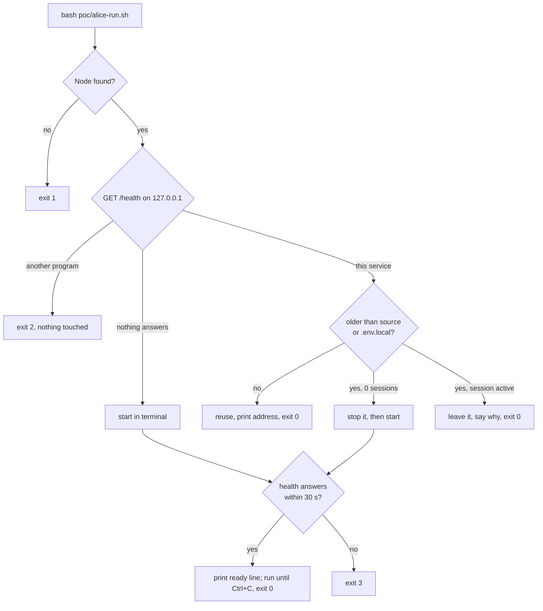

# SPRINT-003 contract: `poc/alice-run.sh`

Pablo wants one command that gets Alice ready: start the service, or reuse one already running, without ever interrupting a session or printing the key. This page turns the [decision path of service start and key](../05-high-level-design-and-architecture/01.4-service-start-and-key.md) into exact steps and exit codes for the shell check. It is part of the [specification](03.5-sprint-003-specification.md) and serves S003-RUN.

*The command makes no OpenAI request and prints nothing from `poc/.env.local` or the package.*

## Rules

| ID | Rule | Cites | Limit |
| --- | --- | --- | --- |
| RN-1 | The script takes no arguments. An argument prints a usage line and exits 64. | 05 01.4 | |
| RN-2 | It finds Node as `start.sh` does: `ALICE_GOOD_MEETINGS_NODE`, then `node` on the path, then the bundled Codex runtime. None found prints a message and exits 1. | 05 01.4 | |
| RN-3 | The port is `PORT` from the environment, else the `PORT=` line of `poc/.env.local` (no other line is read), else 3000. A value outside 1 to 65535 exits 64. | 05 01.4 | |
| RN-4 | It probes `http://127.0.0.1:PORT/health` with a 2-second limit, using the found Node, and decides: no connection, this service (`service` is `alice-good-meetings`), or another program. A listener that gives no reply within the 2 seconds, or a reply that is not this service's, counts as another program. | 05 01.4 | |
| RN-5 | Nothing answers: it starts the service (RN-10). | 05 01.4 | |
| RN-6 | Another program answers: it names the port in a message, exits 2 and starts or stops nothing. | 05 01.4 | |
| RN-7 | This service answers and is current: it prints the address, starts nothing and exits 0. | 04 [plan](../04-benchmarks-and-eval-strategy/03.6-sprint-003-evaluation-plan.md) | |
| RN-8 | The service is older when any service source file or `poc/.env.local` has a modification time later than `startedAt`. Service sources are the `poc/*.mjs` files the service imports; test, page-check, smoke and capture tools are not. | 05 01.4 | R6 |
| RN-9 | Older with `sessions` 0: it ends that service (found by its listening port, sent a stop request, waited up to 5 seconds) and then starts a new one; if it will not end, exit 3. Older with a session active: it leaves the service running, says a restart is pending because a session is active, prints the address and exits 0. It never interrupts a session. | 05 01.4 | R6 |
| RN-10 | To start, it passes `--env-file=.env.local` only when that file exists; otherwise it says recognition and proposed answers are unavailable until a key is added. The service runs in the terminal, and Ctrl+C ends it with exit 0. | 05 01.4 | |
| RN-11 | It prints "ready" with the address only after `/health` answers, polling for up to 30 seconds. If the service exits first or does not answer in time, it says so, stops it and exits 3. | 05 01.4 | |
| RN-12 | It never prints the key, the env file contents or package text, and never sources the env file. | 02 B2; AGENTS.md | |
| RN-13 | It makes no request to any host except `127.0.0.1`. | 04 plan | |
| RN-14 | It leaves `ALICE_PRINT_REQUEST` and other environment settings as it found them. | 05 01.5 | |

Whether it also opens the page was never put to Pablo; it does not (R6).
[Previous: page and preview](03.5.8-s003-page-and-preview.md) · [Index](03.5-sprint-003-specification.md) · [Next: review items](03.5.10-s003-review-items.md)
