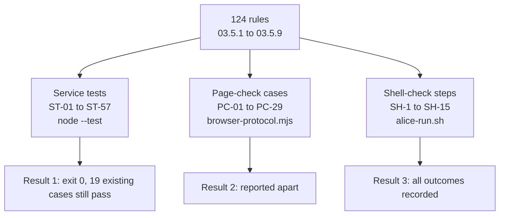

# SPRINT-003 test map: every rule has a check

Pablo needs to know that "it works" means something specific. This map ties each rule of the [SPRINT-003 specification](03.5-sprint-003-specification.md) to one named check, so the three results the sprint asks for, the service tests, the page check and the shell check, can each be read against a rule and nothing is checked that nobody specified.

*Three separate results, as the evaluation plan requires: any can pass while another fails.*

## Where the checks are

| Pages | Checks | Runs in | Task | Commitments |
| --- | --- | --- | --- | --- |
| [03.6.1](03.6.1-s003-service-tests-answer.md), [03.6.2](03.6.2-s003-service-tests-service.md) | ST-01 to ST-57 | `poc/poc.test.mjs` | T27 | TESTS, ANSWER, NOKEY, CONTEXT, DETAILS |
| [03.6.3](03.6.3-s003-page-checks.md) | PC-01 to PC-29 | `poc/browser-protocol.mjs` | T28 | PAGECHECK, GLANCE, DETAILS, NOKEY |
| [03.6.4](03.6.4-s003-shell-checks.md) | SH-1 to SH-15 | shell check of `poc/alice-run.sh` | T30 | RUN |
| [03.6.5](03.6.5-s003-coverage-by-rule.md) | none | the reverse view, rule by rule | | all |

## What is deliberately not a rule

These need a person and sit outside the 124 rules: the human part of the glance check (Pablo names the cue, the Focus question and the gist of the bullets), whether bullets fit the question, whether anything said about him is untrue, whether the details helped, and the live pass rule. They belong to the preview (T21) and the [live session](../04-benchmarks-and-eval-strategy/03.6.1-sprint-003-live-session.md) (T40).
Two procedures belong to 04 and are written on its page [03.8, the package and statement checks](../04-benchmarks-and-eval-strategy/03.8-sprint-003-package-and-statement-checks.md): the reviewer-run package check (file digests and shingle comparison reporting counts only) completes PK-10 for benchmark material, and the statement check compares the two data-statement pages with RQ-1 and RQ-5 (S003-STATEMENTS). Rule PK-11, checked by ST-57, keeps live code from reading `eval-data/`; the reviewer script is `poc/review/package-check.mjs`, written by 09 and run by the reviewer by hand. SH-15 is its own gate, run by a reviewer: it checks PV-6 and is not part of the shell check of `alice-run.sh` or of any product test.

## How a result is read

A rule passes when its checks pass. A check name must stay exact so a failing case points to one rule; if a case is renamed, the coverage page is regenerated. The limits and sizes are fixed by [03.5.11](03.5.11-s003-fixed-layout-values.md); the checks still read the constants (`BULLET_MAX`, `DETAILS_MAX`, the row heights) rather than repeat their values, so a later change touches one place.

## Status

Draft of 18 November 2026 by 08 Detailed Design under the plan's task T12. Nothing has been run, no test exists and no application file changed; saving this page records no acceptance. Return to the [specification](03.5-sprint-003-specification.md) or the [folder index](README.md).
