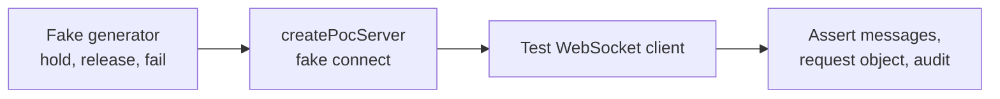

# SPRINT-003 test map: service tests for the answer

These named cases go into `poc/poc.test.mjs` (T27) and run with `node --test poc/poc.test.mjs`. Every case uses the [fixture hooks](03.5.7-s003-print-and-fixtures.md), a fake generator and a synthetic package, and none calls OpenAI. This page covers the request, the result and the controller; the [next page](03.6.2-s003-service-tests-service.md) covers the package, `/health`, retry, timing and the rest. It belongs to the [test map](03.6-sprint-003-test-map.md) and serves S003-TESTS and S003-ANSWER.

*A service test reads the request object and the messages; it never reaches the page or the network.*

| Check | Test title (exact) | Covers |
| --- | --- | --- |
| ST-01 | answer request has exactly five fields | RQ-1, RQ-3 |
| ST-02 | answer request question is the confirmed Focus text | RQ-2 |
| ST-03 | answer request documents are in name order and empty without a package | RQ-4 |
| ST-04 | model input holds only instructions, question and document text | RQ-5, RQ-6 |
| ST-05 | interview agent input never holds an answer or package text | RQ-7 |
| ST-06 | generator makes one call per attempt with no tools and its own model setting | RQ-8 |
| ST-07 | result keeps bullets and details as separate fields | RS-1 |
| ST-08 | bullets accept one to three single-line items within the length limit | RS-2 |
| ST-09 | details respect the limit and are required only with documents | RS-3 |
| ST-10 | malformed or oversized results are rejected whole and never cut | RS-4, RS-5 |
| ST-11 | answer area is empty at ready and uses only the six controller statuses | CT-2 |
| ST-12 | answer area is kept apart from state, snapshots and revision | CT-1 |
| ST-13 | Confirm sets Focus, preparing and one request in one update, result first | CT-3 |
| ST-14 | reworded Confirm replaces the answer and aborts the earlier request | CT-4, CT-5 |
| ST-15 | late result for an earlier version is dropped with its reason | CT-6 |
| ST-16 | accepted result is shown with a package and general with each loader reason | CT-7, LB-9 |
| ST-17 | result is published as one proposed message with a rising sequence | CT-8, CT-9 |
| ST-18 | result after speech starts is published silently and the cue is unchanged | CT-10, CT-17 |
| ST-19 | answer area cannot write Focus, Live or phase and never stales a Live update | CT-11 |
| ST-20 | two failed attempts give failed and the next Confirm starts afresh | CT-12 |
| ST-21 | Stop drops the pending result and keeps content as last known | CT-13 |
| ST-22 | new session starts empty after Stop | CT-14 |
| ST-23 | package is read once at session start | CT-15 |
| ST-24 | no key means no session and no request | CT-16, NK-4 |
