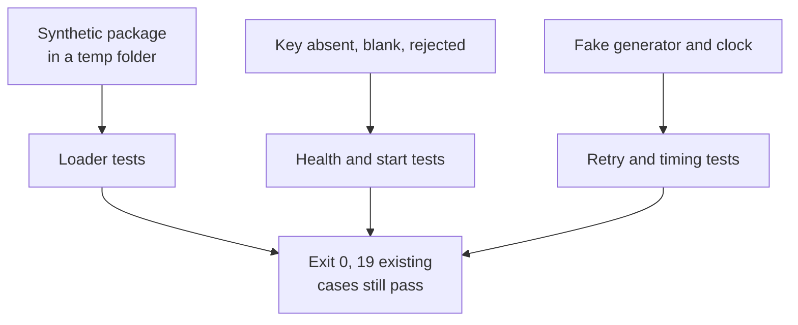

# SPRINT-003 test map: service tests for the package, health, retry and timing

These named cases also go into `poc/poc.test.mjs` (T27) and, like those on the [previous page](03.6.1-s003-service-tests-answer.md), call no OpenAI service. They cover the package loader at its 20,000 boundary, the three no-key cases, `/health`, the one retry, the timing points, the print option and the fixture hooks. The page belongs to the [test map](03.6-sprint-003-test-map.md) and serves S003-TESTS, S003-NOKEY and S003-CONTEXT.

*Each group uses its own fixture, so a failure points at one contract.*

| Check | Test title (exact) | Covers |
| --- | --- | --- |
| ST-25 | package folder is a setting and defaults to poc/context/interview | PK-1 |
| ST-26 | loader skips README, other extensions, dotfiles, links and subfolders | PK-2, PK-3, PK-7 |
| ST-27 | loader reads in name order as strict UTF-8 and one unreadable file voids the package | PK-4 |
| ST-28 | package of exactly 20,000 characters is used and 20,001 is not and is never cut | PK-5 |
| ST-29 | package status is none, empty, unreadable, too-large or usable in that order | PK-6 |
| ST-30 | package text is held in memory only and never appears in audit, log, health or messages | PK-8, PK-10 |
| ST-31 | package_loaded audit holds names, sizes and digests but no text | PK-9 |
| ST-32 | health returns the fixed fields on a GET-only no-store route | HL-1, HL-5 |
| ST-33 | health says not configured for an absent or blank key | HL-2, NK-2 |
| ST-34 | health never holds the key, file names, text or errors | HL-3, NK-7 |
| ST-35 | health reports whether a package was found and its size | HL-4 |
| ST-36 | service starts and listens with no key file | NK-1 |
| ST-37 | rejected key, by error code or a 401 handshake, ends the session with the public error text | NK-3 |
| ST-38 | session opened without a key says it needs a key and never connects | NK-8 |
| ST-39 | failed attempt is retried once with the same request | RT-1, RT-2 |
| ST-40 | second failure gives failed with two attempts and a text-free code | RT-3 |
| ST-41 | no retry after supersede or Stop | RT-4 |
| ST-42 | attempt timeout ends an attempt | RT-5 |
| ST-43 | retry sends the page no extra message | RT-6 |
| ST-44 | confirm time t0 and request start t1 use the injected clock | TM-1, TM-2 |
| ST-45 | answer_timing event holds the derived delays once per version | TM-6, TM-7 |
| ST-46 | answer audit events carry no text | TM-8 |
| ST-47 | print option is off by default and on only for exactly 1 | PR-1 |
| ST-48 | print option writes to standard error only, with its warning | PR-2, PR-3, PR-4 |
| ST-49 | injected generator and transcription replace the defaults | FX-1, FX-2 |
| ST-50 | injected clock, timeout and interview-agent delay work | FX-3 |
| ST-51 | fixture module returns the documented hooks | FX-4 |
| ST-52 | fixtures and synthetic package never touch eval-data | FX-5 |
| ST-53 | preview route serves its files and they refer to no outside address | PV-1, PV-2 |
| ST-54 | accepted result time t2 is when the complete result is in hand | TM-3 |
| ST-55 | render time t3 is the report naming this Focus version with shown or general | TM-4 |
| ST-56 | speech start is the first voiced packet after t0, or null | TM-5 |
| ST-57 | no poc source outside poc/review names eval-data, nothing outside poc/review imports the reviewer script, and the allowed 404 probe is listed | PK-11 |
