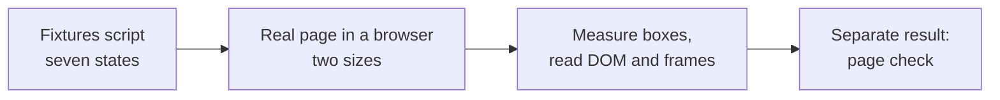

# SPRINT-003 test map: page-check cases

These cases extend `poc/browser-protocol.mjs` (T28). It drives the real page in an installed browser against a scripted session built from the [fixture hooks](03.5.7-s003-print-and-fixtures.md), at 1280 × 900 and 390 × 844. Its result is reported apart from `node --test`, because either can pass alone. The page belongs to the [test map](03.6-sprint-003-test-map.md) and serves S003-PAGECHECK, S003-GLANCE and S003-DETAILS.

*The glance check's layout part is measured here; Pablo's own part is judged in the preview and the live session.*

| Check | Case (exact name) | Covers |
| --- | --- | --- |
| PC-01 | empty state on ready | LB-1, PG-1 |
| PC-02 | preparing state shows no earlier text | LB-2, PG-9 |
| PC-03 | shown with the shortest content | LB-3, PG-1, PG-2 |
| PC-04 | shown with the longest content at 1280 by 900 with each cue: four elements visible, unclipped, not overlapped | PG-2 |
| PC-05 | shown with the longest content at 390 by 844 | PG-2, PG-4 |
| PC-06 | general state with each of four reasons | LB-4, LB-9 |
| PC-07 | failed state has no retry control | LB-5 |
| PC-08 | unavailable on load with no key shows the Unavailable text and reason | LB-6 |
| PC-09 | unavailable on load with no service | NK-6 |
| PC-10 | unavailable after a rejected key | NK-3 |
| PC-11 | last known after Stop and after a disconnect, with the Focus question's own last-known mark | LB-7, LB-10 |
| PC-12 | failed and unavailable are worded differently | LB-8 |
| PC-13 | reworded Confirm replaces the answer and the render report names its version | PG-8, PG-9 |
| PC-14 | proposed message for another version or lower sequence is ignored | PG-10 |
| PC-15 | markup in bullets and details shows as literal text | PG-12 |
| PC-16 | only same-origin requests and no package text in page or frames | PG-13, NK-7 |
| PC-17 | preview shows all states at both sizes with each cue | PV-3, PV-4, PV-5 |
| PC-18 | preview and page make no network request to another origin | PV-2, PG-13 |
| PC-19 | cue, timer, Confirm and Clear live work in each of the seven states, one loop with one assertion per state | PG-14 |
| PC-20 | cue word, Focus and Live text are no smaller than the recorded baseline sizes | PG-3 |
| PC-21 | longest details scroll inside their area while the four elements keep position and size | PG-4 |
| PC-22 | the answer area holds no collapse, retry, button or link | PG-5 |
| PC-23 | content changes with no animation, transition or sound | PG-6 |
| PC-24 | no answer text appears inside the Focus or Live elements | PG-7 |
| PC-25 | on load with no key, Start is disabled with its reason while the timer and cue buttons work | NK-5, PG-11 |
| PC-26 | the page makes exactly one health request on load | HL-6 |
| PC-27 | last known keeps a General answer's tag and reason and a Failed answer's note | LB-7 |
| PC-28 | the four glance rows have the fixed heights at 1280 by 900 and 390 by 844 in every state | PG-15 |
| PC-29 | the controls and Confirm and Clear live sit where the approved preview puts them | PG-16 |
