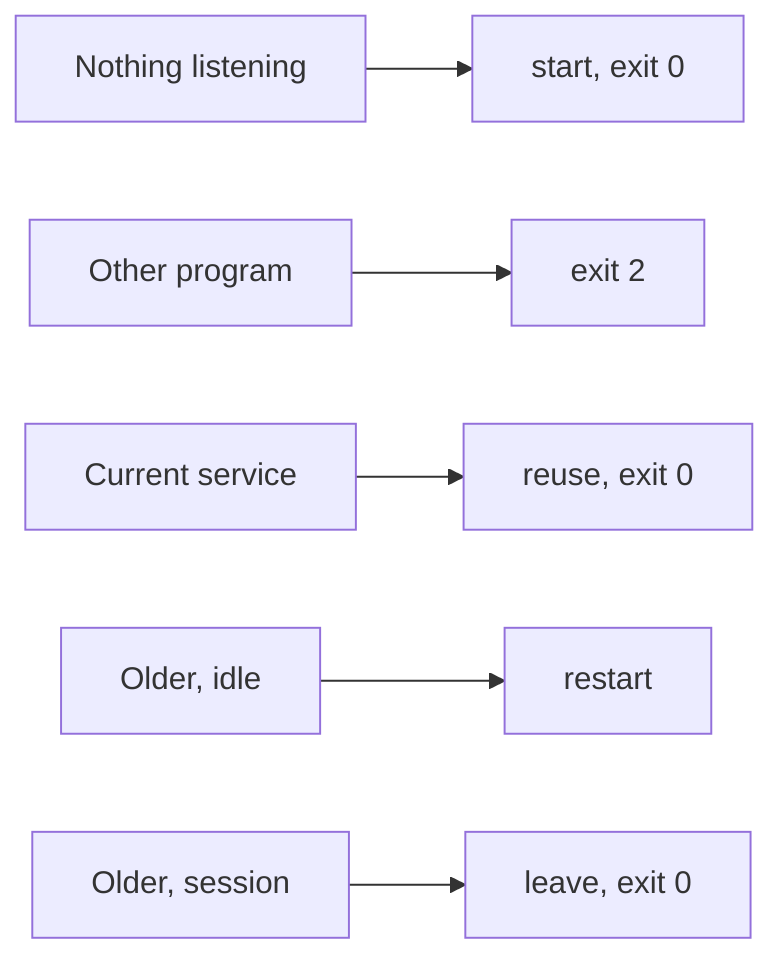

# SPRINT-003 test map: shell-check steps for `poc/alice-run.sh`

09 writes this check with the script (T30) and 10 ReviewQA reviews it. Each step runs the real script against a stand-in service and records the exit code and the message. Steps use a free port, a fake key value such as `sk-test-sentinel` and a temporary copy of `poc/.env.local`; none contacts OpenAI. The page belongs to the [test map](03.6-sprint-003-test-map.md) and serves S003-RUN.

*The three plan outcomes (start, reuse, refuse another program) are SH-1, SH-3 and SH-2; the rest are the rules around them.*

| Check | Step | Covers |
| --- | --- | --- |
| SH-1 | with nothing on the port, the script starts the service, prints ready only after health answers, and ends with exit 0 on Ctrl+C | RN-5, RN-10, RN-11 |
| SH-2 | with another program on the port, exit 2, the port named, the other program untouched | RN-4, RN-6 |
| SH-3 | with a current service running, exit 0, address printed, no second process | RN-7 |
| SH-4 | with no `poc/.env.local`, the service starts, the message names the missing key, health says not configured | RN-10 |
| SH-5 | with an older idle service, it is ended and a new one has a later `startedAt` | RN-8, RN-9 |
| SH-6 | with an older service and an open session, it is left running and the session is not interrupted | RN-9 |
| SH-7 | the output never holds the key sentinel, env file contents or package text | RN-12 |
| SH-8 | with no Node found, exit 1 with a message | RN-2 |
| SH-9 | with an argument, a usage line and exit 64; with a bad port, exit 64 | RN-1, RN-3 |
| SH-10 | with a service that never answers, exit 3 and the process is stopped | RN-11 |
| SH-11 | a scan of the script for any host other than 127.0.0.1, and a run with the print variable set shows it unchanged in the service | RN-13, RN-14 |
| SH-12 | with an older idle service that will not end within 5 seconds, exit 3 with a message and the new service not started | RN-9 |
| SH-13 | with a listener that never replies to the probe, the probe ends after 2 seconds and the script exits 2 | RN-4 |
| SH-14 | with a service that exits before it answers health, exit 3 and no ready line | RN-11 |
| SH-15 | **Gate, its own check, run by a reviewer and not by the script's shell check:** `index.html` is unchanged since the pre-approval revision, and the approval record's preview hashes equal the files' current SHA-256 | PV-6 |
