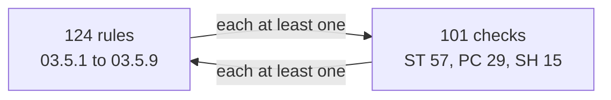

# SPRINT-003 test map: coverage by rule

This page is the reverse view of the three check pages: each rule of the [specification](03.5-sprint-003-specification.md) with the checks that establish it. It lets a reviewer see at once that no rule is unchecked. It was generated from the tables of the check pages by a script that also verified the converse, so it must be regenerated whenever a rule or a check changes. It belongs to the [test map](03.6-sprint-003-test-map.md).

*Verified on 18 November 2026: no rule is without a check and no check is without a rule. This is a document check, not a test run.*

| Group | Rule → checks |
| --- | --- |
| RQ | RQ-1 → ST-01; RQ-2 → ST-02; RQ-3 → ST-01; RQ-4 → ST-03; RQ-5 → ST-04; RQ-6 → ST-04; RQ-7 → ST-05; RQ-8 → ST-06 |
| RS | RS-1 → ST-07; RS-2 → ST-08; RS-3 → ST-09; RS-4 → ST-10; RS-5 → ST-10 |
| PG | PG-15 → PC-28; PG-16 → PC-29; PG-1 → PC-01, PC-03; PG-2 → PC-03, PC-04, PC-05; PG-3 → PC-20; PG-4 → PC-05, PC-21; PG-5 → PC-22; PG-6 → PC-23; PG-7 → PC-24; PG-8 → PC-13; PG-9 → PC-02, PC-13; PG-10 → PC-14; PG-11 → PC-25; PG-12 → PC-15; PG-13 → PC-16, PC-18; PG-14 → PC-19 |
| CT | CT-1 → ST-12; CT-2 → ST-11; CT-3 → ST-13; CT-4 → ST-14; CT-5 → ST-14; CT-6 → ST-15; CT-7 → ST-16; CT-8 → ST-17; CT-9 → ST-17; CT-10 → ST-18; CT-11 → ST-19; CT-12 → ST-20; CT-13 → ST-21; CT-14 → ST-22; CT-15 → ST-23; CT-16 → ST-24; CT-17 → ST-18 |
| LB | LB-1 → PC-01; LB-2 → PC-02; LB-3 → PC-03; LB-4 → PC-06; LB-5 → PC-07; LB-6 → PC-08; LB-7 → PC-11, PC-27; LB-8 → PC-12; LB-9 → ST-16, PC-06; LB-10 → PC-11 |
| HL | HL-1 → ST-32; HL-2 → ST-33; HL-3 → ST-34; HL-4 → ST-35; HL-5 → ST-32; HL-6 → PC-26 |
| NK | NK-1 → ST-36; NK-2 → ST-33; NK-3 → ST-37, PC-10; NK-4 → ST-24; NK-5 → PC-25; NK-6 → PC-09; NK-7 → ST-34, PC-16; NK-8 → ST-38 |
| PK | PK-1 → ST-25; PK-2 → ST-26; PK-3 → ST-26; PK-4 → ST-27; PK-5 → ST-28; PK-6 → ST-29; PK-7 → ST-26; PK-8 → ST-30; PK-9 → ST-31; PK-10 → ST-30; PK-11 → ST-57 |
| RT | RT-1 → ST-39; RT-2 → ST-39; RT-3 → ST-40; RT-4 → ST-41; RT-5 → ST-42; RT-6 → ST-43 |
| TM | TM-1 → ST-44; TM-2 → ST-44; TM-3 → ST-54; TM-4 → ST-55; TM-5 → ST-56; TM-6 → ST-45; TM-7 → ST-45; TM-8 → ST-46 |
| PR | PR-1 → ST-47; PR-2 → ST-48; PR-3 → ST-48; PR-4 → ST-48 |
| FX | FX-1 → ST-49; FX-2 → ST-49; FX-3 → ST-50; FX-4 → ST-51; FX-5 → ST-52 |
| PV | PV-1 → ST-53; PV-2 → ST-53, PC-18; PV-3 → PC-17; PV-4 → PC-17; PV-5 → PC-17; PV-6 → SH-15 |
| RN | RN-1 → SH-9; RN-2 → SH-8; RN-3 → SH-9; RN-4 → SH-2, SH-13; RN-5 → SH-1; RN-6 → SH-2; RN-7 → SH-3; RN-8 → SH-5; RN-9 → SH-5, SH-6, SH-12; RN-10 → SH-1, SH-4; RN-11 → SH-1, SH-10, SH-14; RN-12 → SH-7; RN-13 → SH-11; RN-14 → SH-11 |

Rules not covered by any check: none. Checks with no rule: none. Judgment items that have no rule, and are checked by Pablo in the preview and the live session, are listed on the [test map](03.6-sprint-003-test-map.md).
