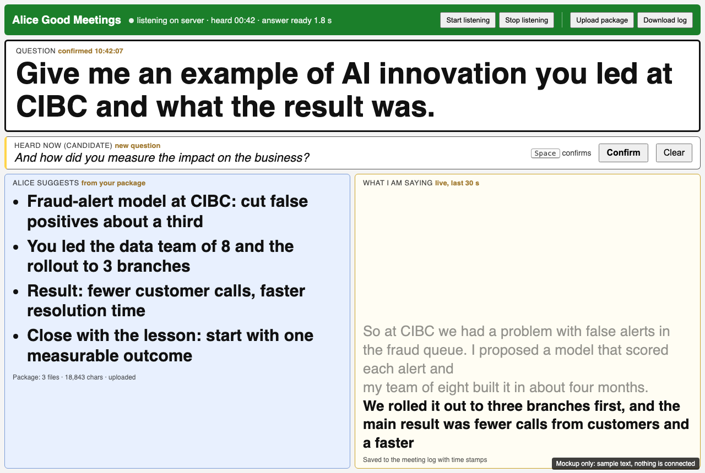

# SPRINT-004 screen specification: a calmer meeting screen with upload and a log

Alice (Alice.Good.Meetings) is used by one person, Pablo, who glances at it from a second monitor while he is in an interview or a meeting. For SPRINT-004 he asked for a new screen: a slim bar, the confirmed question very large, a smaller candidate question, Alice's suggestions beside what he is saying, buttons to upload his package and download a meeting log, and fewer boxes. This specification turns his requests into exact areas, sizes, states and behavior, each tied to a check. It is a draft for the sprint that is still only a [plan](../07-planning/03.14-sprint-004-working-plan.md); nothing is built and no sprint is started.

*The input mockup, drafted by 00 Governance outside its role from Pablo's words; sample text, not an approved design, not a screenshot of Alice. HTML and picture are kept in `images/` (SHA-256 `7df691a0…` and `cac35295…`). Pablo accepted the departures from it listed under Q13 on 19 November 2026.*

## Pages

| Page | Content | Rule IDs |
| --- | --- | --- |
| [03.7.1](03.7.1-s004-screen-areas.md) | Areas, sizes, fonts, bold, contrast | SA |
| [03.7.2](03.7.2-s004-screen-states.md) | Six states and their wording | SS |
| [03.7.3](03.7.3-s004-controls-and-inputs.md) | Buttons, Space, the input tools kept | SC |
| [03.7.4](03.7.4-s004-upload-and-download.md) | Upload package and Download log | SU, SD |
| [03.7.5](03.7.5-s004-meeting-log.md) | Meeting log content and format | ML |
| [03.7.6](03.7.6-s004-meeting-log-storage.md) | Log storage, privacy | MS |
| [03.7.7](03.7.7-s004-open-questions.md) | Decision record and what is still owed | Q1 to Q14 |
| [03.7.8](03.7.8-s004-answer-without-details.md) | The answer without details | AD |
| [03.7.9](03.7.9-s004-avatar.md) | The small avatar of Alice | AV |
| [03.8](03.8-sprint-004-test-map.md) | Test map and tie to the plan's commitments | ST4, PC4, SH4 |

## Pablo's requests

His nine requests, with 91 rules and 106 checks behind them, are named UI-1 to UI-9 in the rule tables: UI-1 the bar, UI-2 the question, UI-3 the candidate line, UI-4 the two columns, UI-5 bold, UI-6 fewer boxes, UI-7 the meeting log, UI-8 scrolling, UI-9 keeping every input tool. The plan's criterion 5 asks for each as a criterion of its own.

## What to know before reading

- **Decided 19 November 2026.** The cue buttons become the keys G, L and S, Esc clears, the package line gets a Remove, bullets stay at three, the details are no longer requested, the right column is "What I hear", a manual cue holds for 10 seconds, the log is kept in `poc/logs/` and a small avatar moves in the bar as a named exception to the no-motion rule. **Changed 22 November 2026:** Pablo removed the keys G, L and S and the 10-second hold; the cue is the timer's alone. The decision record is [03.7.7](03.7.7-s004-open-questions.md); rules that changed are marked "Changed" or "New".
- **Still owed.** Nothing from Pablo on this screen; he has no more UI ideas for now. The plan now carries the log as S004-LOG; S004-GUARD moved to SPRINT-005 and nothing here depends on it.
- **Dependencies.** 05 must accept the upload design and a transcript message with items; 03 and 04 need scenarios and checks for the screen.

## OpenSpec change

The implementation-facing change is `openspec/changes/sprint-004-upload-log-and-screen/` (proposal, design, six specs and tasks); it links to these rules and copies none. It validated with `openspec validate --strict`.

## Status

Draft of 19 November 2026, updated the same day after Pablo's answers by 08 Detailed Design at the request of 00 Governance. It approves nothing, edits no application code and records no acceptance. Return to the [folder index](README.md).
