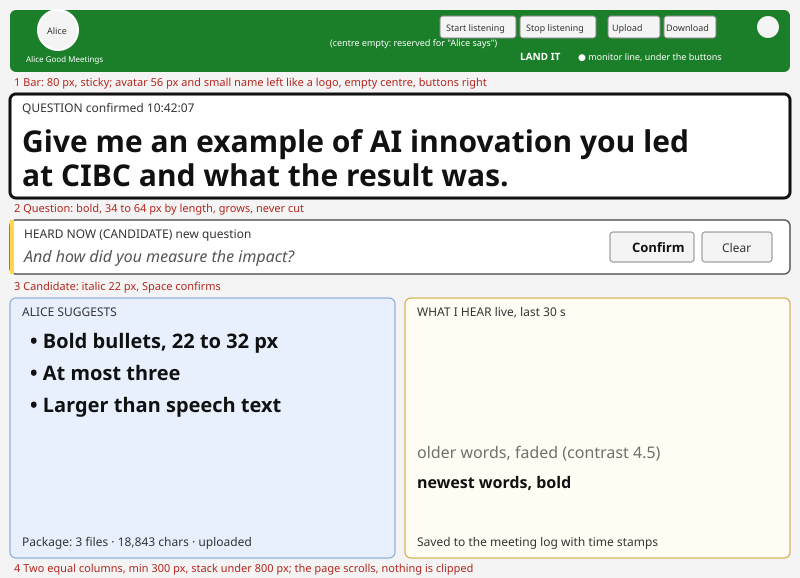

# SPRINT-004 screen: areas, sizes, fonts and bold

Pablo reads this screen from a second monitor while he is in a meeting, so the confirmed question must dominate and everything else must be easy to place at a glance. This page fixes the areas of the new screen, the sizes or ranges of each, and what is bold. It is part of the [screen specification](03.7-sprint-004-screen-specification.md) and works from the [mockup](images/s004-alice-ui-v2-mockup.png), which is input and not an approved design.

*Representative labelled wireframe of the screen, not a screenshot; sizes are for 1280 × 900. [Editable SVG](images/s004-screen-areas.svg).*

## Rules

"Ties to" names Pablo's request UI-1 to UI-9 and, where one applies, the criterion of the [07 plan](../07-planning/03.14-sprint-004-working-plan.md). Sizes are CSS pixels; ranges follow the window height (`vh`).

| ID | Rule | Ties to |
| --- | --- | --- |
| SA-1 | Five areas stack top to bottom: bar, Question, Candidate line, then two columns. Nothing else is visible: no Details box, no second question boxes, no Good, Land it or Stop buttons, no server or debug readout unless `#diagnostics` is in the address. | UI-1, UI-6; S004-SCREEN |
| SA-2 | The page scrolls vertically in a short window and no area clips its content: no area hides overflow, text wraps, nothing is truncated or placed off screen, and there is no horizontal scroll from 320 px wide. | UI-8; S004-SCREEN |
| SA-3 | **Changed (Q2, avatar, logo on the left).** The bar is 80 px high (76 to 84), full width and sticky at the top, so the cue colour stays visible while the page scrolls; in a window under 640 px high it is 56 px and grows rather than clip. From 900 px wide it has a left block, an empty centre and a right block: on the left the avatar with the name under it like a logo (AV-1, SA-5); on the right Start and Stop listening, a divider, Upload package, Download log and the avatar toggle (AV-5) in one row, and under them one row with the cue word and the monitor line (SA-6). Under 900 px the right block wraps to a row of its own below the left block. | UI-1; UI-8; S004-SCREEN |
| SA-4 | The bar's colour is the cue: GOOD `#1b7f2a`, LAND IT amber `#a35c00`, STOP `#b3261e`; text on it is white. The cue changes by the existing timer, 25 s for LAND IT and 35 s for STOP, or by a key (SC-2). Decided Q13: the amber differs from the mockup's `#b36b00`, which gives only 4.18:1 with white. `#a35c00` gives 5.14:1. | UI-1; S004-SCREEN |
| SA-5 | **Changed (Q2, logo).** With the avatar shown, the name "Alice Good Meetings" is a caption under its head: 11 px, regular, white, centred, on one line (two, "Alice Good / Meetings", under 500 px wide); it is hidden in a window under 640 px high. Without the avatar (off, failed or reduced motion) the left block shows the name at 20 px bold on one line, as the page had before. The cue word (GOOD, LAND IT or STOP) is 16 px bold white at the left of the right block's second row, and the bar's accessible name carries the cue (for example "Cue: LAND IT"). | UI-1; S004-SCREEN |
| SA-6 | **Changed (logo on the left).** The monitor line is 15 px, regular, in the second row of the right block after the cue word, right-aligned under the buttons, and wraps instead of truncating. It shows a dot that is lit while audio arrives, the status, seconds heard and the last answer delay. | UI-1; S004-SCREEN |
| SA-7 | **Changed (avatar).** Bar buttons are 14 px with at least 32 px of height, in this order: Start listening, Stop listening, Upload package, Download log, then the avatar toggle when shown. | UI-1, UI-9; S004-SCREEN |
| SA-8 | The Question box has a 3 px `#111` border, a 13 px upper-case label with a bold tag, and the question in bold 700. Size by text length: up to 90 characters clamp(34px, 6.2vh, 64px); 91 to 180 clamp(28px, 4.8vh, 48px); over 180 clamp(24px, 3.8vh, 36px). The box grows with the text and never truncates it. | UI-2; S004-SCREEN |
| SA-9 | The Candidate line has a 4 px accent left border, a 13 px label with its tag, italic text at 22 px (20 to 24) that wraps fully, then the hint "Space confirms" (14 px), Confirm (16 px) and Clear (16 px). | UI-3; S004-SCREEN |
| SA-10 | Two equal columns with an 8 px gap and a minimum height of 300 px, equal in height. Under 800 px wide they stack, Alice suggests first. | UI-4, UI-8; S004-SCREEN |
| SA-11 | "Alice suggests": label with tag, then bold bullets at clamp(22px, 3.4vh, 32px) with line height 1.22, at most three, each at most 120 characters (decided Q3: the mockup's fourth bullet is not used), and a 12 px package line at the foot. | UI-4; S003 RS-2; S004-SCREEN |
| SA-12 | **Changed (Q12).** The right column is labelled "What I hear", with tag "live, last 30 s", then text at 26 px (22 to 28), line height 1.3, anchored to the bottom, with a 12 px foot. The newest words are bold 700; older words are regular and faded. | UI-4; S004-SCREEN |
| SA-13 | Size order holds at every window height: Question text at least 1.5 times the bullet size, bullets at least the speech size, speech at least the candidate size. | UI-2, UI-4; S004-SCREEN |
| SA-14 | **Changed (logo).** Bold (weight 700) is on exactly: the cue word, the Question text, the tags, the bullets, the newest words, an enabled Confirm, every error or notice line and, only when the avatar is absent, the 20 px name. The caption under the avatar, labels, the monitor line, hints, older words and foots are regular. | UI-5; S004-SCREEN |
| SA-15 | Text contrast is at least 4.5:1, or 3:1 for text at 24 px or 18.66 px bold and larger. Older words use opacity 0.6 or more (4.93:1); the mockup's 0.45 gives 3.02:1. | UI-5; purpose; S004-SCREEN |
| SA-16 | **Changed (avatar).** Content changes in place with no animation, transition or sound, and all service text is shown as plain text. The one exception is the avatar box of AV-1: it alone may move, inside its box, and nothing outside it animates or flashes. | UI-9; S003 PG-6, PG-12; S004-SCREEN |
| SA-17 | **Changed (05 decision).** The service's `transcript` message is a snapshot that replaces the last one: `items` (`id` as the log's `itemId`, `text`, `final`, `at` in ms from the session start) for the last 30 s, at most 8 items and 1500 characters. Partial text goes to the page and is never logged. The item still being transcribed, else the latest final item, is bold; every earlier item is faded. Newest is decided per item, not per word (decided Q11). | UI-4; S004-SCREEN |
| SA-18 | **New (S004-MEETING).** Visible screen text, tooltips and accessible names say "meeting" and never "interview": the name "Alice Good Meetings", the meeting log, Download log. Interviews are one kind of meeting; internal names such as the package folder are not shown. | UI-1; S004-MEETING |
| SA-19 | **New (logo).** The centre of the bar between the left and the right block is reserved for a future "Alice says" message area. In this sprint it is empty: it holds no text, border, placeholder or control, and from 900 px wide it keeps at least a quarter of the bar's width. | UI-1; S004-SCREEN |

[Index](03.7-sprint-004-screen-specification.md) · [Next: states](03.7.2-s004-screen-states.md)
