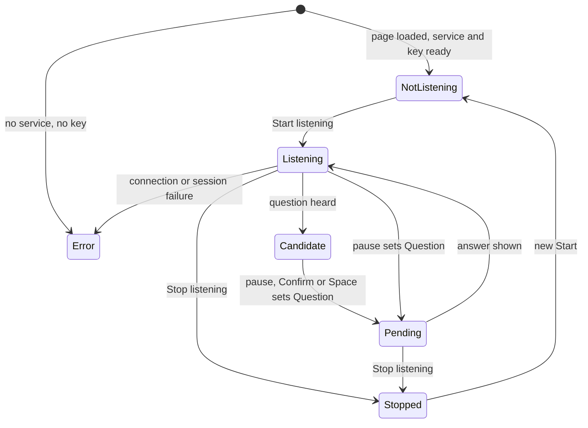

# SPRINT-004 screen: the states and their wording

The screen is always in some state, and Pablo must be able to tell which one in a glance, in particular whether Alice is listening, whether a question is waiting to be confirmed and why an answer is missing. This page lists the states, what each area shows and the exact wording. It is part of the [screen specification](03.7-sprint-004-screen-specification.md) and uses the answer wording of [03.5.3](03.5.3-s003-answer-labels.md) where it exists.

*Package missing is not a state of its own: it is a notice that combines with any state above, and Error is a banner over them.*

## Rules

Wording in quotation marks is proposed and shown in the same place in every state; "Q" numbers are on the [open questions](03.7.7-s004-open-questions.md).

| ID | State and what the page shows | Ties to |
| --- | --- | --- |
| SS-1 | **Not listening.** Bar green, monitor "not listening", Start and Upload enabled, Stop disabled. Question "No question yet"; candidate "Not listening", Confirm and Clear disabled; Alice column "An answer appears when Alice hears a question and you pause."; speech column "Not listening". | UI-1 to UI-4; S004-SCREEN |
| SS-2 | **Listening.** Monitor "● listening on server · heard 00:42"; Start and Upload disabled, Stop enabled; candidate "Waiting for a question"; the speech column fills. After a pause with no new question the candidate area says "No new question heard." in regular text, never as an error. | UI-3, UI-4; S004-SCREEN |
| SS-3 | **Candidate present.** The candidate text and its tag ("new question" or "restatement") show; Confirm is enabled and bold, Clear is enabled, and "Space confirms" is visible. The Question box does not change. | UI-3; S004-SCREEN |
| SS-4 | **Answer pending.** The Question box shows the new text with the tag "confirmed 10:42:07" and its source ("by pause", "by Confirm" or "by Space"); the candidate area is cleared; the Alice column says "Preparing an answer for this question." with no earlier bullets; the monitor adds "preparing an answer". | UI-2, UI-4; S004-SCREEN |
| SS-5 | **Answer shown.** The bullets appear complete and together in the Alice column with the tag "from your package", or "general" for general points with its reason (03.5.3 LB-4); the monitor shows "answer ready 1.8 s". | UI-4; S004-SCREEN |
| SS-6 | **Error.** A bold notice row of full width appears between the bar and the Question box with the cause, and clears when the cause goes. Causes and wording: "The Alice service is not running.", "No OpenAI key is set up.", "OpenAI did not accept the key.", "Microphone access was refused.", "Connection to transcription was lost; stop and restart.", "Session limit reached (30 minutes); stop and restart.". A failed answer shows "No proposed answer for this question." in the Alice column. With no service or key, Start and Upload are disabled with the cause. | UI-1; S003 NK; S004-SCREEN |
| SS-7 | **Package missing.** The Alice column's package line says in bold "No package: answers are general." (or "Package over 20,000 characters, not used.", "Package is empty, not used.", "Package could not be read, not used."), answers carry the general tag, and Upload stays enabled. It is a notice, not an error. | S004-STATUS; UI-4 |
| SS-8 | **Stopped.** The Question box and the Alice column keep their content with the tag "Last known, not live"; the speech column keeps its text, all faded, with nothing bold; Start, Upload and Download are enabled. | S003 LB-7, LB-10; S004-SCREEN |
| SS-9 | **Uploading.** The package line says "Loading package…", Upload is disabled, and nothing else changes; the result follows [03.7.4](03.7.4-s004-upload-and-download.md). | S004-UPLOAD |
| SS-10 | States combine: an error row and a package notice may both show; the Question, candidate and columns always show the latest content for their own state. No state hides the bar or its buttons. | UI-8, UI-9; S004-SCREEN |
| SS-11 | **New (Q14), changed (sprint-align).** **Manual cue.** After G, L or S the bar shows the chosen colour and cue word for 10 seconds in any state, then the timer's cue returns. A later key wins and restarts the 10 seconds. A new question, a Focus change, Start or Stop does not end the hold. The monitor line, columns and buttons do not change. | UI-1, UI-9; S004-SCREEN |

The seven answer states of UC-05 ([01.5.1](../03-system-model-and-use-cases/01.5.1-proposed-answer-states.md): Empty, Preparing, Shown, General, Failed, Unavailable, Last known) are a different list from these screen states. They map as: SS-1 shows Empty or Unavailable, SS-4 Preparing, SS-5 Shown or General, SS-6 Failed or Unavailable, SS-8 Last known. The page checks name both lists ([03.8.3](03.8.3-s004-page-checks-behavior.md)).

[Previous: areas](03.7.1-s004-screen-areas.md) · [Index](03.7-sprint-004-screen-specification.md) · [Next: controls](03.7.3-s004-controls-and-inputs.md)
