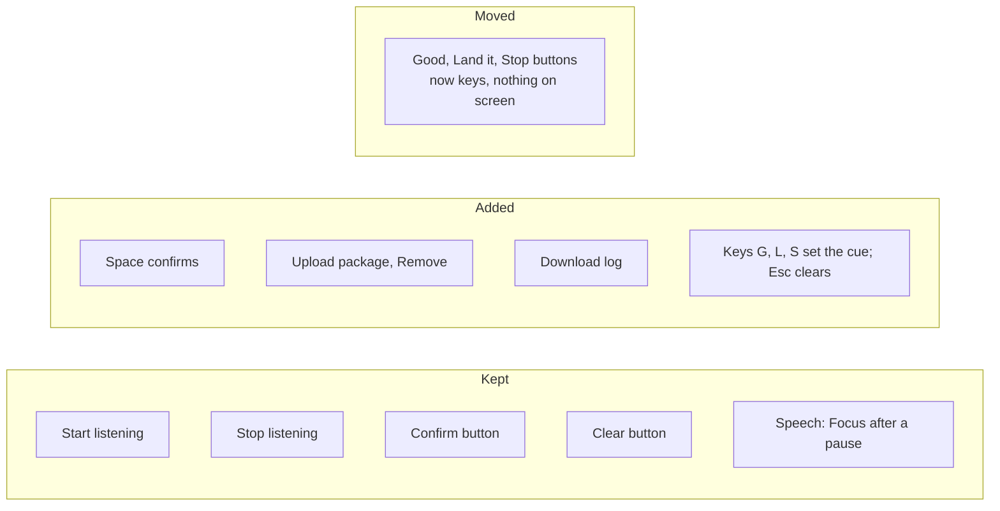

# SPRINT-004 screen: controls and input tools

Pablo asked for fewer buttons and for Space to confirm, and also for no input tool to be removed: "add, never remove". This page lists every control and input channel of the new screen and which are new; where the two requests collided he decided (Q1) to keep the cue function as keys. It is part of the [screen specification](03.7-sprint-004-screen-specification.md).

*Pablo decided on 19 November 2026: the manual cue buttons leave the screen and keep their function as keys.*

## Rules

| ID | Rule | Ties to |
| --- | --- | --- |
| SC-1 | **Changed (Q5).** Enabled states: Start listening when not listening and the service and key are ready; Stop listening while listening; Upload package when not listening and not already loading; Download log always, as in SD-2; Remove package only when a package is loaded and the page is not listening; Confirm and Clear only while a candidate is present. A disabled control keeps its place and its cause appears as visible text (SS-6, SS-7), not only as a tooltip. | UI-1, UI-9; S004-CUE |
| SC-2 | **Changed (Q1, Q14).** The Good, Land it and Stop buttons are not in the page. The keys G, L and S set the cue to GOOD, LAND IT and STOP: the bar and the cue word change at once and the cue is held for 10 seconds (`CUE_HOLD_MS` 10,000), during which the timer does not change it. The latest key wins and restarts the hold, and a new question does not end it. After the hold the timer's own cue resumes, which is GOOD when not listening. Nothing for the keys shows on screen. | UI-1, UI-9; S004-CUE |
| SC-3 | Space confirms the candidate when one is present and keyboard focus is not on a button, link or text field. It then sends the same confirmation as the Confirm button and the page does not scroll. Otherwise Space keeps its normal behavior. After Start, Stop, Upload or Download is pressed the page releases focus from that button, so Space is free to confirm. | UI-3, UI-9; S004-CUE |
| SC-4 | The Confirm button and Space send the identical `question.confirm` request for exactly the Live wording displayed, plus a field `via` (`button` or `space`) that only the meeting log uses. | UI-3; UC-04; S004-CUE |
| SC-5 | **Changed (Q4).** Clear keeps its behavior (`question.reset`, never writes the Question). The Esc key also clears the candidate, with `via` `escape` for the log. | UI-3, UI-9; S004-CUE |
| SC-6 | Speech is an input channel and keeps working as today: a clear question before a pause sets the Question automatically, and Confirm and Space stay optional. | UI-9; 05 01.7; S004-CUE |
| SC-7 | **Changed (Q1, Q4, Q5, avatar).** Input inventory after this sprint is Start, Stop, Confirm, Clear, Space, Esc, the keys G, L and S, the key A and the avatar toggle, Upload, Remove, Download and speech. Every input of the SPRINT-003 page remains, the three cue buttons as keys. | UI-9; S004-CUE |
| SC-8 | **Changed (avatar).** Every control is reachable by Tab in the order of the screen (Start, Stop, Upload, Download, the avatar toggle, Confirm, Clear) and shows a 3 px accent outline when focused. | UI-9; S004-CUE |
| SC-9 | **Changed (Q5, Q6, avatar).** No control is added beyond those listed in SC-7, the avatar toggle included. There is no control to hide the monitor line (Q6). | UI-9; S004-CUE |
| SC-10 | **New (Q1, Q4), changed (sprint-align, avatar).** The keys Space, Esc, G, L, S and A act only when keyboard focus is not on a button, link or text field and no modifier key is held. While a button has focus, G, L, S, A and Esc do nothing and Space presses that button. G, L, S and A work in every state; Space and Esc only while a candidate is present. | UI-9; S004-CUE |
| SC-11 | **New (sprint-align).** The cue timer and the 10-second hold take their time only from the page's standard clock (`performance.now()`, `Date` and timers), so the page check can control and advance it with its clock emulation instead of waiting. No test-only code path is added. | UI-9; S004-CUE |

## How the collision was settled

Request 1 removed the three manual cue buttons and request 9 said to keep every input tool. Pablo decided on 19 November 2026 to keep them as keys G, L and S with nothing on screen (Q1), and to add Esc for Clear (Q4). In the SPRINT-003 code the timer took a manual cue back at its next update while listening; Pablo decided on 19 November 2026 that a manual cue holds for 10 seconds and then the timer resumes (Q14, SC-2, SS-11).
A global Space or Esc key stops the browser's own Space scroll and Esc behavior only while a candidate is present; SC-10 limits it so Tab, a focused button or a text field keep working.

[Previous: states](03.7.2-s004-screen-states.md) · [Index](03.7-sprint-004-screen-specification.md) · [Next: upload and download](03.7.4-s004-upload-and-download.md)
