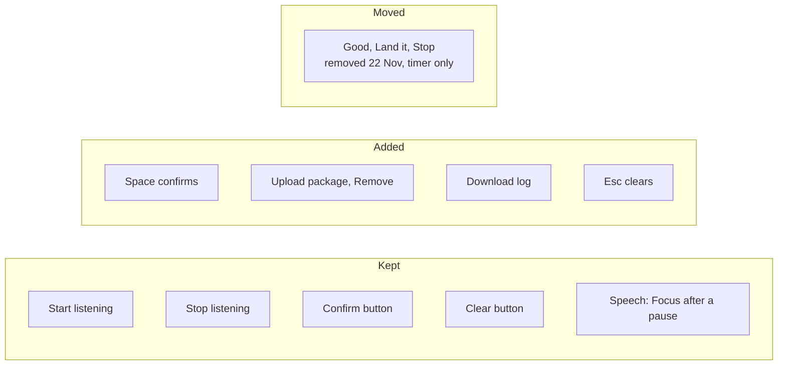

# SPRINT-004 screen: controls and input tools

Pablo asked for fewer buttons and for Space to confirm, and also for no input tool to be removed: "add, never remove". This page lists every control and input channel of the new screen and which are new; where the two requests collided he decided (Q1) to keep the cue function as keys. It is part of the [screen specification](03.7-sprint-004-screen-specification.md).

*Pablo decided on 19 November 2026 that the manual cue buttons become keys, and on 22 November 2026 that they are removed (the keys and the hold with them): the cue is set only by the timer.*

## Rules

| ID | Rule | Ties to |
| --- | --- | --- |
| SC-1 | **Changed (Q5).** Enabled states: Start listening when not listening and the service and key are ready; Stop listening while listening; Upload package when not listening and not already loading; Download log always, as in SD-2; Remove package only when a package is loaded and the page is not listening; Confirm and Clear only while a candidate is present. A disabled control keeps its place and its cause appears as visible text (SS-6, SS-7), not only as a tooltip. | UI-1, UI-9; S004-CUE |
| SC-2 | **Changed (22 Nov 2026, Pablo's decision).** The Good, Land it and Stop buttons are not in the page, and the keys G, L and S, and the 10-second manual cue hold, are removed: pressing them does nothing. The cue word and bar colour are set only by the timer (LAND IT at 25 s, STOP at 35 s, GOOD when not listening). This removes no tool Pablo uses: he said there is no point in telling himself good, land it or stop. | Pablo 22 Nov; UI-1, UI-9; S004-CUE |
| SC-3 | Space confirms the candidate when one is present and keyboard focus is not on a button, link or text field. It then sends the same confirmation as the Confirm button and the page does not scroll. Otherwise Space keeps its normal behavior. After Start, Stop, Upload or Download is pressed the page releases focus from that button, so Space is free to confirm. | UI-3, UI-9; S004-CUE |
| SC-4 | The Confirm button and Space send the identical `question.confirm` request for exactly the Live wording displayed, plus a field `via` (`button` or `space`) that only the meeting log uses. | UI-3; UC-04; S004-CUE |
| SC-5 | **Changed (Q4).** Clear keeps its behavior (`question.reset`, never writes the Question). The Esc key also clears the candidate, with `via` `escape` for the log. | UI-3, UI-9; S004-CUE |
| SC-6 | Speech is an input channel and keeps working as today: a clear question before a pause sets the Question automatically, and Confirm and Space stay optional. | UI-9; 05 01.7; S004-CUE |
| SC-7 | **Changed (22 Nov 2026, Pablo's decision).** Input inventory after this sprint is Start, Stop, Confirm, Clear, Space, Esc, the key A and the avatar toggle, Upload, Remove, Download and speech. The keys G, L and S are no longer inputs (SC-2); every other input of the SPRINT-003 page remains. | UI-9; S004-CUE |
| SC-8 | **Changed (avatar).** Every control is reachable by Tab in the order of the screen (Start, Stop, Upload, Download, the avatar toggle, Confirm, Clear) and shows a 3 px accent outline when focused. | UI-9; S004-CUE |
| SC-9 | **Changed (Q5, Q6, avatar).** No control is added beyond those listed in SC-7, the avatar toggle included. There is no control to hide the monitor line (Q6). | UI-9; S004-CUE |
| SC-10 | **Changed (22 Nov 2026, Pablo's decision).** The keys Space, Esc and A act only when keyboard focus is not on a button, link or text field and no modifier key is held. While a button has focus, A and Esc do nothing and Space presses that button. A works in every state; Space and Esc only while a candidate is present. G, L and S have no function. | UI-9; S004-CUE |
| SC-11 | **Changed (22 Nov 2026, Pablo's decision).** The cue timer takes its time only from the page's standard clock (`performance.now()`, `Date` and timers), so the page check can control and advance it with its clock emulation instead of waiting. No test-only code path is added. The hold is removed. | UI-9; S004-CUE |

## How the collision was settled

Request 1 removed the three manual cue buttons and request 9 said to keep every input tool. Pablo decided on 19 November 2026 to keep them as keys G, L and S with nothing on screen (Q1), and to add Esc for Clear (Q4). In the SPRINT-003 code the timer took a manual cue back at its next update while listening; Pablo decided on 19 November 2026 that a manual cue holds for 10 seconds and then the timer resumes (Q14, SC-2, SS-11). **Changed (22 Nov 2026, Pablo's decision):** he then removed the keys G, L and S and the hold ("there is no point for me to tell myself good, landing or stop"), so the cue is the timer's alone; nothing he uses is removed.
A global Space or Esc key stops the browser's own Space scroll and Esc behavior only while a candidate is present; SC-10 limits it so Tab, a focused button or a text field keep working.

[Previous: states](03.7.2-s004-screen-states.md) · [Index](03.7-sprint-004-screen-specification.md) · [Next: upload and download](03.7.4-s004-upload-and-download.md)
