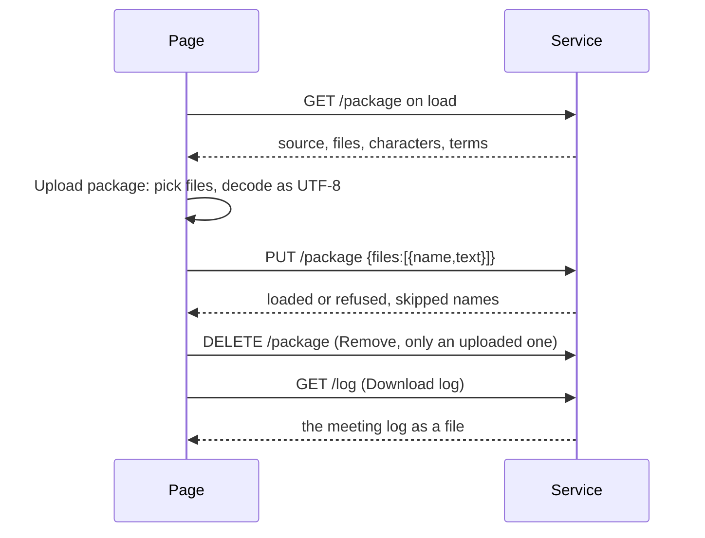

# SPRINT-004 screen: the Upload package and Download log buttons

Pablo wants to hand Alice his preparation package from the page and to take the meeting log away with one press. This page specifies both buttons: what the page does, what it asks of the service and what he sees. The limits and caller checks of the upload are those of [05 01.8.1](../05-high-level-design-and-architecture/01.8.1-upload-limits-and-statements.md), which is a draft; the zip option is not used. It is part of the [screen specification](03.7-sprint-004-screen-specification.md).

*The upload is a setup command; it never changes the Question. The log download only reads.*

## Upload package

| ID | Rule | Ties to |
| --- | --- | --- |
| SU-1 | The button opens the browser's file picker for several files, accepting `.md` and `.txt`. It picks no folder and no zip in this sprint (decided Q7: files only). | S004-UPLOAD |
| SU-2 | The page decodes each file as strict UTF-8. A file that fails is named and nothing is sent: "Not loaded: notes.md could not be read as text. Your previous package is still in use." | S004-UPLOAD |
| SU-3 | **Changed (sprint-align, 05 01.8.1).** The page sends `PUT /package` with `Content-Type: application/json` and `{files:[{name, text}]}`. The service enforces the caller (Host and Origin), the content type (any other is refused as `content-type`), 200 KB for the body, 20 files, `.md` or `.txt` only, no dotfiles, `README.md` skipped, and 20,000 characters in total. A name with `/`, `\`, `..`, a drive letter, a NUL or control character, or longer than 255 characters refuses the whole upload as `refused` and names the file; names are never trimmed or rewritten. Text holding U+FFFD or NUL is refused as `unreadable`. | S004-UPLOAD |
| SU-4 | The answer is `{result, reason, package:{files, chars, terms, source}, skipped:[{name, reason}]}`. A refusal changes nothing and the previous package stays. File names appear only in this answer, to the page that sent the upload. | S004-UPLOAD |
| SU-5 | **Changed (Q5).** The package line says "Loading package…" while waiting, then on success "Package loaded: 3 files, 18,843 of 20,000 characters, 14 terms." plus any "Skipped: README.md (not used)". On refusal it says "Not loaded: over 20,000 characters (24,310). Your previous package is still in use." Other reasons: `too-many-files`, `body-too-large`, `empty`, `unreadable`, `refused` (unsafe names included), `content-type`, `listening`. After Remove it says "Package removed." | S004-UPLOAD |
| SU-6 | **Changed (Q5).** Upload and Remove are disabled while listening and the service answers 409 with reason `listening` if asked anyway. The line says "Stop listening to load a package." | S004-UPLOAD |
| SU-7 | A successful upload replaces the previous package (05-Q2) and the package survives Stop (05-Q1). Both are 05's recommendations awaiting Pablo. | S004-UPLOAD |
| SU-8 | **Changed (Q5).** The page asks `GET /package` on load, after an upload and after Stop, and shows the foot of the Alice column: "Package: 3 files · 18,843 chars · uploaded", "Package: 3 files · folder", or "No package", followed by a small "Remove" whenever a package is loaded. It shows no file names and no text. | S004-STATUS |
| SU-9 | The package text stays in the service's memory: no route returns it, no file or log holds it, and the audit holds counts and names only. | S004-UPLOAD; UI-7 |
| SU-10 | **New (Q5), changed (sprint-align).** Remove sends `DELETE /package`, with the caller checks of SU-3, and clears the package that is loaded now, whether uploaded or from the folder. The folder package stays cleared until the service restarts; after a restart the status shows the folder package or "No package". Remove is disabled while listening and refused with `listening` if asked anyway. | S004-UPLOAD |

## Download log

| ID | Rule | Ties to |
| --- | --- | --- |
| SD-1 | `GET /log` returns the current meeting log, or the most recent one: status 200, `text/plain; charset=utf-8`, `Content-Disposition: attachment; filename="alice-meeting-20261119T104207Z.jsonl"` and `Cache-Control: no-store`. With no log it returns 404 and the text "No meeting log yet." | UI-7; S004-DOWNLOAD |
| SD-2 | The button is always enabled. The page fetches `/log` from its own origin and saves the result as a file; on 404 it shows "No meeting log yet." in the monitor line. | UI-7; S004-DOWNLOAD |
| SD-3 | The same Host and Origin rules as the session socket apply to `/package` and `/log`; any other caller gets 403 and reads nothing. | UI-7; S004-UPLOAD |
| SD-4 | While listening the download holds the log so far, complete lines only, and does not interrupt the session. | UI-7; S004-DOWNLOAD |

[Previous: controls](03.7.3-s004-controls-and-inputs.md) · [Index](03.7-sprint-004-screen-specification.md) · [Next: meeting log](03.7.5-s004-meeting-log.md)
