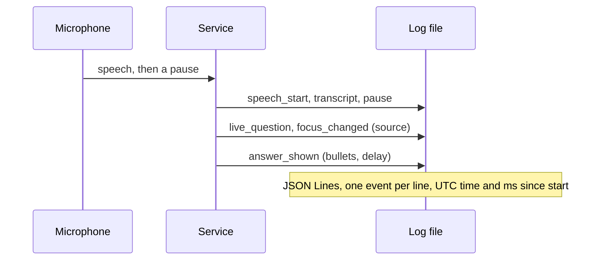

# SPRINT-004 meeting log: what is recorded and its format

After a meeting Pablo wants to see what was heard, what Alice asked and showed, and when, with time stamps, so he can review the meeting and later refine the log. This page fixes the first version, complete and as it is: its format and every event it holds. Where it is stored is on [the next page](03.7.6-s004-meeting-log-storage.md). It is part of the [screen specification](03.7-sprint-004-screen-specification.md) and is new work: the 07 plan puts "B-05 record" in SPRINT-005, so Pablo decided on 19 November 2026 to include the record in SPRINT-004 (Q8); it is the commitment S004-LOG, criteria 3 and 4 of the plan.



*Every line is an event with a time; the log is appended while the session runs.*

## Format and events

```json
{"t":"2026-11-19T15:42:07.412Z","ms":18230,"type":"focus_changed","focusVersion":2,"source":"pause","text":"How did you measure the impact?"}
```

| ID | Rule | Ties to |
| --- | --- | --- |
| ML-1 | **Changed (05 decision).** The log is UTF-8 JSON Lines. Each line is one event with `t` (ISO 8601 UTC with milliseconds, the wall clock), `ms` (milliseconds since the session started, the monotonic clock) and `type`. The schema `version` (1) is in the first line only, because a file is one session. | UI-7; S004-LOG |
| ML-2 | **Changed (05 decision).** `log_started` is the session start and carries the header of ML-14; `session_stopped` has `reason` (`user`, `error`, `limit` or `disconnect`) and seconds heard, and its `t` and `ms` are the end. There is no separate `session_started`. | UI-7; S004-LOG |
| ML-3 | `speech_start`, and `pause` with `startMs` and `durationMs` for each silence of 800 ms or more, from the service's voiced-packet test. | UI-7; S004-LOG |
| ML-4 | `transcript` for every final transcription item, with `itemId`, `text`, `audioStartMs` and `audioEndMs`. Partial text is not logged. | UI-7; S004-LOG |
| ML-5 | `live_question` for each Live wording and version (`liveId`, `version`, `kind`, `text`), and `live_cleared` with `by` (`clear`, `confirm` or `pause`). | UI-7; S004-LOG |
| ML-6 | `focus_changed` for each Focus version with `text`, `exchangeId` and `source`: `pause`, `confirm-button` or `confirm-space`. | UI-7; S004-LOG |
| ML-7 | **Changed (Q4).** `control` for each Confirm or Clear with `control`, `via` (`button`, `space` or `escape`) and the result (`confirmed`, `reset`, `stale`, `invalid`, `unavailable`). | UI-3, UI-7; S004-LOG |
| ML-8 | `answer_shown` with `focusVersion`, `status` (`shown` or `general`), `reason`, `bullets` (decided Q9: logged) and `delayMs`; also `answer_failed` and `answer_dropped` with their text-free reasons. | UI-7; S004-LOG |
| ML-9 | `package` at session start and `package_upload` after an upload, holding the source, status, file count, characters, term count and `skipped` count. File names are left out. | UI-7; S004-LOG |
| ML-10 | `error` with a code and the public message shown on the page. | UI-7; S004-LOG |
| ML-11 | Never in the log: package text or file contents, the key, the prompts, hints and replies exchanged with OpenAI, the interview agent's reply, and audio. No package file is copied into the log; the bullets shown can quote the package and are logged anyway (Q9). | UI-7; S004-LOG |
| ML-12 | **Changed (sprint-align).** Complete means no sampling: every final transcript item, pause, question and Focus change of the session is written, in the order they happened, up to the 5 MB cap of MS-4. After the cap the last line is one `log_full` event and nothing more is written. A write failure never stops the session; the monitor line then says "log not saved". | UI-7; S004-LOG |
| ML-13 | **New (Q8).** Every listening session writes a log. There is no setting or control to turn logging off in this version. | UI-7; S004-LOG |
| ML-14 | **Changed (05 decision).** The header on `log_started` holds `version`, `sessionId`, the UTC start with `tzOffsetMin`, `revision` (the Git commit or "unknown"), `models`, `keyConfigured`, `pauseMs` and the package source kind with counts only. Cue limits and the 10-second hold are not in it. | UI-7; S004-LOG |
| ML-15 | **New (05 decision).** Version 1 has no cue events and no transcription confidence: the cue lives only in the page, and the service does not keep confidence. | UI-7; S004-LOG |

Not in this version, on purpose: cue-change events and transcription confidence (declined from 12's list by 05, cue events a SPRINT-005 candidate), a mark key, an audio reference, speaker names (the service cannot tell Pablo from the interviewer), and the log's use for review or search. Bullets can quote the package; Pablo decided to log them anyway (Q9).
[Previous: upload and download](03.7.4-s004-upload-and-download.md) · [Index](03.7-sprint-004-screen-specification.md) · [Next: storage](03.7.6-s004-meeting-log-storage.md)
