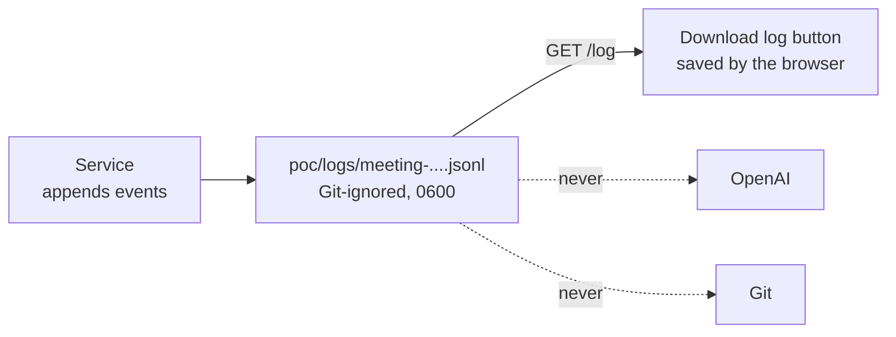

# SPRINT-004 meeting log: storage, privacy and download

The meeting log holds what was said in a meeting, so it is private text kept on Pablo's machine in a Git-ignored folder and leaving it only when he presses Download log. This checkout is not synced to Google Drive. This page fixes where it lives, how it is protected and how it relates to what leaves the Mac. It is part of the [screen specification](03.7-sprint-004-screen-specification.md); the events are on [03.7.5](03.7.5-s004-meeting-log.md).

*The log goes nowhere except to Pablo's own download.*

## Rules

| ID | Rule | Ties to |
| --- | --- | --- |
| MS-1 | **Changed (Q10, decided again 19 Nov).** A log file is created per listening session in `poc/logs/`, named `meeting-<start UTC as 20261119T104207Z>-<first 8 characters of the session id>.jsonl`. The setting `ALICE_LOG_DIR` moves the folder; tests use a temporary one. | UI-7; S004-LOG |
| MS-2 | **Changed (Q10).** `poc/logs/.gitignore` ignores everything in the folder except itself, and `git check-ignore` confirms a log file is ignored; the root `.gitignore` is unchanged. A folder moved by `ALICE_LOG_DIR` is Pablo's responsibility. | UI-7; S004-LOG |
| MS-3 | The folder is created with mode 0700 and each file with mode 0600. Lines are appended one at a time and flushed, so the file is readable during a session and after a crash. | UI-7; S004-LOG |
| MS-4 | **Changed (sprint-align).** A file stops growing at 5 MB: the service writes one `log_full` event as its last line and no more, so a log is complete up to 5 MB (ML-12). The cap is provisional and nothing is rotated or deleted. | UI-7; S004-LOG |
| MS-5 | Only the service writes the log. The page cannot write it, no route lists or deletes logs, and `GET /log` returns only the current or most recent file (SD-1). | UI-7; S004-LOG |
| MS-6 | Nothing in a log is ever sent to OpenAI or read back by the service apart from `GET /log`. | UI-7; privacy; S004-LOG |
| MS-7 | **Changed (Q10).** The data statements of the root `AGENTS.md` and `poc/README.md` say that transcript text, questions and answers, including what other people say, are kept in `poc/logs/` (or `ALICE_LOG_DIR`) on this machine until Pablo deletes them, and 04's statement check covers them. | S004-STATEMENTS |
| MS-8 | Deleting a log is Pablo's own act on the file system; Alice offers no delete control in this version. | UI-7; S004-LOG |
| MS-9 | **New (Q10).** There is no retention: Alice never deletes, rotates or expires a log, and the files stay until Pablo deletes them himself. | UI-7; S004-LOG |

## Cautions for Pablo

- **Google Drive.** This checkout is not synced to Google Drive, so `poc/logs/` stays on this machine (Pablo, 19 November 2026). If he moves the folder or the project, he must check that again.
- **Other people's words.** The log keeps what others say, locally only, for every meeting and with no expiry; Pablo decided this, and any consent rules are his call, not the specification's.
- **Download.** The browser saves the file to his Downloads folder, which is outside Git and the project; Alice cannot clean it up.

[Previous: meeting log](03.7.5-s004-meeting-log.md) · [Index](03.7-sprint-004-screen-specification.md) · [Next: open questions](03.7.7-s004-open-questions.md)
