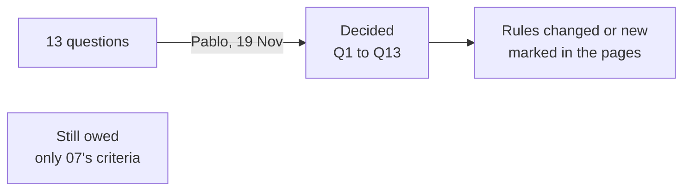

# SPRINT-004 screen: decision record and what is still owed

Pablo answered the thirteen questions of the first draft on 19 November 2026, as relayed by 00 Governance, accepting 08's recommendation each time, and later decided the two that were owed: the log folder is inside the project (reversing the first answer) and a manual cue holds for 10 seconds. The 20,000-character limit and files-only upload stay for this sprint. This page records what was decided and which rules changed, and what is still owed. It is part of the [screen specification](03.7-sprint-004-screen-specification.md). The decisions are relayed, not recorded by Pablo himself, and every page here remains a draft.

*Every decision is a rule or a marked change; nothing is owed by Pablo on this screen.*

## Decided

| Q | Decision | Rules changed (marked in the pages) |
| --- | --- | --- |
| Q1 | Keys G, L and S set the cue; nothing on screen | SC-2, SC-7, SC-10 (new) |
| Q2 | A small cue word beside the name | SA-3, SA-5, SA-14 |
| Q3 | Three bullets | SA-11 (unchanged, now decided) |
| Q4 | Esc clears | SC-5, SC-7, SC-10, ML-7 |
| Q5 | A small Remove in the package line | SC-1, SC-7, SC-9, SU-5, SU-6, SU-8, SU-10 (new) |
| Q6 | No control to hide the monitor line | SC-9 |
| Q7 | Files only, no folder or zip | SU-1 (unchanged, now decided) |
| Q8 | The meeting record is in SPRINT-004, one log per listening session, for every meeting | ML-13 (new); S004-LOG, criteria 3 and 4 of plan v6 |
| Q9 | Answers shown are logged (confirmed again) | ML-8 (unchanged, decided) |
| Q10 | Logs inside the project in Git-ignored `poc/logs/` (this copy is not synced to Google Drive), a setting moves them; no retention; they keep other people's speech, local only; every meeting is logged. Decided again on 19 Nov, reversing the first answer | MS-1, MS-2, MS-7, MS-9 (new), ML-13 (new); SH4-1, ST4-30, ST4-34 |
| Q11 | One Question box plus the candidate line; the model is no longer asked for details; newest words per item | AD-1 to AD-3 (new, page 03.7.8); SA-17 (decided) |
| Q12 | The right column is "What I hear" | SA-12 |
| Q13 | Departures from the mockup accepted: sticky bar, amber `#a35c00`, older words at 0.6, error row, smaller text for long questions | SA-3, SA-4, SA-8, SA-15, SS-6 (unchanged, now decided) |
| Q14 | A manual cue holds for 10 seconds, then the timer resumes | SC-2, SS-11 (new), SC-11 (new); PC4-43, PC4-46 to PC4-48 |
| Avatar | A small animated avatar of Alice in the bar, on by default, an explicit exception to SA-16; blinking when idle and a short expression or nod per state change, no head or hand movement, about 15 fps, paused when hidden; a visible toggle and the key A, off with reduced motion and silently off on any load failure within 5 s; the CC0 `mpfb.glb` first, a silver-haired Alice model later (19 Nov) | AV-1 to AV-8 (new), SA-3, SA-7, SA-16, SC-7 to SC-10 |
| Also | The 20,000-character package limit stays; files only; no more UI ideas for now | SU-3 |

## Still owed or open

- **Nothing from Pablo on this screen.** He has no more UI ideas for now, so the plan's UI criteria cover the nine requests only.
- **05's own questions on the package** (keep after Stop, replace on upload, remember terms, which sprint) are assumed as 05 recommends in SU-7 and are not answered here.
- **07** issues plan v6 without S004-GUARD; this specification ties its rules to the commitment IDs, which do not change, and the plan v6 numbers are in [03.8](03.8-sprint-004-test-map.md).

## What remains uncertain

- The model may add a `details` field anyway and fail more answers until the instructions work (ST4-32).
- Nothing about the speech column is measured: the per-item transcript message does not exist yet and 05 has not accepted it.
- The log events, the 10-second hold and the screen sizes are specified, not run; real window sizes on Pablo's second monitor are unknown, and the hold's length may feel wrong in use.
- 03 and 04 have not yet aligned their pages to this screen; the three first-pass reviews of 19 November found changes required.
[Previous: storage](03.7.6-s004-meeting-log-storage.md) · [Index](03.7-sprint-004-screen-specification.md) · [Answer without details](03.7.8-s004-answer-without-details.md)
