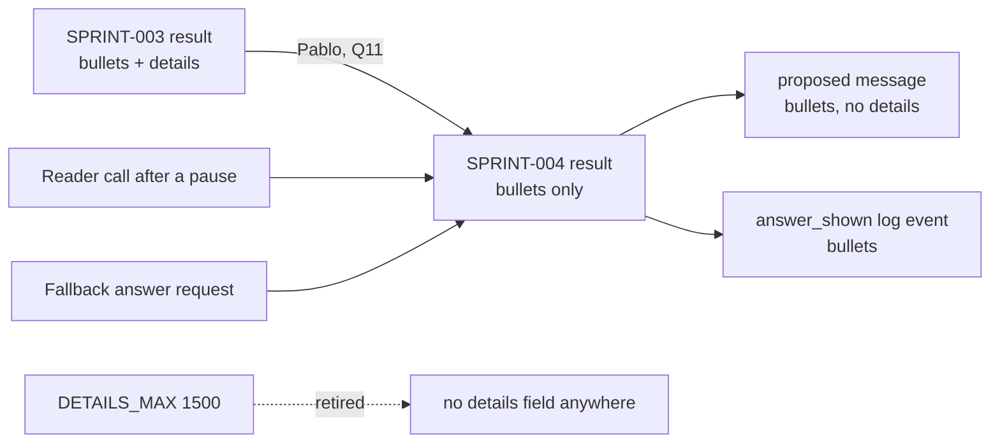

# SPRINT-004 screen: the answer without a details area

Pablo removed the details box to reduce clutter, and decided on 19 November 2026 (Q11) that the model is no longer asked for details at all. That saves cost and delay for every answer and changes the contract that SPRINT-003 built around bullets plus details, in both places the model returns an answer: the call after each pause and the fallback request. This page states the new contract and lists what it changes in the [SPRINT-003 specification](03.5-sprint-003-specification.md). It is part of the [screen specification](03.7-sprint-004-screen-specification.md).

*One list of at most three bullets goes from the model to the page and the log.*

## Rules

| ID | Rule | Ties to |
| --- | --- | --- |
| AD-1 | **Reissued (sprint-align, 05 A1).** The post-pause reader call asks for bullets only: its instructions and its reply schema drop `details`, and the reply keeps the question, coverage and at most three bullets. | S004-SCREEN; UI-6 |
| AD-2 | **Reissued.** The fallback answer request, used only when the reader's answer is not valid, asks for bullets only in its instructions and its result `{bullets}` with the bullet rules of RS-2; the general-points wording without a package is unchanged. | S004-SCREEN; UI-6 |
| AD-3 | **Reissued.** Either result that carries a `details` field, or any other unknown field, is rejected whole as RS-4 says. `DETAILS_MAX` no longer exists; `BULLET_MAX` stays 120. | S004-SCREEN; UI-6 |
| AD-4 | **New.** Both paths produce the same `proposed` message and state: `bullets`, `status`, `reason` and the other existing fields, no `details`; the log's `answer_shown` holds bullets only. A General answer is bullets only. | S004-SCREEN; S004-LOG |

## What this changes in SPRINT-003

The SPRINT-003 pages stay as written, because that build is committed and its tests match it. These items are superseded when SPRINT-004 builds and are to be reviewed then:
- **Rules:** RS-1 (two fields) and RS-3 (details limit), the details wording of RQ-6, CT-8 and LB-3 to LB-4, and the layout rules PG-2 to PG-7, PG-15, PG-16 and PV-3 to PV-5, which the new areas SA-1 to SA-17 replace.
- **Checks:** ST-07, ST-09, ST-17 where it names details, and the page cases PC-03 to PC-05, PC-20 to PC-24, PC-28 and PC-29.
- **Unchanged:** the request object, the package loader, one retry, the seven answer states, the no-key cases and `/health`.

## What stays uncertain

- Whether answers become noticeably shorter or faster is not measured; the live session will show it.
- A model that adds a `details` field anyway is rejected, which could make answers fail more often until the instructions work; the checks are ST4-32 and ST4-39. 05 sends its own wording of this change; where it differs, this page follows 05.

[Index](03.7-sprint-004-screen-specification.md) · [Open questions and decisions](03.7.7-s004-open-questions.md)
