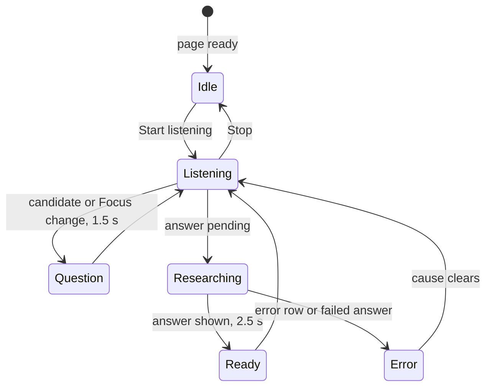

# SPRINT-004 screen: the small avatar of Alice

Pablo decided on 19 November 2026 to add a small animated face of Alice to the bar, driven only by what the page already knows. It is a deliberate exception to the rule that nothing on the screen moves. This page fixes where it sits, what moves, how it is turned off and how it fails quietly. It is part of the [screen specification](03.7-sprint-004-screen-specification.md) and works from 05's [avatar adapter](../05-high-level-design-and-architecture/01.11-avatar-adapter.md).

*The six avatar states follow the screen states; an error outranks everything else.*

## Rules

| ID | Rule | Ties to |
| --- | --- | --- |
| AV-1 | **Changed (logo on the left).** The avatar is a round box of 56 px (52 to 60) at the left end of the bar, like a logo, with the name as a small caption under its head (SA-5), in the 80 px bar. Under 900 px it is 48 px, under 500 px 36 px, and in a window under 640 px high 40 px in the 56 px bar with no caption. It is decorative (`aria-hidden`). No other area changes size and the size order of SA-13 holds; the centre of the bar stays empty (SA-19). | UI-1; S004-AVATAR |
| AV-2 | **New.** The box carries `data-avatar-state` with one of `idle` (SS-1, SS-8), `listening` (SS-2, SS-3), `question`, `researching` (SS-4), `ready` (SS-5) or `error` (SS-6). Each state uses the closest built-in mood or expression of the library, with no custom animation. | UI-1; S004-AVATAR |
| AV-3 | **New.** `question` starts when a candidate appears or the Focus version rises, whichever is first, and lasts 1.5 s; `ready` starts when an answer is shown and lasts 2.5 s; a failed answer shows `error` for 3 s. Both then return to the page's state. A timed state cannot start again within 3 s. Priority, highest first: `error`, `researching`, `question` or `ready`, `listening`, `idle`. Times use the page clock (SC-11). | S004-AVATAR |
| AV-4 | **New.** Motion is only an occasional blink when idle and one short expression, or one small nod if the library has it, on each change of state; no head movement and no hand gestures otherwise. Drawing is capped at about 15 frames a second and stops while the tab is hidden. The box also carries `data-avatar-frames`, a draw counter, for checks. | S004-AVATAR |
| AV-5 | **New.** A visible toggle, 32 × 32 px with `aria-pressed` and the label "Avatar", sits at the right end of the bar after Download log, and the key A does the same (SC-10). The choice is remembered in the browser; the default is on, also when storage is unavailable. With the system's reduced-motion setting the avatar is off, the toggle is hidden and A does nothing. | S004-AVATAR; UI-9 |
| AV-6 | **New.** On any failure within 5 s (no WebGL, library or model missing, load error, lost context) the avatar box and the toggle are removed silently: no message, no error row, and the name shows at 20 px bold as before (SA-5). Loading starts after the page is ready and never delays Start, Upload or the page. | S004-AVATAR |
| AV-7 | **New.** TalkingHead, three.js and the model are vendored, pinned and committed in `poc/vendor/`, with the licence file of each beside it, and listed in the service's fixed file list. They are loaded from the page's own origin by the adapter `poc/avatar.js`, with its companion `poc/avatar.md`, through a dynamic import; no CDN. The first model is the library's CC0 example `mpfb.glb`; a silver-haired Alice model comes later. | S004-AVATAR |
| AV-8 | **New.** The adapter reads a frozen copy of the page state and has no write path to the cue, timer, audio, service or log; it runs inside its own try/catch, so a failure cannot affect another behavior. It makes no sound and no speech. | S004-AVATAR |

## The exception, and what is uncertain

**Why the left.** Pablo changed his mind on 19 November 2026: Alice sits at the left of the bar like a logo, with the name small beneath her, which Pablo reads only when he pays attention. That empties the centre of the bar, which he wants kept free for a future "Alice says" message area (SA-19); nothing is shown there in this sprint. The cue word and the monitor line therefore sit small under the buttons on the right.
SA-16 now names this box as the one place that may move ([03.7.1](03.7.1-s004-screen-areas.md)): nothing outside the box animates, and nothing flashes. The page's disabled CSS animation does not stop a drawing loop, so AV-4's cap and pause carry the limit.
Two readings of Pablo's words: "a nod" is allowed once per change of state although he also said no head movement; and with reduced motion the avatar stays off even if he presses A. His 5-second limit counts from page ready. Not measured: the load on the laptop with a call running, the size of the model, and whether the library has a nod.
[Index](03.7-sprint-004-screen-specification.md) · [Controls](03.7.3-s004-controls-and-inputs.md)
