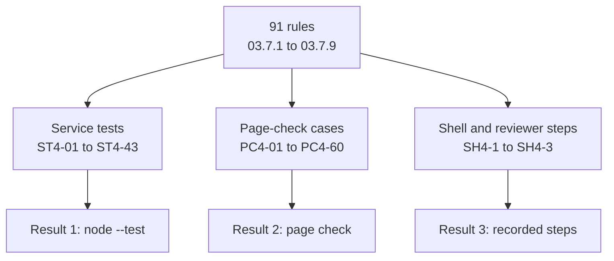

# SPRINT-004 test map: every screen rule has a check

Pablo needs to know that the new screen works in the ways he asked for, and the sprint's reviewers need each rule of the [screen specification](03.7-sprint-004-screen-specification.md) tied to one named check and to a criterion of the [07 plan](../07-planning/03.14-sprint-004-working-plan.md). This map does both. It is a draft: nothing is built, no check has run, and the SPRINT-003 checks (124 rules, 101 checks) are unchanged and still to be re-run (plan criterion 9).

*Three separate results, as in SPRINT-003. Each rule has at least one check and each check at least one rule ([coverage](03.8.4-s004-coverage-by-rule.md)).*

## Where the checks are

[03.8.1](03.8.1-s004-service-tests-and-shell.md) holds ST4-01 to ST4-28; [03.8.5](03.8.5-s004-service-tests-more.md) holds ST4-29 to ST4-43, SH4-1 to SH4-3; [03.8.2](03.8.2-s004-page-checks-screen.md) holds PC4-01 to PC4-16, PC4-49 and PC4-60; [03.8.3](03.8.3-s004-page-checks-behavior.md) holds PC4-17 to PC4-48; [03.8.6](03.8.6-s004-avatar-checks.md) holds PC4-50 to PC4-59.

## Tie to the 07 plan

Rules are tied to the commitment IDs of the [review brief](../07-planning/03.15-sprint-004-review-brief.md), which do not change, with the criterion numbers of plan v6. S004-GUARD moved to SPRINT-005 on 19 November 2026, so no rule or check here depends on it; plan criterion 7 is now S004-MEETING. The SPRINT-003 print option (PR-1 to PR-4) is unchanged. Pablo's nine requests are UI-1 to UI-9 in the rule tables.

| Commitment (plan v6 criterion) | Rules | Checks |
| --- | --- | --- |
| S004-STATUS (1) | SU-8, SS-1, SS-7 | ST4-01, PC4-17, PC4-23, PC4-40 |
| S004-UPLOAD (2) | SU-1 to SU-10 | ST4-02 to ST4-07, ST4-29, ST4-35 to ST4-40, PC4-35 to PC4-39, PC4-45 |
| S004-LOG (3) | ML-1 to ML-15, MS-1 to MS-9 | ST4-12 to ST4-28, ST4-30, ST4-34, ST4-41, ST4-42, SH4-1, PC4-42 |
| S004-DOWNLOAD (4) | SD-1 to SD-4 | ST4-08 to ST4-10, PC4-41 |
| S004-SCREEN (5) | SA-1 to SA-17, SA-19, SS-1 to SS-10, AD-1 to AD-4 | PC4-01 to PC4-26, PC4-60, ST4-11, ST4-31 to ST4-33, ST4-38, ST4-39 |
| S004-AVATAR (11) | AV-1 to AV-8 | PC4-50 to PC4-59, ST4-43, SH4-3 |
| S004-CUE (6) | SC-1 to SC-11, SS-11 | PC4-27 to PC4-34, PC4-43 to PC4-48, ST4-18 |
| S004-MEETING (7) | SA-18 | PC4-49 |
| S004-STATEMENTS (9) | MS-7 | SH4-2 |

Plan criteria 8, 9 and 10 are not screen rules and are not covered here; I suggest the live session also exercise the screen, Upload, Remove and Download log. SPRINT-003 checks that name details or the old layout are superseded, as listed on [03.7.8](03.7.8-s004-answer-without-details.md).
[Specification index](03.7-sprint-004-screen-specification.md) · [Open questions](03.7.7-s004-open-questions.md)
