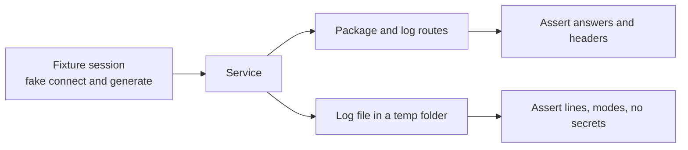

# SPRINT-004 test map: service tests and shell steps

These named cases go into `poc/poc.test.mjs` and run with `node --test poc/poc.test.mjs`; none calls OpenAI. They use the [fixture hooks](03.5.7-s003-print-and-fixtures.md) of SPRINT-003 and a temporary folder for packages and logs. The page-side cases are on [03.8.2](03.8.2-s004-page-checks-screen.md) and [03.8.3](03.8.3-s004-page-checks-behavior.md). The remaining service tests and the shell steps are on [03.8.5](03.8.5-s004-service-tests-more.md). This page belongs to the [test map](03.8-sprint-004-test-map.md) and serves S004-STATUS, S004-UPLOAD, S004-LOG and S004-DOWNLOAD.

*The log and package checks read files and responses; no browser is needed.*

| Check | Test title (exact) | Covers |
| --- | --- | --- |
| ST4-01 | GET package returns source, counts and terms but no text | SU-8, SU-9 |
| ST4-02 | PUT package loads several md and txt files and replaces the package | SU-3, SU-4, SU-7 |
| ST4-03 | upload limits for body, files, types, names, README and total characters | SU-3 |
| ST4-04 | refused upload keeps the previous package and gives its reason | SU-4, SU-5 |
| ST4-05 | upload while listening is refused with the listening reason | SU-6 |
| ST4-06 | uploaded package survives Stop and is replaced by the next upload | SU-7 |
| ST4-07 | package text is never returned, written or logged, and no uploaded file name reaches the audit or console | SU-9, ML-11 |
| ST4-08 | package and log routes refuse a wrong Host or Origin | SD-3 |
| ST4-09 | GET log returns the current log with its headers, complete lines only | SD-1, SD-4 |
| ST4-10 | GET log answers 404 with no log | SD-1 |
| ST4-11 | transcript message is a replace-whole snapshot of the last 30 seconds with item ids and ms offsets within limits | SA-17 |
| ST4-12 | log starts with log_started holding the version and every line has time, ms and type | ML-1 |
| ST4-13 | session stop event with its reason and seconds, and no separate session_started | ML-2 |
| ST4-14 | speech start and pause events for silences of 800 ms or more, a pause written when the silence ends with its start and duration | ML-3 |
| ST4-15 | only final transcript items are logged | ML-4 |
| ST4-16 | live question and cleared events | ML-5 |
| ST4-17 | focus changes log their source | ML-6 |
| ST4-18 | confirm and clear controls log how they were used: button, space or escape | ML-7, SC-4 |
| ST4-19 | answer shown, failed and dropped events | ML-8 |
| ST4-20 | package and upload events hold counts and no names | ML-9 |
| ST4-21 | error events hold the public message | ML-10 |
| ST4-22 | log never holds the key, prompts, replies, package text or audio | ML-11 |
| ST4-23 | log is complete, in write order with ms never decreasing, and a write failure does not stop the session | ML-12 |
| ST4-24 | log folder defaults to poc/logs, is moved by a setting and file names follow the pattern | MS-1 |
| ST4-25 | log files have mode 0600 and the service leaves the log folder's mode as it found it | MS-3 |
| ST4-26 | a log is complete up to its cap and then ends with one log_full event | MS-4, ML-12 |
| ST4-27 | only the service writes logs and no route lists or deletes them | MS-5 |
| ST4-28 | nothing from a log is sent to OpenAI | MS-6 |
