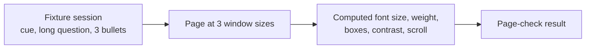

# SPRINT-004 test map: page checks for areas, sizes and bold

These cases extend `poc/browser-protocol.mjs`. It drives the real page in an installed browser against a scripted session from the fixture hooks and measures computed styles and boxes at 1280 × 900, 1280 × 500 (a short window) and 390 × 844. Its result is reported apart from `node --test`. This page covers [03.7.1](03.7.1-s004-screen-areas.md); the states, controls, upload and download are on [03.8.3](03.8.3-s004-page-checks-behavior.md). It belongs to the [test map](03.8-sprint-004-test-map.md) and serves Pablo's requests UI-1 to UI-8.

*Sizes and weights are read from the rendered page, not from the style sheet.*

| Check | Case (exact name) | Covers |
| --- | --- | --- |
| PC4-01 | the five areas appear in order and none of the removed ones | SA-1, SC-2 |
| PC4-02 | in a short window the page scrolls, no area clips and the last line is reachable | SA-2 |
| PC4-03 | the bar is 80 px high (56 px in a window under 640 px high), full width, with a left block, an empty centre and a right block from 900 px wide, and stays at the top while scrolling | SA-3 |
| PC4-04 | the bar colour follows the cue and its text keeps the contrast | SA-4 |
| PC4-05 | the caption under the avatar is 11 px regular, the 20 px bold name shows when the avatar is absent, the cue word is 16 px bold in the right block and the bar's accessible name has the cue | SA-5 |
| PC4-06 | the monitor line is 15 px regular, sits under the buttons after the cue word and wraps | SA-6 |
| PC4-07 | the bar buttons and the avatar toggle are in order, at least 14 px and 32 px high | SA-7 |
| PC4-08 | **Changed (22 Nov, SA-8 and SA-13).** the Question box border, bold text and size: SA-8's size by length raised to 1.5 times the bullet size, so medium and long questions both give 33, 45.9 and 48 px at 500, 900 and 1200 px high; never truncated | SA-8 |
| PC4-09 | the Candidate line sizes and full wrapping | SA-9 |
| PC4-10 | the two columns are equal with an 8 px gap and stack under 800 px | SA-10 |
| PC4-11 | the bullets are bold, sized to their range and at most three | SA-11 |
| PC4-12 | the column labelled What I hear has newest items bold, older ones faded and anchored to the bottom | SA-12, SA-17 |
| PC4-13 | the size order holds at 500, 900 and 1200 px of window height | SA-13 |
| PC4-14 | computed weight is 700 on the bold set, the name only without the avatar, and below 700 on every other text | SA-14 |
| PC4-15 | every text meets its contrast threshold, older words included | SA-15 |
| PC4-16 | content outside the avatar box changes without animation, transition or sound and markup shows as text | SA-16 |
| PC4-49 | no visible text, tooltip or accessible name on the page says interview | SA-18 |
| PC4-60 | the centre of the bar holds nothing and keeps a quarter of the bar's width from 900 px wide | SA-19 |
