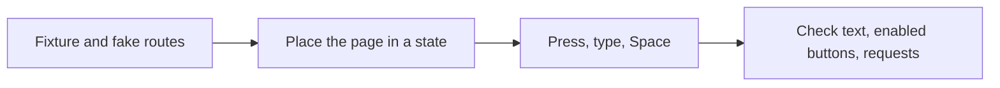

# SPRINT-004 test map: page checks for states, controls, upload and download

These cases continue those of [03.8.2](03.8.2-s004-page-checks-screen.md) in `poc/browser-protocol.mjs`, with a fixture session that can be placed in each state of [03.7.2](03.7.2-s004-screen-states.md) and a fake service for the package and log routes. Each case names one behavior. The seven answer states of UC-05 are checked inside these cases: Empty by PC4-17, Preparing by PC4-20, Shown and General by PC4-21 and PC4-23, Failed and Unavailable by PC4-22, Last known by PC4-24; the mapping is on [03.7.2](03.7.2-s004-screen-states.md). The page belongs to the [test map](03.8-sprint-004-test-map.md) and serves UI-1 to UI-9 and plan criteria 1 to 3.

*A case moves the page into one state, acts and reads what it shows.*

| Check | Case (exact name) | Covers |
| --- | --- | --- |
| PC4-17 | not listening shows its wording and enabled buttons | SS-1 |
| PC4-18 | listening shows the monitor, waits for a question and says no new question was heard | SS-2 |
| PC4-19 | a candidate shows its tag, enables Confirm and shows the Space hint | SS-3 |
| PC4-20 | a pending answer shows the confirmed question with its source and no earlier bullets | SS-4 |
| PC4-21 | a shown answer shows bullets together with its tag and delay | SS-5 |
| PC4-22 | each error cause shows its notice row and clears with the cause | SS-6 |
| PC4-23 | each missing-package case shows its line, general tag and enabled Upload | SS-7 |
| PC4-24 | stopped keeps content marked last known with no bold speech | SS-8 |
| PC4-25 | uploading shows its line and disables Upload | SS-9 |
| PC4-26 | states combine and the bar and its buttons never hide | SS-10 |
| PC4-27 | each control, Remove included, is enabled only in its states and a disabled one shows its cause as text | SC-1 |
| PC4-28 | Space confirms outside buttons and fields, does not scroll and focus is released after a button | SC-3 |
| PC4-29 | Confirm and Space send the identical request apart from the field via | SC-4 |
| PC4-30 | Clear resets by button and by Esc and never writes the Question | SC-5 |
| PC4-31 | a question before a pause still sets the Question by speech | SC-6 |
| PC4-32 | **Changed (22 Nov).** the input inventory has Start, Stop, Confirm, Clear, Space, Esc, A, the avatar toggle, Upload, Remove and Download, and no G, L or S | SC-7 |
| PC4-33 | Tab visits the controls in order, the avatar toggle after Download, with a visible 3 px outline | SC-8 |
| PC4-34 | the page holds no control that was not listed | SC-9, MS-8 |
| PC4-35 | Upload opens a picker for several md and txt files and no folder or zip | SU-1 |
| PC4-36 | a file that is not UTF-8 is named, nothing is sent and the old package stays | SU-2 |
| PC4-37 | the upload request has the right route, type and body shape | SU-3 |
| PC4-38 | each upload result and reason, and package removed, shows its message | SU-4, SU-5 |
| PC4-39 | upload is disabled while listening with its message | SU-6 |
| PC4-40 | the package line follows GET package on load, after upload and after Stop, with Remove only for an uploaded package and no names | SU-8 |
| PC4-41 | Download log saves a file, is always enabled and shows the 404 message | SD-2 |
| PC4-42 | the monitor says log not saved when the log cannot be written | ML-12 |
| PC4-43 | **Changed (22 Nov).** pressing G, L or S changes neither the bar nor the cue word | SC-2 |
| PC4-44 | **Changed (22 Nov).** Space, Esc and A do nothing in a button, link or text field or with a modifier key | SC-10 |
| PC4-45 | Remove clears an uploaded package, shows the folder package or none, and is disabled while listening | SU-10 |
| PC4-46 | **Changed (22 Nov).** with the page clock controlled, the cue is the timer's alone: GOOD, LAND IT after 25 s, STOP after 35 s, and no key holds or changes it | SC-2, SS-11, SC-11 |
| PC4-47 | **Changed (22 Nov).** a new question, a Focus change, Start or Stop leaves the cue to the timer | SS-11 |
| PC4-48 | **Changed (22 Nov).** while a button has focus Esc and A do nothing and Space presses the button | SC-10 |
