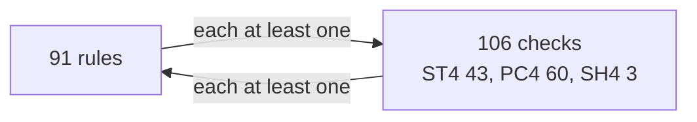

# SPRINT-004 test map: coverage by rule

This is the reverse view of the three check pages: each rule of the [screen specification](03.7-sprint-004-screen-specification.md) with the checks that establish it, so a reviewer sees at once that no rule is unchecked. It was generated from the tables of the check pages by a script that also verified the converse, and must be regenerated when a rule or check changes. It belongs to the [test map](03.8-sprint-004-test-map.md).

*Verified on 19 November 2026, after Pablo's answers: no rule is without a check and no check is without a rule. This is a document check, not a test run.*

| Group | Rule → checks |
| --- | --- |
| SA | SA-1 → PC4-01; SA-2 → PC4-02; SA-3 → PC4-03; SA-4 → PC4-04; SA-5 → PC4-05; SA-6 → PC4-06; SA-7 → PC4-07; SA-8 → PC4-08; SA-9 → PC4-09; SA-10 → PC4-10; SA-11 → PC4-11; SA-12 → PC4-12; SA-13 → PC4-13; SA-14 → PC4-14; SA-15 → PC4-15; SA-16 → PC4-16; SA-17 → ST4-11, PC4-12; SA-18 → PC4-49; SA-19 → PC4-60 |
| SS | SS-1 → PC4-17; SS-2 → PC4-18; SS-3 → PC4-19; SS-4 → PC4-20; SS-5 → PC4-21; SS-6 → PC4-22; SS-7 → PC4-23; SS-8 → PC4-24; SS-9 → PC4-25; SS-10 → PC4-26; SS-11 → PC4-46, PC4-47 |
| SC | SC-1 → PC4-27; SC-2 → PC4-01, PC4-43, PC4-46; SC-3 → PC4-28; SC-4 → ST4-18, PC4-29; SC-5 → PC4-30; SC-6 → PC4-31; SC-7 → PC4-32; SC-8 → PC4-33; SC-9 → PC4-34; SC-10 → PC4-44, PC4-48; SC-11 → PC4-46 |
| SU | SU-1 → PC4-35; SU-2 → PC4-36; SU-3 → ST4-02, ST4-03, PC4-37, ST4-35, ST4-36, ST4-37; SU-4 → ST4-02, ST4-04, PC4-38; SU-5 → ST4-04, PC4-38; SU-6 → ST4-05, PC4-39, ST4-29; SU-7 → ST4-02, ST4-06; SU-8 → ST4-01, PC4-40; SU-9 → ST4-01, ST4-07; SU-10 → PC4-45, ST4-29, ST4-40 |
| SD | SD-1 → ST4-09, ST4-10; SD-2 → PC4-41; SD-3 → ST4-08; SD-4 → ST4-09 |
| ML | ML-1 → ST4-12; ML-2 → ST4-13; ML-3 → ST4-14; ML-4 → ST4-15; ML-5 → ST4-16; ML-6 → ST4-17; ML-7 → ST4-18; ML-8 → ST4-19; ML-9 → ST4-20; ML-10 → ST4-21; ML-11 → ST4-07, ST4-22; ML-12 → ST4-23, ST4-26, PC4-42; ML-13 → ST4-34; ML-14 → ST4-41; ML-15 → ST4-42 |
| MS | MS-1 → ST4-24; MS-2 → SH4-1; MS-3 → ST4-25; MS-4 → ST4-26; MS-5 → ST4-27; MS-6 → ST4-28; MS-7 → SH4-2; MS-8 → PC4-34; MS-9 → ST4-30 |
| AD | AD-1 → ST4-31; AD-2 → ST4-38; AD-3 → ST4-32, ST4-39; AD-4 → ST4-33 |
| AV | AV-1 → PC4-50; AV-2 → PC4-51; AV-3 → PC4-52; AV-4 → PC4-53; AV-5 → PC4-54, PC4-55; AV-6 → PC4-56, PC4-57; AV-7 → ST4-43, SH4-3, PC4-58; AV-8 → PC4-56, PC4-59 |

**Recount, 19 November 2026, avatar as a logo on the left:** SA 19, SS 11, SC 11, SU 10, SD 4, ML 15, MS 9, AD 4, AV 8 = 91 rules; checks ST4 43, PC4 60, SH4 3 = 106. Not covered by any rule: nothing Pablo has decided. S004-GUARD moved to SPRINT-005 and has no rules or checks here.
