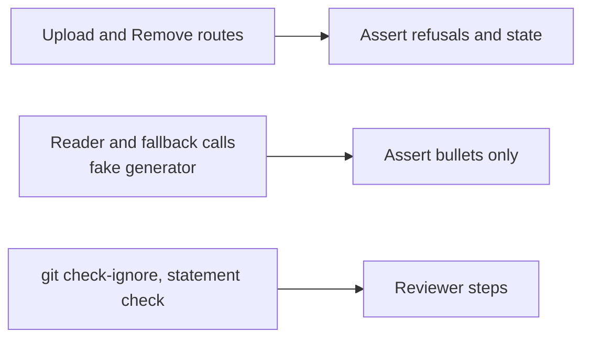

# SPRINT-004 test map: more service tests and shell steps

These named cases continue [03.8.1](03.8.1-s004-service-tests-and-shell.md) in `poc/poc.test.mjs`; none calls OpenAI, and they use the same fixtures and temporary folders. They cover Remove, the log's retention and switch, the answer without details, the upload's name and content-type rules and the two reviewer steps. The page belongs to the [test map](03.8-sprint-004-test-map.md) and serves S004-UPLOAD, S004-LOG, S004-SCREEN and S004-STATEMENTS.

*Service tests assert responses and messages; the two shell steps are run by a reviewer.*

| Check | Test title (exact) | Covers |
| --- | --- | --- |
| ST4-29 | DELETE package clears the loaded package, folder one included, until restart and is refused while listening | SU-10, SU-6 |
| ST4-30 | old logs are never deleted, rotated or expired by a new session | MS-9 |
| ST4-31 | the reader call asks for bullets only in its instructions and reply schema | AD-1 |
| ST4-32 | a reader reply with a details field is rejected whole and no details limit exists | AD-3 |
| ST4-33 | the proposed message, state and logged answer carry bullets and no details, general included | AD-4 |
| ST4-34 | every listening session writes a log and there is no way to turn logging off | ML-13 |
| ST4-35 | a name with a slash, backslash, dot-dot, drive letter, control character or over 255 characters refuses the whole upload as refused and names the file | SU-3 |
| ST4-36 | an upload without the JSON content type is refused as content-type | SU-3 |
| ST4-37 | text holding U+FFFD or NUL is refused as unreadable | SU-3 |
| ST4-38 | the fallback answer request asks for bullets only in instructions and result | AD-2 |
| ST4-39 | a fallback result with a details field is rejected whole | AD-3 |
| ST4-40 | after a restart the status shows the folder package or no package | SU-10 |
| ST4-41 | the header holds version, session, UTC start and offset, revision, models, key state, pause setting and package source with counts, and no cue thresholds | ML-14 |
| ST4-42 | version 1 holds no cue events and no transcription confidence | ML-15 |
| ST4-43 | the fixed file list serves poc/vendor files, poc/avatar.js and nothing else new | AV-7 |
| SH4-1 | `git check-ignore` confirms a log file in poc/logs is ignored and the root `.gitignore` is unchanged | MS-2 |
| SH4-2 | reviewer: 04's statement check finds the log sentences in the root `AGENTS.md` and `poc/README.md` | MS-7 |
| SH4-3 | reviewer: the files in poc/vendor are pinned with recorded hashes, each with its licence beside it, and poc/avatar.md exists | AV-7 |
