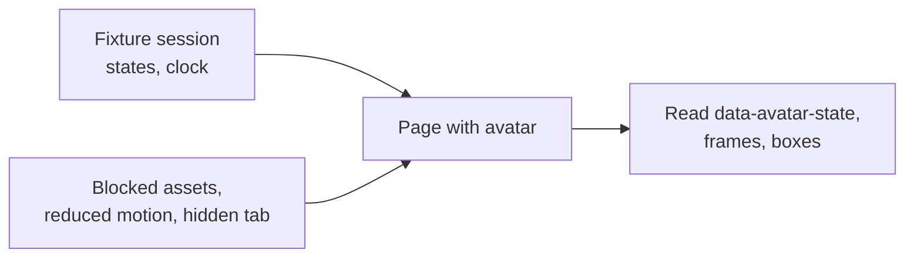

# SPRINT-004 test map: page checks for the avatar

These cases continue [03.8.3](03.8.3-s004-page-checks-behavior.md) in `poc/browser-protocol.mjs` and check [03.7.9](03.7.9-s004-avatar.md). They run against the real page with the avatar adapter and its vendored files, using the box's `data-avatar-state` and `data-avatar-frames` instead of pixels, the controlled page clock for timers, and blocked or failing asset requests for the failure cases. The page belongs to the [test map](03.8-sprint-004-test-map.md) and serves S004-AVATAR (plan criterion 11) and the "add, never remove" principle.

*The checks read what the adapter publishes, so they do not depend on WebGL pixels.*

| Check | Case (exact name) | Covers |
| --- | --- | --- |
| PC4-50 | the avatar is a round 56 px box at the left end of the bar from 900 px wide, 48 px under 900 px, 36 px under 500 px and 40 px in a short window, and no other area changes size | AV-1 |
| PC4-51 | each screen state sets the matching avatar state | AV-2 |
| PC4-52 | the question and ready states last 1.5 and 2.5 seconds, a failed answer shows error for 3 seconds, no restart within 3 seconds, and priority holds | AV-3 |
| PC4-53 | drawing stays near 15 frames a second and stops while the tab is hidden | AV-4 |
| PC4-54 | the toggle and the key A switch the avatar, the choice survives a reload and the default is on | AV-5 |
| PC4-55 | with reduced motion the avatar and toggle are absent and A does nothing | AV-5 |
| PC4-56 | when the library, model or WebGL fails within 5 seconds the box and toggle vanish with no message and the name shows at 20 px bold and the rest of the page is as before | AV-6, AV-8 |
| PC4-57 | with the avatar on, nothing outside its box animates or flashes over two seconds | AV-6 |
| PC4-58 | the page asks only its own origin for the avatar files in poc/vendor and poc/avatar.js | AV-7 |
| PC4-59 | a throwing adapter leaves the cue, timer, keys and audio sends working and the frozen state cannot be written | AV-8 |
