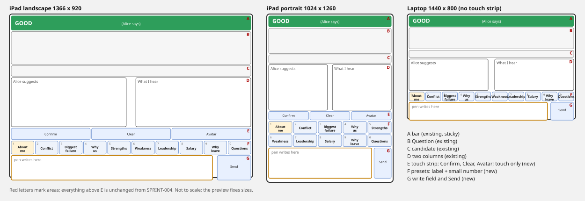

# SPRINT-006 screen specification (draft): iPad, a pen field and presets

**Draft. No sprint is active for it and nothing here is approved.** Pablo (22 November 2026, relayed by 00 Governance) asked for a new screen for SPRINT-006 that builds on the [SPRINT-004 screen](03.7-sprint-004-screen-specification.md): a big input field below everything, touch buttons for what the keys do today, and about ten preparation presets. He will use it on an iPad Pro 12.9 inch (2015) with Safari, Apple Pencil and touch, in Monday meetings and while preparing; the laptop screen must keep working.

*Labelled wireframe (laptop panel drawn small, so its labels crowd), not a design or a screenshot; sizes are fixed by a later preview. [Editable SVG](images/s006-screen-three-sizes.svg).*

## What this draft proposes

| Ask | Proposal | Page |
| --- | --- | --- |
| A big input field to write in with the pen | One plain text area below everything; Safari's Scribble turns Pencil writing into text, so no handwriting code is needed. Send makes the text the Question. | [03.9.2](03.9.2-s006-pen-field.md) |
| Touch buttons for what the keys do | A strip of three buttons (Confirm, Clear, Avatar), shown on touch screens only; the keys stay. The GOOD, LAND IT and STOP buttons were dropped on 22 Nov 2026 with the manual cue. | [03.9.3](03.9.3-s006-touch-buttons.md) |
| About ten preparation presets | Ten buttons with a one or two word label and a small number; one tap shows the prepared question and answer, nothing is said aloud. | [03.9.4](03.9.4-s006-presets.md) |
| Sizes, order, orientation | Areas A to D keep their SPRINT-004 rules; E, F and G are added under them. | [03.9.1](03.9.1-s006-layout-and-sizes.md) |
| What must be decided and by whom | 13 questions for Pablo; items for 03, 05 and 04. | [03.9.5](03.9.5-s006-open-questions-and-handoffs.md) |

## Principles kept

- **Add, never remove.** Every SPRINT-004 input stays: keys, speech, buttons ([SC-7](03.7.3-s004-controls-and-inputs.md)).
- **Attention.** Nothing new sits in the glance area (A to D); the new areas are below it, still, silent and without motion ([SA-16](03.7.1-s004-screen-areas.md)).
- **Rule groups:** TL layout, TF field, TB touch buttons, TP presets, TQ questions. Rules marked *Changed* amend a SPRINT-004 rule; the old text is not edited.

[Next: layout and sizes](03.9.1-s006-layout-and-sizes.md)
