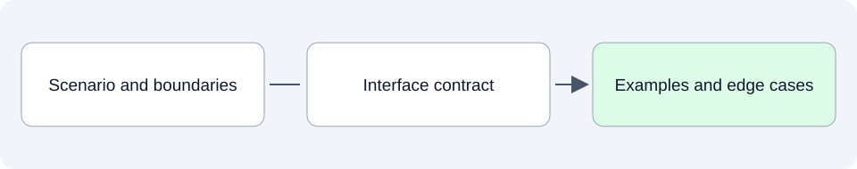

# Detailed design: make behavior precise

This folder will describe the contracts an implementation needs: inputs, outputs, data types, functions, state changes, collaborators and failure behavior.

## SpeakerCoach today

No implemented behaviour is documented here yet. One proposed design awaits Pablo's review:

- [UC-04 · Focus question and Live question](03-uc-04-focus-and-live-question.md) (proposed 4 November 2026): two always-visible areas in the question panel, with mockups, state rules, protocol changes and an OpenSpec update proposal.
- [UC-04 verification](02-uc-04-verification.md) (4 November 2026, by 09 Coding, awaiting review): live-run results per scenario, timings and findings for the implemented Focus/Live panel.

## What belongs here as we develop

A useful design should let an engineer understand what a component owns, how callers use it and what happens when inputs are missing or ambiguous. Source companions should explain the implemented version of those responsibilities and interfaces.

## Explore

- Read the [use cases](../03-system-model-and-use-cases/README.md) and [architecture](../05-high-level-design-and-architecture/README.md) for the behavior and boundaries the design must support.

Read files in order: **01 Intended**, **02 Current**, **03 Planned**. Additional topics use dotted numbers such as `01.1` or `03.2`; release and sprint plans identify their horizon in the filename and text.
See the [folder guide](../../../asdg/00-governance/docs/stage-layout.md) for consolidation at cycle closeout. Return to [project documentation](../README.md).
