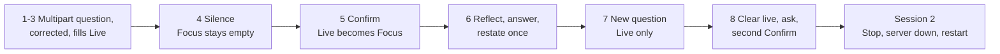

# UC-04 live check plan (run 4, SPRINT-002)

Pablo runs one scripted session speaking alone, then a short failure session. This covers SPRINT-002 criteria 1 to 3: the full task 4.1 sequence, the failure cases of task 4.2 and the causes of rejected agent results. Results go to `docs/asdg/08-low-level-design/02-uc-04-verification.md` (task 4.4). Runs 1 to 3 were free-form; this one follows a script so every scenario appears once.

## Before running

1. The [POC service](../../../poc/README.md) already runs with rejection reasons logged, writing its audit log to `/tmp/speakercoach-audit-4.log`. Each run makes billable OpenAI requests. Only Pablo should be audible.
2. Start the [capture](../../../poc/live-capture.md) with output `/tmp/speakercoach-live-uc04-4`. Press **Option+Shift+K** in the page after each step below. Closing Chrome ends the capture.

## Session 1: speaking alone (task 4.1)

Wait for Live to settle, about 5 to 8 seconds, before each next step.

| Step | Pablo says or does | Expect |
| --- | --- | --- |
| 1 | "Tell me about a project you are proud of." | Live shows it, tagged *new question*; Focus "No focus question yet" |
| 2 | "So you want a project I'm proud of and my role in it?" | Live updates (version rises); Focus still empty |
| 3 | "No, actually: the project, and what I would change about it." | Live shows both parts (corrected multipart) |
| 4 | Silent about 10 seconds | Focus still empty: nothing automatic writes it |
| 5 | Tab to **Confirm question**, press Enter | Focus shows the step 3 wording; Live empty; phase QUESTION |
| 6 | Pause 10 seconds; answer for about 40 seconds, restating once: "so, the project and what I would change" | Focus fixed; Live may show a *restatement*; LAND IT then STOP; note whether "Confirmed…" still shows |
| 7 | "Next question: why do you want this role?" | Live shows it, *new question*; Focus still the step 3 wording |
| 8 | Click **Clear live**; say "How do I handle conflict on a team?"; click **Confirm question** | Live clears, refills only from the new speech, then becomes Focus |

## Session 2: failures (task 4.2)

1. Press Start Listening, say "What is your biggest weakness?", and press **Stop** while the agent shows *thinking*. Expect no later update (late model output is dropped).
2. Start again, ask a question, confirm it, then press Ctrl+C in the service terminal. Expect Focus "(last known, not live)", Live "Not listening", controls disabled.
3. Restart the service and reload the page. Expect empty Focus and Live, and nothing resent.
4. Stale, retired and delayed confirmations cannot be timed by hand. Try one quick correction followed at once by Confirm; otherwise these stay covered by the [browser protocol check](../../../poc/browser-protocol.md), and are labelled as such.

## Recorded, and limits

For each step: pass, fail or unverified; the displayed Focus and Live wording; Live id and version. Times: transcript final, Live shown, click, commit and render. From the audit log: each rejected agent result's reason, counted against run 3's 5 of 11. One person's session shows the feature works, not that the agent recognizes intent reliably.
