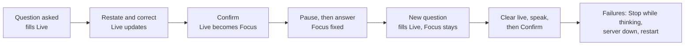

# UC-04 live check plan (SPRINT-001, task group 4)

Pablo runs one scripted live session in which he speaks alone, then a short failure session. The goal is to see the question panel work with real transcription and the real agent, and to record what was shown and when. Results go to `docs/asdg/08-low-level-design/02-uc-04-verification.md` (task 4.4). This is a plan; nothing here has run yet.

## Before running

1. **Audit (done 4 November):** the server now audits `question_control` and `transcript_final` without text, covered by `poc.test.mjs`.
2. **Capture (done 4 November):** Pablo chose [live-capture.mjs](../../../poc/live-capture.md), which logs every page message with times, saves itself every 3 seconds, and takes a screenshot and panel text when you press Option+Shift+K in Chrome. Press it after each step below.
3. Run `bash poc/start.sh > /tmp/speakercoach-audit.log`, then the capture script. Each run makes billable OpenAI requests. Only Pablo should be audible.

## Session 1: speaking alone (task 4.1)

Rewritten on 4 November for the [Focus and Live design](../08-low-level-design/03-uc-04-focus-and-live-question.md), after the first live run found that a confirmed question could be overwritten.

| Step | Pablo does | Expect | Use case point |
| --- | --- | --- | --- |
| 1 | Reads aloud "Tell me about a project you are proud of." | Live shows it, tagged *new question*; Focus "No focus question yet" | Live fills automatically |
| 2 | "So you want a project I'm proud of and my role in it?" | Live updates; Focus unchanged | Restatement with Pablo's voice alone |
| 3 | "No, the project and what I would change about it." | Live shows both parts | Corrected multipart wording |
| 4 | Stays silent about 10 s | Focus still empty | Nothing automatic writes Focus |
| 5 | Tab to **Confirm question**, Enter | Focus shows that wording; Live empty; timer unaffected | Exact confirmation |
| 6 | Pauses about 10 s, then answers 40 s, restating the question once | Focus fixed; Live may show a restatement; LAND IT then STOP | Focus survives the answer |
| 7 | "Next question: why do you want this role?" | Live shows it, *new question*; Focus still the step 5 wording | The 4 November regression |
| 8 | Clicks **Clear live**, says "How do I handle conflict on a team?", clicks Confirm | Live clears, refills from later speech, becomes Focus | Clear live, then a new cycle |

## Session 2: failures (task 4.2)

Stop while the agent shows *thinking*: no later update appears. Stop the server with Ctrl+C: Focus shows *(last known, not live)* and controls disable. Restart both: the page starts empty and resends nothing. A live stale or lost confirmation is hard to time by hand; try one fast correct-then-click, and otherwise rely on the [browser protocol check](../../../poc/browser-protocol.md) and unit tests, labelled as such.

## Recorded per step, and limits

For each step: pass, fail or unverified; the displayed Focus and Live wording; and the session, Live and request IDs. Times: transcript final, Live shown, click, commit and render. Task 4.3, isolated benchmark replay, is proposed as skipped and recorded as unverified. One person's session shows that the feature works, not that the agent recognizes intent reliably or that coaching is effective.
